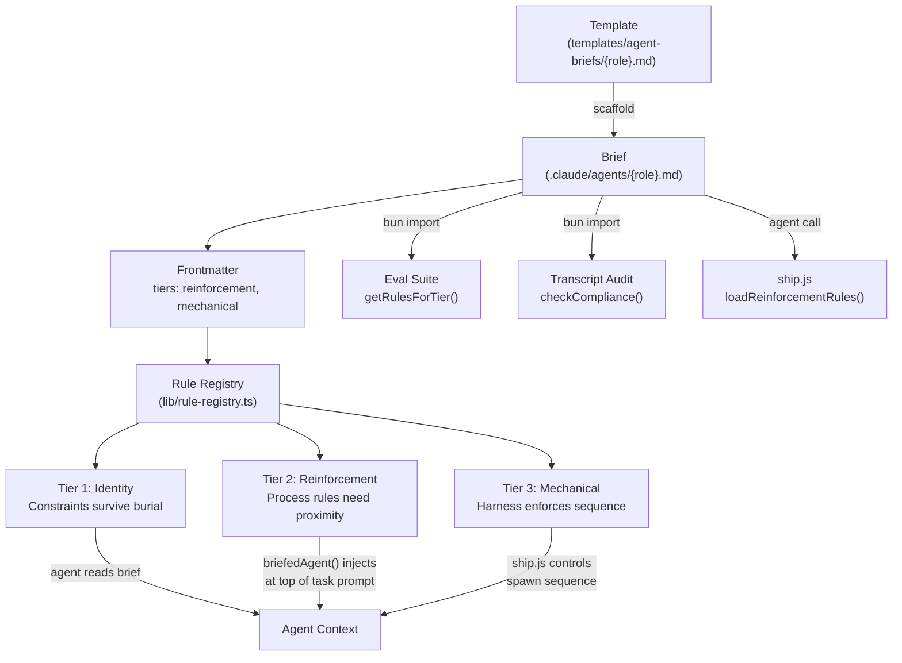

# Agent Brief Template

## Problem Statement

Agent briefs (`.claude/agents/*.md`) are generated by the scaffold. Currently, the templates are hardcoded as TypeScript template literal strings inside `scripts/scaffold-project.ts` — each agent is ~80 lines of inline markdown embedded in code. To change a "Never Do" rule or add a section, you edit TypeScript, not markdown.

This creates three problems:
1. **Template changes require code changes** — editing a rule means editing scaffold-project.ts, which is a 1,400-line script
2. **Templates can't be validated by the conformity engine** — they're strings inside code, not markdown files the engine can scan
3. **No spec governs what briefs must contain** — required sections, max lines, mandatory rules are implicit in the code

The AGENTS-MD-TEMPLATE-SPEC solved this for AGENTS.md (D-3: template in `prompts/agents-md-template.md` with `${VAR}` placeholders). Agent briefs need the same treatment.

## Design Decisions

| # | Decision | Rationale |
|---|----------|-----------|
| D-1 | Agent brief templates stored as markdown files with ${VAR} placeholders | Same pattern as AGENTS.md template (SC-259). Editing a brief = editing markdown |
| D-2 | Templates live in `templates/agent-briefs/` | Separate from prompts/ (on-demand reference) and specs/ (constraints). Templates are scaffold inputs |
| D-3 | Scaffold reads template files and fills variables from project scan | Scan logic stays in scaffold-project.ts, template content is data. Same separation as AGENTS.md |
| D-4 | Each role has one template file: marcus.md, quinn.md, rook.md, serena.md, aditi.md | One file per role |
| D-5 | Shared rules in `.claude/rules/agent-principles.md` (unconditional rule) | Core Principles and Never Do load for ALL agents via project rules, not injected per-brief. `_shared.md` kept empty for backwards compat |
| D-8 | `${PROJECT_IDENTITY}` and `${SHARED_RULES}` removed from templates | Agents inherit AGENTS.md and `.claude/rules/` automatically — no duplication needed. 526→427 lines (19% reduction) |
| D-6 | Generated briefs validated by conformity engine against this spec | Required sections, max lines, mandatory rules are testable SCs |
| D-7 | Prompt routing table generated from scan, not template | The "Reference (read when needed)" section is dynamic (per-project prompts) — scaffold generates it, template doesn't include it |

## Template Variables

| Variable | Source | Example |
|----------|--------|---------|
| `${SOURCE_DIRS}` | Directory scan (lib/, src/, gates/, hooks/) | `- lib/\n- gates/` |
| `${PROMPT_PREFIX}` | prompts/ directory path | prompts |
| `${DEV_UI_LINE}` | rungate.json dev.uiBase | `- **Dev UI:** http://localhost:3000` |
| `${DEV_API_LINE}` | rungate.json dev.apiBase | `- **Dev API:** http://localhost:8080` |
| `${PAGES_TABLE}` | rungate.json pages map | Markdown table |
| `${TEST_CMD}` | rungate.json or package.json | `bun test` |

Removed (D-8): `${PROJECT_IDENTITY}` (in AGENTS.md), `${SHARED_RULES}` (in `.claude/rules/agent-principles.md`)

## Required Sections (every agent brief must have)

1. Frontmatter (name, description, tools, model + platform-native fields below)
2. Identity line ("You are X, role description")
3. Agent-specific workflow or rules section (TDD, testing mode, scan methodology, etc.)

## Platform-Native Frontmatter Fields (Claude Code)

These fields are emitted by the scaffold generator and leverage Claude Code's native capabilities. Non-Claude-Code consumers ignore them. See `docs/research/claude-code-platform-audit.md` for alternatives.

| Field | Default by role | Purpose |
|-------|----------------|---------|
| `memory: project` | Marcus | Cross-session learning via `.claude/agent-memory/` |
| `maxTurns: 30` | Marcus | Spiral prevention — mechanical turn limit |
| `effort: high/low` | Marcus/Quinn high, Rook/Discovery low | Per-agent effort level |
| `isolation: worktree` | Marcus | Always run in isolated git worktree |
| `disallowedTools` | Quinn/Rook/Discovery/Serena/Aditi: [Write, Edit] | Mechanical write restriction |
| `omitClaudeMd: true` | Quinn/Rook/Discovery | Skip global CLAUDE.md — saves ~2K tokens |
| `hooks.Stop` | Marcus: exit 2 if tests fail | Mechanical test enforcement |

## Success Criteria

- [x] SC-348: templates/agent-briefs/ directory exists
- [x] SC-349: templates/agent-briefs/_shared.md exists
- [x] SC-350: lib/generators/agent-briefs.ts contains [templates/agent-briefs] — the generator moved out of scaffold-project.ts (SCAFFOLD-DECOMPOSITION-SPEC); the SC did not follow it
- [x] SC-351: Each generated brief has all 8 required sections (behavioral)
- [x] SC-352: .claude/agents/marcus.md frontmatter has model
  - The VALUE is deliberately not asserted here. Models are routed per role in `.claude/rungate/roles.json` (marcus is opus), and AGENT-8 already checks every brief against that config. Hard-coding `sonnet` in this SC asserted a second, contradictory source of truth — and the frontmatter-field matcher is anchored at end-of-statement, so any trailing prose on this line silently unbinds it.
- [x] SC-353: .claude/agents/marcus.md is under [120] lines
- [x] SC-354: Editing a template file and re-scaffolding updates the generated brief (behavioral)
- [x] SC-355: lib/generators/agent-briefs.ts contains [_shared] — same move as SC-350
- [x] SC-356: lib/scaffold/steps.ts contains [promptKeywords]
  - Repointed in #398, and the move is the smaller half of why. The token was `routing` against `scripts/scaffold-project.ts`, and what it matched there was `docs-routing.md` inside a GAP message — an unrelated filename containing the substring. Prompt-keyword routing has lived in `lib/scaffold/steps.ts` for as long as the generators have; the SC was green the whole time without ever looking at it, which is `.claude/rules/checks-must-be-able-to-fail.md`'s second shape. `promptKeywords` is the config key the routing actually merges, so it cannot be satisfied by prose.
- [x] SC-357: Template variables filled from project scan match actual project values (behavioral)
- [ ] SC-385: Agent-to-prompt keyword routing defined in config, not hardcoded in scaffold (behavioral)
- [x] SC-386: Consumers can override keyword routing in their rungate.json (behavioral)
- [x] SC-410: `lib/generators/types.ts` AgentMeta interface contains [memory, maxTurns, effort, disallowedTools, omitClaudeMd, isolation, hooks]
- [x] SC-411: `lib/create-brief.ts` DEFAULT_AGENT_META has `memory: "project"` for marcus
- [x] SC-412: `lib/create-brief.ts` DEFAULT_AGENT_META has `disallowedTools` for non-coding agents
- [x] SC-413: `lib/generators/agent-briefs.ts` emits all AgentMeta fields in frontmatter

## Implementation

### Phase 1: Extract templates
1. Extract each agent's template string from scaffold-project.ts into `templates/agent-briefs/{name}.md`
2. Extract shared rules into `templates/agent-briefs/_shared.md`
3. Replace hardcoded strings in scaffold-project.ts with file reads + variable substitution
4. Verify: re-scaffold produces identical briefs

### Phase 2: Validate
1. Add conformity engine checks for required sections
2. Add model: sonnet enforcement
3. Add 120-line cap check

## Three-Tier Rule Enforcement

Rules in agent briefs are classified into three tiers. The tier determines WHERE a rule is enforced — not whether it exists (it always lives in the brief).



### Tier Definitions

| Tier | Where Enforced | What Goes Here | Why |
|------|---------------|----------------|-----|
| **Identity** | Brief (agent reads it) | Constraints, "never do X", coding philosophy | Constraints are checked against, not sequenced — survive any context position |
| **Reinforcement** | Task prompt (ship.js injects) | Process rules: "run X before/after", test discipline | Process rules collapse when buried under 600+ lines (arXiv 2608.02639) |
| **Mechanical** | Harness structure (code) | Critical sequences: TDD, test-before-commit | Agent physically can't skip — harness owns the sequence |

### Configuration

The `tiers` field in brief frontmatter maps section names to tiers:

```yaml
---
name: marcus
tiers:
  reinforcement: ['Testing Rules']
  mechanical: ['Workflow']
---
```

Sections not listed default to `identity`. The field is set in `agentMeta` in scaffold-project.ts and flows through to generated briefs.

### Success Criteria (Three-Tier)

- [x] SC-423: .claude/agents/marcus.md frontmatter has tiers
- [x] SC-424: lib/rule-registry.ts exists
- [x] SC-425: workflows/ship.js contains [briefedAgent]
- [x] SC-426: lib/rule-registry.ts contains [reinforcement]
- [x] SC-427: lib/create-brief.ts contains [tiers, agentMeta] — `agentMeta` and the tier map live in the brief factory now, not in scaffold-project.ts
- [x] SC-428: lib/rule-registry.ts contains [identity]

## A brief carries one project-owned region (#655)

Every per-role surface an agent reads was regenerated from harness-wide
inputs, so a reinforcement mined from a project's own compliance history had
nowhere in that project to live. The four positions, each verified against
the source at `db66dd79`:

| Position | What it was |
|---|---|
| `lib/scaffold/owned-files.ts` | `.claude/agents/*.md` declared `regenerate`, *"Don't edit briefs"* |
| `lib/scaffold/steps.ts` | the brief write was a bare `writeFileSync(p, content)` — no `ownedStrategy`, no `decideOwnedWrite`, so the declaration above was never consulted and a bare overwrite merely coincided with it |
| `lib/generators/agent-briefs.ts` | reads only the templates, `_shared.md` and the scan; `_shared.md` resolves under `scan.harnessTemplatesDir`, so a project rule written there reaches every consumer |
| `.claude/rungate/roles.json` | `tiers.reinforcement` is a list of section NAMES (`["Discovery Rules"]`), not rule text |

`## Project Constraints` is the fourth option beyond #648's three
destinations. It works the way `AGENTS.md`'s `## Hard Constraints` does
(#568) and **through the same merge**, which is the design decision worth
stating: `preserveSections` takes a `SectionSpec` and the two files supply
different vocabularies. Two copies of the merge with different constants
would be two deciders answering one question, and a mutation of either would
leave the other holding every case up.

The section is **opt-in** and no template emits it. A generated section
would take `preserveSections`' own-section branch and refuse every
re-scaffold on every consumer that had written one, which is the opposite of
the promise.

The hill-climb **prefers** the region and does not create it. Creating it
would make `NO_SECTION` unreachable and silently change every receipt #646
made reportable; a brief with none of the four headings still reaches that
state.

### Success Criteria (project-owned region)

- [ ] SC-2131: test/scaffold-ownership.test.ts contains [every section-preserving row declares WHICH section] — and that the two rows name different headings, because one spelling for both files would make a rule written in the wrong file look like it was in the right one
- [ ] SC-2132: test/brief-project-region.test.ts contains [a marker written into the region survives a re-scaffold verbatim] — the premise is asserted first: the generator's own output contains neither the marker nor the heading, and the run really regenerated
- [ ] SC-2133: test/brief-project-region.test.ts contains [the merge is idempotent — a third run is byte-identical]
- [ ] SC-2134: test/brief-project-region.test.ts contains [no shipped template emits the project-owned heading]
- [ ] SC-2135: test/brief-project-region.test.ts contains [the write is refused, the lines are named, and the file is untouched] — read off disk, byte-compared against the content before the run
- [ ] SC-2136: test/brief-project-region.test.ts contains [the same colliding templates write freely when no region was planted] — the control, so the refusal is about the region and not about an unreadable template
- [ ] SC-2137: test/brief-project-region.test.ts contains [a COMMIT reinforcement lands in the region and survives a re-scaffold]
- [ ] SC-2138: test/brief-project-region.test.ts contains [with no region the loop still uses a generated heading, and NO_SECTION still fires]
- [ ] SC-2139: test/brief-project-region.test.ts contains [the brief write reads OWNED_FILES rather than naming a strategy] — asserted over a structural cut of the write loop, not a fixed window (#664)

### The mutation battery, predicted and measured

Measured over `test/brief-project-region.test.ts` +
`test/scaffold-ownership.test.ts` + `test/unit/scaffold-probe-order.test.ts`
(48 tests). Every count was predicted before the battery ran, and **the
baseline row was read before any mutation row** — an instrument that has
stopped reporting takes the baseline down with it, and that is the row
nobody checks. The baseline's composition was read too: 8 + 33 + 7.

| Row | Predicted | Measured | The input on which mutant and original differ |
|---|---|---|---|
| **baseline** — unmutated | 48 pass, 0 fail | **48 pass, 0 fail** | — |
| the genuinely pre-#655 write: the loop body replaced by `writeFileSync(p, content)` | 5 | **6 of 48** | a scratch project scaffolded, `## Project Constraints\n\n- CANARY-655` appended to `marcus.md`, scaffolded again. Printed and compared before the row was counted: the original's brief contains `CANARY-655` afterwards, the mutant's does not |
| the `OWNED_FILES` row flipped back to `regenerate`, the write path untouched | 5 | **6 of 48** | the same fixture. `ownedStrategy` resolves `regenerate`, so `decideOwnedWrite` takes the plain branch and the line is gone |
| **the cheapest wrong fix**, applied in full | 2 | **2 of 48** — SC-2139 and SC-2131, and nothing else | a tree where the behaviour is right and every declared surface is wrong. See below |
| `preserveSections` short-circuited to return the generated content | 3 | **3 of 48** | the same fixture: the merge is the only thing carrying the section, so the write lands without it and the collision can no longer be detected |
| `ownedSections(label)` dropped from the brief's `decideOwnedWrite` call | 3 | **4 of 48** | the same fixture. The call then defaults to `## Hard Constraints`, which no brief has, so the region reads as absent — Silent Default Substitution, and the reason the parameter is declared on the row |
| the refusal arm writes the generated content and reports `UPDATED` | 1 | **1 of 48** — SC-2135 | the colliding-templates fixture: the original refuses and names `CANARY-655`, the mutant writes a brief with the planted line gone and reports success. #568's defect, reintroduced in the new file |
| the hill-climb's `projectIdx` preference removed | 1 | **1 of 48** — SC-2137 | a brief carrying both `## Project Constraints` and `## Testing Rules`: the original puts the reinforcement in the region and it survives the next scaffold, the mutant puts it under `## Testing Rules` and the next scaffold deletes it |

**Two rows came back HIGH, and in both the extra red is the real kind.**
Both are SC-2139, which asserts the declaration is in the path on *two*
sides — the row says `section-preserving`, and the write loop resolves it
through `ownedStrategy`/`ownedSections` rather than carrying a literal. The
predictions counted the behavioural cases and forgot the case written
specifically to watch the declaration. Not a crashing mutant in either row:
42 of 48 still pass and every red is about the brief write. Per
`.claude/rules/checks-must-be-able-to-fail.md`, that is "the prediction was
wrong and the check is better than you thought".

#### The cheapest wrong fix, named, applied and measured

**Named:** call the preservation at `generateAgentBriefsStep`'s write site —
a literal `"section-preserving"` and a literal `BRIEF_CONSTRAINTS_SECTION`
— and leave the `OWNED_FILES` row and `.claude/rules/harness-managed.md`
both saying `regenerate` / *"Don't edit briefs"*. One import, two literals.

It is the 5pm repair and it **works**: `bun run typecheck` reports 0 errors
and **46 of 48 pass**. Every behavioural case is green — the marker
survives, the merge is idempotent, the refusal fires and names its lines,
the reinforcement lands in the region and survives a re-scaffold. The three
reconciliation cases in `test/scaffold-ownership.test.ts` are green too,
*because `OWNED_FILES` was never touched*, so the doc and the declaration
still agree with each other about the wrong thing.

What ships is a brief that preserves edits while every surface a human or an
agent reads to decide whether to edit one says not to — the declared
contract and the behaviour disagreeing, with the documentation as the half
that is wrong. That is the state the bare `writeFileSync` had already left
this row in, and it is why criterion 3 is load-bearing rather than
documentation hygiene.

**The two cases that survive it are SC-2131 and SC-2139, and they are the
only protection.** SC-2131 because reverting the row leaves one
section-preserving entry where the declaration now requires more than one
that declares its section; SC-2139 because it reads the write loop and
refuses a strategy literal there. Neither is a behavioural case and neither
could be — a repair that is behaviourally correct cannot be caught by
watching behaviour.

None of the seven mutations is left in the tree; all were run and reverted,
and `lib/scaffold/steps.ts`, `lib/scaffold/owned-files.ts`,
`lib/agents-md-sections.ts`, `lib/compliance-report.ts`,
`.claude/rules/harness-managed.md` and `test/brief-project-region.test.ts`
were confirmed byte-identical to the measured source afterwards by
`shasum -a 256 -c`, with the baseline re-measured at 48 pass / 0 fail.

### What #655 did NOT do

- **The region is not created for a consumer.** A project opts in by writing
  the heading, exactly as it does for `AGENTS.md`'s `## Hard Constraints`.
  Making the hill-climb write the heading when it is absent would make
  `NO_SECTION` unreachable and change every receipt #646 shipped, so it is a
  decision for #648 with that cost stated rather than a side effect here.
- **The `COMMIT` default is unchanged.** Which destination the shipped loop
  uses is #648's first criterion and has to move
  `scripts/persist-compliance.ts`'s re-grade step with it.
- **`roles.json` still carries section names, not rule text.** Nothing here
  needed it: the region is in the brief, which is where a rule an agent
  reads has to be.

## Cautions

- Template files are scaffold INPUTS, not outputs — don't regenerate them on re-scaffold
- The `_shared.md` partial is a convention, not a framework — simple file inclusion, not a template engine
- Keep templates readable as standalone markdown — someone should be able to read `templates/agent-briefs/marcus.md` and understand what the brief will look like
- Don't over-engineer variable substitution — `${VAR}` string replacement is sufficient, no need for Handlebars/Mustache
