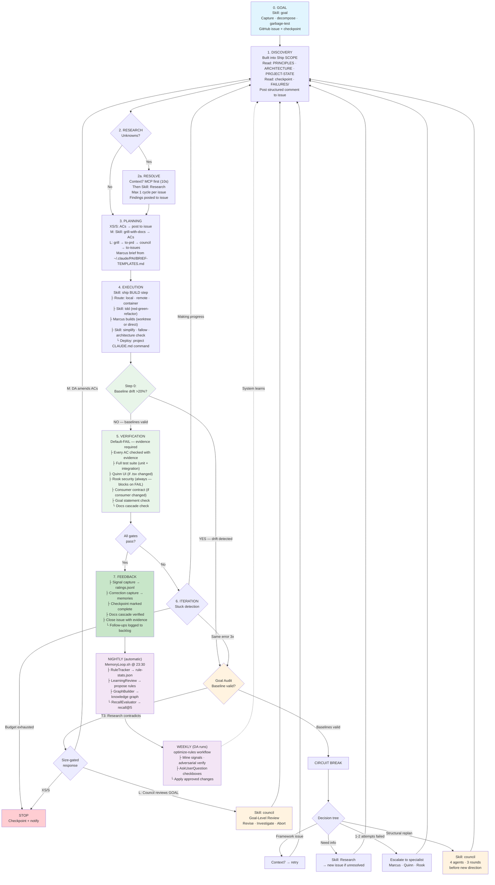

# PAI Agentic Harness Standard
# Version 1.0 | 2026-06-19

Every issue follows the same loop. No improvisation. Each step invokes a skill or is handled by hooks. The standard defines WHAT is invoked, WHEN, and WHAT artifact each step produces.

**Governing principle:** Determinism through architecture, not models. Every step is a skill invocation or a mechanical check — never "remember to do X."

**AFK autonomy rule:** Once the harness plan receives Jason's approval, execute autonomously with **zero `AskUserQuestion` interruptions**. The DA makes all judgment calls — approach selection, cleanup scope, agent routing, ordering. The only acceptable interruptions are: (1) a circuit breaker firing, (2) a destructive action on shared state (force push, production deploy, data deletion), (3) the final completion report. "Which option do you prefer?" mid-execution is a harness violation — the DA was hired to make those calls.

**Relationship to other docs:**
- **Algorithm v3.7.0** — orchestrates work selection and ISC decomposition. The Algorithm invokes the FULL harness starting at GOAL (not just ship). The Algorithm selects WHICH issue to work; the harness defines HOW to work it.
- **Ship SKILL.md** — implements EXECUTION and VERIFICATION. This standard wraps ship with the surrounding steps (GOAL, DISCOVERY, RESEARCH, ITERATION, FEEDBACK).
- **ADR-039** — defines convergence loop architecture. This standard operationalizes it.

---

## The Loop

```
GOAL → DISCOVERY → RESEARCH → PLANNING → EXECUTION → VERIFICATION → ITERATION → FEEDBACK
  ▲                                                                       │
  └───────────────────────── (loop back on failure) ──────────────────────┘
```



---

## 0. GOAL — `Skill("goal")`

**Purpose:** Capture the goal, decompose into measurable criteria, persist to GitHub issue.

**Three entry modes:**

| Mode | Trigger | Goal skill behavior |
|---|---|---|
| **Goal, no issues** | Jason states a goal in natural language | Read project PRINCIPLES.md pre-flight questions to inform decomposition → Decompose → garbage-test each criterion → `gh issue create` |
| **Goal, issues exist** | Jason states a goal + related issues already open | `gh issue list` → map existing issues against goal → create only gap issues |
| **Issue, no goal** | Jason points at a specific issue number | Read issue → validate ACs meet garbage test → enrich if needed |

**Outputs (MANDATORY — skill does not exit without these):**
- GitHub issue with standardized body:
  ```
  ## Goal
  [Jason's words, verbatim]

  ## Success Criteria
  - [ ] SC-1: [measurable, garbage-tested]
  - [ ] SC-2: [measurable, garbage-tested]

  ## Scope Boundary
  - In: [explicit]
  - Out: [explicit]

  ## Circuit Breakers
  - Per-issue: [N iterations max]
  - Per-goal: [token/cost ceiling or "all issues closed/deferred"]

  ## Baseline Values
  - SC-1 baseline: [the quantity or entity this SC measures against] Source: [where this number comes from]
  - SC-2 baseline: [same]
  These values are the Goal Audit comparison targets. Every AC with a numeric threshold
  must state its denominator and source. M/L mandatory, XS/S optional.

  ## Related Issues
  - #N — [status] — [how it relates]
  ```
- Checkpoint written to `$RUNGATE_WORK_DIR/{slug}/CHECKPOINT.md`

**Quality bar:** Every success criterion passes the garbage test ("Could garbage data pass this?"). If yes, tighten until no. Every AC with a numeric threshold must state its denominator ("download 80% of N items where N = [source]").

**Handoff to DISCOVERY:** GitHub issue number + checkpoint path.

---

## 1. DISCOVERY — Built into Ship SCOPE

**Purpose:** Load all context needed to size and plan the work.

**Process (mechanical — same every time):**
1. Read project docs in order: PRINCIPLES.md → ARCHITECTURE.md → PROJECT-STATE.md
2. Read the GitHub issue + any linked specs/ADRs
3. Read checkpoint if resuming (`$RUNGATE_WORK_DIR/{slug}/CHECKPOINT.md`)
4. Read `MEMORY/LEARNING/FAILURES/` for prior patterns matching this domain
5. Check `gh issue list` for related open issues

**Output:** Structured GitHub issue comment posted via `gh issue comment` with:
- Answer to each quality-bar question below
- File path + line number citation for every fact
- Last-modified timestamp for every doc read
This artifact is durable — it survives context compaction and session boundaries.

**Quality bar — must answer ALL of these from docs (not memory):**
- What exists now? What needs to change? What constraints apply?
- For scraper/infrastructure work: Where does this run? What auth? What prerequisites? Where does output go?
- For UI work: Which component? What data feeds it? What consumers read it?
- If ANY answer is "I don't know" and it's not in the docs → that's a **doc gap**. Log as issue via `gh issue create` immediately. Then either fix the doc gap first or proceed with RESEARCH to find the answer.

**Critical rule:** Every fact used in PLANNING and EXECUTION must trace to a doc read during DISCOVERY — never to DA memory. If the DA "knows" something but can't point to the file and line where it's documented, it's not verified. Read the doc or flag the gap.

**Handoff to RESEARCH:** List of unknowns (if any). If no unknowns, skip to PLANNING.

**Reference:** → Ship SKILL.md "Project docs gate" for the reading order.

---

## 2. RESEARCH — Conditional

**Purpose:** Resolve unknowns before planning. Prevent spiraling.

**Gate (mechanical checks — no judgment):**
- `grep -r "api_name\|library_name" src/` returns 0 hits → external API/library not in codebase → YES
- DISCOVERY quality bar has an unanswered question → YES
- Framework/library error encountered during prior iteration → YES
- If ALL checks return NO → skip to PLANNING

**Process (strict order — Context7 first, always):**
1. **Context7 MCP** (`resolve-library-id` → `query-docs`) — 10 seconds max. Try this FIRST for any framework/library question.
2. **Only if Context7 doesn't answer** → `Skill("Research")` with specific question.
3. **Max 1 research cycle per issue.** If research doesn't resolve it, the finding becomes "we need more info" — log as a new issue, move on.

**Output:** Findings posted to GitHub issue via `gh issue comment`.

**Quality bar:** Every unknown from DISCOVERY is either resolved or logged as a separate issue. No unknowns carry forward silently.

**Handoff to PLANNING:** Resolved findings. Unresolved unknowns become new issues.

**Anti-pattern:** 2+ hours of research without resolution. If this happens, STOP — create an issue for the unknown and move to the next actionable item.

**Reference:** → Research SKILL.md for deep research workflows. Context7 MCP for framework docs.

---

## 3. PLANNING — Size-dependent skill chain

**Purpose:** Right-size the ceremony. Small work ships fast. Large work gets stress-tested.

**Size routing (determined by Ship SCOPE):**

| Size | Ceremony | Skills invoked |
|---|---|---|
| **XS/S** | Write ACs → post to issue → go to EXECUTION | None — Ship SCOPE handles inline |
| **M** | Decompose into XS/S sub-issues, stress-test approach | `Skill("grill-with-docs")` → `Skill("to-issues")` → 2-4 XS/S sub-issues → each ships through proven pipeline |
| **L** | Full planning pipeline | `Skill("grill-with-docs")` → `Skill("to-prd")` → `Skill("council")` (debate the PRD) → `Skill("to-issues")` → each sub-issue re-enters at GOAL |

**Decomposition gate (mechanical — enforced by ship.js after Discovery):**

If Discovery returns >6 ACs, the issue MUST be decomposed before implementation:
1. Read the governing spec's phase headers (`### Phase N`)
2. Group ACs by spec phase (≤6 per group)
3. Create sub-issues — one per phase, each referencing the parent issue and spec section
4. Rescope the parent issue to Phase 1 only
5. Continue shipping Phase 1; subsequent phases ship as separate `/ship N` runs

This is not a judgment call. If AC count > 6, decomposition is mandatory and automatic.

- [x] SC-503: workflows/ship.js contains [DECOMPOSE_REQUIRED, sub-issue, acs.length, MAX_ACS_PER_ISSUE = 6] — the token was `ac.length`, which the file has never contained; the limit is a named constant, so asserting the bare literal `6` would have passed on any stray 6 in a 1000-line file

**Output:**
- ACs posted to GitHub issue via `gh issue comment` (BEFORE execution starts)
- Marcus brief prepared (from ~/.claude/PAI/BRIEF-TEMPLATES.md)
- For L: sub-issues created, each with own ACs

**Quality bar:** Every AC has a declared evidence type (code presence, grep absence, screenshot, API response, test pass). Every AC passes the garbage test.

**Handoff to EXECUTION:** GitHub issue with ACs + Marcus brief.

**Reference:** → ~/.claude/skills/ship/SKILL.md for AC templates, evidence types, issue templates, garbage test table. → ~/.claude/PAI/BRIEF-TEMPLATES.md for Marcus brief format.

---

## 4. EXECUTION — `Skill("ship")` BUILD step

**Purpose:** Build the thing. TDD. Deploy.

**Process (Ship BUILD — same every time):**

**Step 0: Execution target routing (from DISCOVERY):**
Check DISCOVERY's answer to "Where does this run?":
- **Local** (laptop, this machine) → proceed to step 1 below (Marcus builds locally)
- **Remote host** (Mac Mini, server, external container) → route through `Skill("infrastructure-and-devops")`:
  1. Read project CLAUDE.md for the remote host (e.g., "SalesHub scraper runs ONLY on the Mac Mini container")
  2. Read `reference_mac_mini_ssh` memory (or equivalent) for SSH credentials — `jasonhorn@mini.local`
  3. SSH to remote host → sync code (`git pull origin main`) → rebuild container → execute the task
  4. Verify results remotely before returning to VERIFICATION
  5. DA never types raw SSH commands — always through the infrastructure skill or a standard pattern
- **Container-only** → read project CLAUDE.md for container deploy command (e.g., `make rebuild`)

**Step 1 (local builds only):**
1. `Skill("tdd")` — red-green-refactor, vertical slices (exempt: config-only, pure doc, JSON, UI copy)
2. Marcus builds — isolation mode is a mechanical check, not memory:
   - Project root under `~/.claude/`? → `isolation: "worktree"`
   - Project root elsewhere? → direct (no worktree)
3. Architecture check (M+ only) — `Skill("improve-codebase-architecture")`
4. `Skill("simplify")` — 3-agent code review on changed files
5. `npx fallow` — static analysis on changed files (unused code, circular deps, duplication, complexity). Zero-token, ~10 sec. Runs for all sizes.
5. For M/L iterative work: Marcus works on a feature branch per ADR-039 ("main branch untouched until full convergence"). XS/S may commit to main directly.
6. DA merges to main + deploy — read project CLAUDE.md for deploy command. Do not assume any specific deploy command.
7. Rollback protocol: every iteration produces one squashed commit on feature branch. Rollback = `git revert`, not `git reset`. Main branch untouched until full convergence (ADR-039 gate 5).

**The workflow never writes to the default branch (#136).** Step 6 above says the
DA merges, and ADR-039 says main is untouched until convergence. `workflows/ship.js`
was doing neither: a `merge-and-push` step in the VERIFY phase merged the work
branch into whatever branch `PROJECT_ROOT` happened to be on and ran a bare
`git push`. One run finished `SHIPPED` with its code on `main` as a direct,
non-merge commit — no pull request, no pre-merge CI. The push failed first, so the
ref actually written (`HEAD:main`) was chosen by an agent recovering from an error.

Ship pushes the work to its own branch and opens a PR. CI gates the merge there,
which is what the ship gate already assumed — `branch-merged` reads "at ship gate:
check code is pushed, not merged", with the merge verified at prove. A project that
wants direct-to-main needs an explicit, off-by-default setting; it must not be the
only path.

- [x] SC-539: workflows/ship.js not contains [git merge ${worktreeBranch}, label: 'merge-and-push'] — the auto-merge is removed, not relocated
- [x] SC-540: test/ship-never-writes-main.test.ts contains [pushCommands, every push names an explicit ref, no push names main or master] — the "every occurrence satisfies X" shape has no matcher, so the criterion names the test that evaluates it rather than restating the rule in prose nothing can check
- [x] SC-541: workflows/ship.js contains [REFUSING: on $branch, SKIPPED MERGE: checkout is on $branch] — the commit step and the prior-branch merge both refuse the default branch
- [x] SC-542: workflows/ship.js contains [const shipBranch = branchToReuse, --head ${shipBranch}] — the PR head is derived from the run, not read back out of a checkout
- [x] SC-543: lib/workflow-security.ts contains [isSafeBranchName, SAFE_BRANCH] and workflows/ship.js contains [isSafeBranchName(shipBranch)] — a branch name reaching a shell is validated, and both copies are executed against the same inputs

### A remediation round's work reaches the branch (#155)

`commitDir` is fixed by the FIRST implement pass. The verify and ship
remediation loops call `runImplement()` again — a new agent in a new worktree
— and then commit from `commitDir`, which still points at the old one. Nothing
is staged, `git commit` has nothing to commit, and the step reports the HEAD
that was already there, because its schema asked only for a string.

Measured on `wf_67f052e6-1a5` (shipping #143): three Marcus passes, 25 agents,
67 minutes, 1.19M subagent tokens, and the SHA never moved off `d6a0c358`. Both
remediation worktrees were still on disk afterwards, sitting at `origin/main`
with the work uncommitted. Rook met the same fact from the other side and filed
it as a SCOPE finding — the diff it was given was empty.

The lost work is the visible half. The dangerous half is that the retry gate
was handed the NEW worktree as its `cwd`, so it graded files that are not on
the branch and cannot be fetched. That run only avoided recording a PASS for an
unreachable tree because the remediation also failed.

Collecting into the directory that owns the branch, rather than rebasing the
new worktree onto it, is deliberate: the remediation worktree is cut from
`origin/main` and does not contain the round before it, so a replay would
conflict with the work it re-derived.

- [x] SC-555: workflows/ship.js contains [collectAgentWork, COLLECT-AGENT-WORK-START] and not contains [reimpl.buildResult?.worktreePath] — one collection implementation, and no gate is pointed at a directory whose contents are not on the branch
- [x] SC-556: workflows/ship.js contains [collect-verify-regression, collect-ship-regression] — both remediation loops collect before they commit, which is the half that was missing
- [x] SC-557: workflows/ship.js contains [parentSha, reCommit.commitSha === reCommit.parentSha] — a recommit that committed nothing is a result the workflow sees, not a string it accepts
- [x] SC-558: test/ship-remediation-commits.test.ts contains [remediationBlocks, there are exactly two of them] — the sweeps are bounded by a positive control, so a slicer that stops matching fails loudly instead of passing vacuously

Collecting into `commitDir` rather than `PROJECT_ROOT` changed where the step
can write. `PROJECT_ROOT` comes from the workflow's arguments; `commitDir` can
be a path an **agent** reported as its worktree. The first commit of #155
interpolated it raw, which is two hazards in one line — a destination outside
the repository, and `$(...)` executing. `workflows/ship.js:377` is the record
of that exact pairing shipping once before and being caught by review.

Allowlist and quoting are independent layers and neither is sufficient:
quoting a path to another project still commits another project's files, and
an allowlist that forgets to quote still executes a substitution.

- [x] SC-559: workflows/ship.js contains [collectDestination, COLLECT-DESTINATION-START] and not contains [cd ${dest}] — a destination is allowlisted and quoted, never sanitised into something that looks acceptable
- [x] SC-560: test/ship-collect-destination.test.ts contains [loadCollectDestination, new Function, shellQuote(dest)] — the validator is executed rather than grepped, because "ship.js contains collectDestination" stays true after the body is reduced to `return dir`

The collection above was wired into both loops and still discarded the work,
because what it was handed was `undefined`. `runImplement()` built
`agentResults` only on its decomposed sub-issue path; the single-Marcus path —
which is the one EVERY remediation round runs — returned a `buildResult`
without it. `results || []` then defaulted to an empty list, found no worktree
to move from, and returned `{ok: true, collected: 0}` without spawning
anything. `staged` was false, so the caller fell back to staging `commitDir`,
and `commitDir` is the first pass's worktree, where the new work is not.

Measured twice on `wf_14bb327b-5d2`: both recommit steps reported
`RUNGATE_NO_CHANGES` against an unmoved HEAD, and the best of that run's three
implementations was thrown away — recovered by hand from its worktree.

`{ok: true, collected: 0}` was serving two different situations: "there was
nothing to collect" and "I was never told what to collect". Only the first is
a success, and the second was the one actually happening. The fix is at the
source — one return shape from both of `runImplement`'s paths — and the
refusal is the other half of it, because a shape fix alone leaves the next
caller free to make the same omission silently.

"ship.js contains collectAgentWork" stayed true for the whole time the
collector was being handed `undefined`, so the criteria below are carried by a
suite that EXECUTES the collector and `runImplement` with injected
dependencies, in the manner of SC-560.

- [x] SC-571: workflows/ship.js contains [agentResults: [{, One shape for both of runImplement's paths] — runImplement's single-agent success pairs its own worktree with its own filesChanged, so a remediation round hands the collector the same shape the decomposed path does
- [x] SC-572: workflows/ship.js contains [!Array.isArray(results), a caller that cannot say what to collect is a failure] — the collector refuses a caller that did not say what to collect, while an empty list stays an ordinary success, so the two situations stop sharing one answer
- [x] SC-573: test/ship-remediation-commits.test.ts contains [loadCollectAgentWork, loadRunImplement, new Function] — the collector and runImplement are extracted and run, because a source-text assertion is exactly what failed to notice this for the length of #155

### The commit step reports its state write (#166)

The same run that found the collector defect was refused by the ship gate for
an unrelated one: `buildCommit` and `agents.marcus` were absent from
`workflow-state.json`. They were written by step 3 of a three-step commit
prompt — a `bun -e` one-liner — while the schema the agent answered with asked
only for `{branch, commitSha, pushed}`. So an agent could commit, push, answer
correctly and never run step 3, and the workflow read that as a fully
successful commit.

Intermittent rather than broken: `wf_7c91ba3a-a22` and `wf_14bb327b-5d2` both
have the fields, `wf_b5f65252-24f` does not. The run then spent a BUILD
remediation round and two ship gates failing on something no amount of
re-implementing could fix, because the missing thing was never in the code.

An instruction an agent can skip without the reply changing is not a step. The
same shape as SC-557 one phase earlier, and it was not looked for here.

The one-liner carried a second defect. `s.agents = {marcus, quinn}` is an
assignment, safe only because it ran before rook. Since SC-569, `agents.rook`
is the record of whether the security review ran, so anything re-running that
write after the Verify phase erases it and the run reaches the PR step with no
security record at all.

- [x] SC-574: scripts/record-build-commit.ts contains [REFUSE_EXIT, buildMarcusRecord] — the state write is a script with a receipt and one refusal exit code, so every argument that is not the shape it must be is refused rather than sanitised
- [x] SC-575: workflows/ship.js contains [stateRecorded, COMMIT-STATE-GUARD-START] and not contains [s.agents = {marcus] — the reply must say the write happened, the run stops at the commit step when it does not, and the agents map is merged rather than replaced
- [x] SC-576: test/record-build-commit.test.ts contains [loadGuard, an existing agents.rook survives] — the guard is extracted and executed, and the merge is proven against a state that already carries a security verdict

What was broken to prove these fail — run, counted, reverted:

| mutation | result |
|---|---|
| the guard always returns null | 2 fail |
| the call-site TEXT removed — `const stateRefusal = commitStateRefusal(commitResult)` deleted | 1 fail |
| the guard defined but not wired into the run — marked region wrapped in `if (false)`, wrapper outside the markers | **0 fail (52 pass)** before #201; **1 fail** after |
| the recorder replaces `agents` instead of spreading it | 2 fail |
| `stateRecorded` dropped from the step's `required` list | 1 fail |
| `REFUSE_EXIT = 0` in the real source | the harness refuses to build its mutant and the file aborts |

Rows two and three were one row until #201, recorded as "the guard defined but
not wired into the run | 1 fail". That credited the test with more than it
had. Re-measured on 2026-10-08, the two halves come apart:

- Deleting the call-site text does cost 1 fail, because the test asserted on
  that exact string.
- Making the guard unreachable while leaving every character of it in place —
  wrap the `COMMIT-STATE-GUARD` region in `if (false)`, with the wrapper
  OUTSIDE the marker comments so `loadGuard`'s slice stays byte-identical —
  cost **nothing**. 52 pass, 0 fail, with the declaration never binding and
  the call below it reaching for a name that was never created. Wrapping a
  region does not change the characters inside it, so neither the `toContain`
  nor the `toMatch` noticed.

Same measurement on the two sibling suites, same day: the `BLOCKING-GRADES`
region wrapped that way left test/blocking-grades.test.ts at 19 pass / 0 fail,
and `SECURITY-DECISION` left test/security-verdict-blocks.test.ts at 113 pass
/ 0 fail — a dead compliance gate and a dead security gate, both green.

#201 closed all three with `assertMarkedBlockReachable` from
`lib/reachability.ts`, which reads the block's chain of enclosing AST nodes
rather than its text and refuses anything outside `PERMITTED_ENCLOSING`. Each
of the three suites now asserts its marked region's chain is `["Program"]`,
and record-build-commit.test.ts additionally asserts the call site's chain is
`["Program", "VariableDeclaration"]`, so both halves of "wired into the run"
are read off the parse. Re-run with the same three mutations: 1 fail each,
reverted, `git status` clean.

The first version of SC-575's test asserted only that `ship.js` contained the
string `COMMIT_STATE_NOT_RECORDED`, and reducing the branch to `if (false)`
left all 21 tests green. The mutation survived its first pass, as every
source-text assertion in this repo has.

A second trap was hit and is now a property of the test rather than a note:
the mutant must live beside the real script, because this one imports
`../gates/orchestrator`. From a temp directory that import does not resolve,
bun exits non-zero, and every mutant run reads as "the refusal was rejected on
the merits" — a mutation harness that proves nothing while reporting success.

### The commit recorder records measurements, it does not invent them (#173)

SC-574 fixed the write and left two of its values unexamined. The script does
not only record a commit: it also writes `agents.quinn` and the whole of
`environments.local`, and two of those values were constants.

`environments.local.tests` was the literal string `PASS`, written by a script
that runs no tests. The `tests-pass` check in `gates/workflow.test.ts` reads
exactly that field, and it distinguishes three states — PASS, SKIP, and not
set, which it reports. The constant turned the third into the first. Quinn's
verdict arrived from `ship.js` as the ceremony tier in disguise: PASS whenever
the tier was not LIGHT. That is PASS whenever Quinn was *supposed* to run,
including every path where the agent returned something unusable.

Both were written by assignment, so they replaced rather than merged — the
same defect SC-575 fixed one level up in `agents`, left in place one level
down. Latent while the only call site ran before Quinn and before the Verify
phase; #169 adds two that run after both, which is when a measured FAIL starts
being overwritten by a constant PASS in the artefact the ship gate reads.

The rule the fix encodes: a step may record what it measured. A FAIL already
in the file is a measurement, and a step that measured nothing does not get to
change its mind.

- [x] SC-587: scripts/record-build-commit.ts contains [#173-NO-TESTS-VERDICT] and not contains [tests: "PASS"] — the recorder writes no test verdict at all, because it runs no tests, and absent is a state `tests-pass` reports while PASS is one it believes
- [x] SC-588: scripts/record-build-commit.ts contains [PRESERVED_VERDICTS, buildLocalEnvironment] — the old token embedded a comma inside the bracket list, and the matcher splits on commas, so it searched for the fragment `...record(state.environments` which no source line contains. `environments.local` and each agent's own record are merged rather than replaced, and a verdict already recorded as FAIL is never overwritten by the commit step
- [x] SC-589: workflows/ship.js contains [QUINN-VERDICT-START, quinnVerdictFor(quinnLocalRan, quinnLocalResult)] and not contains [--quinn ${shellQuote(discovery.ceremonyTier] — the verdict handed to the recorder is the one Quinn returned, a reply that is not a verdict is FAIL rather than PASS, and the chooser is a marked function the test executes
- [x] SC-590: test/record-build-commit.test.ts contains [quinn FAIL survives, tests verdict is not invented, makeMutant] — both overwrites are named cases, and each runs against a mutant that re-introduces the overwrite, so neither assertion can hold because the script wrote nothing

What was broken to prove these fail — each run over
`test/record-build-commit.test.ts` and `test/spec-compliance.test.ts`
(83 pass, 0 fail unmutated), counted, reverted:

| mutation | result |
|---|---|
| the hardcoded test verdict put back in the recorder | 3 fail |
| `PRESERVED_VERDICTS` emptied | 2 fail |
| `environments.local` assigned instead of spread | 3 fail |
| `quinnVerdictFor` treats an unusable reply as a pass | 1 fail |
| the commit step passes the tier ternary again | 2 fail |

Two of those mutations are not described here, they are performed on every
run: `makeMutant` builds the `tests: "PASS"` and empty-`PRESERVED_VERDICTS`
copies inside the tests that assert against them, and each test asserts the
mutant *does* overwrite. A preservation test is otherwise satisfied by a
script that writes nothing at all.

The reverse of the SC-575 trap also applies and cost a run here: the doc
comment explaining the removed ternary contained the ternary, so the assertion
that `ship.js` no longer has it failed against the comment describing why.
Prose about a banned literal is the literal.

**Output:** Code committed, tests passing, deployed to test environment.

**Quality bar:** Read project CLAUDE.md for test commands. Tests pass with 0 failures. Code deployed and reachable.

**Handoff to VERIFICATION:** List of changed files + deploy confirmation.

**Reference:** → Ship SKILL.md BUILD step. → ~/.claude/PAI/BRIEF-TEMPLATES.md for Marcus brief.

---

## 5. VERIFICATION — Ship VERIFY step + agents

**Purpose:** Prove every AC is met with evidence. Default-FAIL — nothing passes without proof.

**Process (mechanical — same every time):**
0. **Baseline validity check.** For each SC with a Baseline Value, compare against the latest execution observation from structured findings on the issue. If drift exceeds 20%, SKIP AC evaluation and route to ITERATION Goal Audit gate. This prevents false PASS on wrong premises.
0.5. **Issue re-read (inherited drift check).** After receiving agent output and before writing the completion report, re-read the GitHub issue body via `gh issue view NUM`. Compare agent output against the original AC text and thresholds on the issue — not conversation memory or the brief's paraphrase. Inherited drift accumulates when the DA evaluates against a stale mental model of the ACs instead of the canonical source. This step costs 5 seconds and prevents false PASS from drift.
1. Every AC-N checked against evidence (→ ~/.claude/skills/ship/SKILL.md evidence types)
2. Full test suite: `bun test` (all tests in test/ directory)
3. Tests pass on test env — read project CLAUDE.md for test port (e.g., 7776 for DailyBriefDashboard). Do not assume port.
4. If UI change (any `.tsx` file modified) → spawn Quinn with Playwright MCP tools (browser_navigate, browser_snapshot, browser_take_screenshot)
5. Always → spawn Rook (security scan on the files git says changed). Not conditional on size and not conditional on having a UI: a CLI that shells out is the higher-risk surface, not the lower one. Gating this on ceremony tier meant rook was spawned 0 times across 3,555 workflow agents (#126, #127). Rook's scope is established from git before it is spawned, and an empty scope blocks the run — a PASS over zero files is an absent review, not a clean one (#129).
6. If consumer change (read project PRINCIPLES.md consumer list; if any changed file is in consumer list → mandatory) → Consumer 4-layer verification (→ ~/.claude/skills/ship/SKILL.md)
7. Goal statement check (→ `project_application_mission.md`)
8. Docs cascade check (→ Ship SKILL.md DURABILITY matrix)

**Output:** PASS/FAIL per AC with evidence. Completion report (→ ~/.claude/skills/ship/SKILL.md template).

**Quality bar:** ALL ACs have evidence. ALL tests pass (zero tolerance). Quinn PASS if UI. Rook PASS, always — a FAIL, an absent review, or a review whose scope could not be established all block the run and no PR is opened.

**Handoff to ITERATION:** PASS → close issue, go to FEEDBACK. FAIL → enter ITERATION.

**Reference:** → Ship SKILL.md VERIFY step. → ~/.claude/skills/ship/SKILL.md completion report template. → ~/.claude/PAI/Testing/QUINN-STANDARD.md for Quinn protocol.

### The security review can fail the run (#129)

Rook's verdict was computed, logged and graded, and read by nothing that could
stop anything. The merge decision consulted only `verifyResult`.

Measured twice on live runs before this was written. On `wf_7c91ba3a-a22` rook
returned `{"result":"FAIL"}` carrying a reproduced HIGH guard bypass; the
workflow returned `SHIPPED` and opened a PR. The verdict reached the run
summary only as a compliance grade — which measures whether rook followed its
brief, not what it found. On `wf_67f052e6-1a5` rook returned FAIL with two
HIGHs and the run stopped on an unrelated ship-gate failure; remove that and it
ships them. A third run, the one that produced this change, did it again.

A second and independent cause sat underneath. `roles.json` gives rook
`"isolation": "worktree"`, and that worktree is cut from `origin/main`, so
`git diff --name-only origin/main...HEAD` inside it is **empty**. Both runs
said so in rook's own words, and both found anything at all only because rook
reconstructed a scope on its own initiative. "Found no problems in nothing" and
"found no problems" serialise identically, so an empty scope was a PASS.

So the scope is established from git by a separate step before the reviewer is
spawned, pinned to a validated commit SHA, and an empty or unresolvable scope
exits non-zero. The verdict combines that exit code with rook's answer and
fails closed on both — a scope that could not be established cannot be mistaken
for a scope that was clean.

There is no warn-only mode and no config switch to disable the block. A gate
with an off switch is this defect one indirection out. Blocking is cheap to
reverse in practice: the work stays on `origin/<shipBranch>`, nothing is
discarded, and the run can be re-driven once the finding is addressed.

- [x] SC-566: workflows/ship.js contains [SECURITY-DECISION-START, securityVerdict.verdict !== 'PASS'] — the verdict is read at the point that decides whether the run proceeds, and anything that is not a positive PASS stops it before the PR step
- [x] SC-567: workflows/ship.js contains [rookReviewSha(commitResult.commitSha), The review scope has already been established from git] — the reviewer is pinned to a commit the workflow validated, instead of diffing the HEAD of whatever worktree it was handed
- [x] SC-568: scripts/rook-review-scope.ts contains [REFUSE_EXIT, an empty diff] — the scope comes from git in a step that exits non-zero on an empty or unresolvable scope, so emptiness is not something the agent being reviewed gets to report
- [x] SC-569: scripts/record-security-verdict.ts contains [buildRookRecord, failureList] — the run artefact records whether security ran and what it said, built from a findings file rather than from text interpolated into a command
- [x] SC-570: test/harness-standard-security.test.ts contains [carriesSizeCondition, dropNegatedConditions, the matcher still catches a real size condition] — this section's security step is asserted to carry no size qualifier, by a matcher with a positive control, so widening the negation stripper cannot make it pass vacuously

What was broken to prove these fail — run, counted, reverted:

| mutation | result |
|---|---|
| the empty-scope branch stops throwing (`if (false)`) | 3 fail |
| the fail-closed initialiser flipped to `verdict: 'PASS'` | 1 fail |
| the decision branch neutralised (`if (false)`) | 3 fail |
| `REFUSE_EXIT = 0` in the real source | the suite refuses to build its mutant and the file aborts |

The last row is the guard on the guard. Every negative scope case runs twice —
the real script and a copy with `REFUSE_EXIT` set to `0` — and asserts the real
one refuses while the copy does not. Zeroing the real constant leaves nothing
to mutate, so rather than passing quietly the harness fails loudly. Two
properties make that work and both are asserted rather than assumed:
`REFUSE_EXIT` is assigned exactly once, and the script has no relative imports,
so the mutant can run from a temp directory instead of dying on module
resolution and reading as a refusal on the merits.

### A verdict names a commit, and the commit moves (#169)

#129 gave the review a real scope and made its verdict block the run. It left
the verdict pinned to a commit the branch no longer ends at, and nothing
compared the two.

Field evidence from the #164 run: `agents.rook.testedSha` was `3fe336f1` while
the branch tip was `ef998b73`, and all four reviewed files had been rewritten
between them — 236 insertions, 254 deletions. The review ran, the verdict was
read, the verdict was PASS, and it was a PASS about code the pull request did
not contain. The #129 defect one commit out.

**A verdict is usable only while the branch tip still matches `testedSha`.**
`reviewSha` is captured once, from the commit step, before any remediation
round can move the branch, so no variable in this file notices the move.
Beside the decision that reads the verdict, `ship.js` now re-reads the commit
the branch ends at and compares it with `agents.rook.testedSha` from
`workflow-state.json`, through an inlined copy of `reviewIsCurrent`. Both
values are read at the point of comparison rather than carried: #169, #155 and
#166 are all one shape, a value captured early and consumed later as though it
still described the run.

A review that is not current returns `SHIP_FAILED` with a reason prefixed
`SECURITY_REVIEW_STALE`, on the return path the FAIL verdict already uses and
ahead of the PR step. The comparison fails closed — a missing SHA, a malformed
SHA and two different SHAs are one answer, because none of them is evidence
that what was read is what will ship. It tolerates abbreviation, because the
commit step reports `rev-parse --short` while the scope script resolves a full
SHA, and a check that refuses every run is switched off rather than obeyed.

**The check runs twice, once per remediation loop.** The first comparison sits
inside `SECURITY-DECISION-START/END`, which is reached after the review and
before the PR step, and it covers the Verify regression loop: that loop commits
upstream of the decision, and the head is re-read from git afterwards. The Ship
regression loop commits at `recommit-ship`, *after* the decision block, so for
one release it was uncovered — a Ship-round remediation moved the branch past
the reviewed commit exactly as #164 did, and nothing looked again.

`STALE-REFUSAL-START/END` is the second comparison, immediately after
`recommit-ship` and before the ship gate is retried. It reads the tip the round
just pushed — `reCommit.commitSha`, already validated one statement earlier by
`commitStateRefusal` — against the same `testedSha`, through the same inlined
`reviewIsCurrent`, and refuses the same way. Neither check is a warning. It is
the half that matters most: a remediation round exists because something
failed, which makes it where the risky code goes.

Both the refusal and its positive control are named cases in
`test/security-verdict-blocks.test.ts`, extracted from `ship.js` by marker and
executed rather than grepped for, because a block that refuses every Ship round
is switched off rather than obeyed and reads identical to a correct one in a
source-text assertion.

- [x] SC-583: workflows/ship.js contains [testedSha, HEAD, stale] — the security record is compared against the commit the run is about to open a PR for, rather than trusted because it exists
- [x] SC-584: workflows/ship.js contains [SECURITY_REVIEW_STALE] and not contains [securityVerdict.verdict === 'PASS' ? ] — a mismatch is a named refusal on the same path as every other security failure, not a warning in the log
- [x] SC-585: lib/security-verdict.ts contains [reviewIsCurrent] — the comparison lives beside `rookGateVerdict`, so the inlined copy in ship.js and the library are driven over one input matrix by `test/security-verdict-blocks.test.ts`, as #129 established
- [x] SC-586: workflows/ship.js contains [recommit, buildCommit] — `buildCommit` names the commit the PR is opened from, because a stale `buildCommit` is the same defect in the field the ship gate already reads
- [x] SC-603: workflows/ship.js contains [STALE-REFUSAL-START, reviewIsCurrent(testedSha] — the Ship regression round's new tip is compared against the reviewed commit after `recommit-ship`, not only before it, so the loop that exists because something failed is the one that is checked
- [x] SC-604: workflows/ship.js contains [shipRoundCurrency.current, shipFailed('Ship', shipRoundReason] — the Ship-round mismatch returns SHIP_FAILED on the path the Verify-side mismatch already uses, and no branch in the file turns a currency verdict into a log line the run continues past
- [x] SC-605: test/security-verdict-blocks.test.ts contains [the ship round moves the branch past the review, a ship round that changes nothing still ships] — the refusal and its positive control are both named cases over the block extracted from ship.js, so a check that refuses every Ship round fails this file

SC-598 — both remediation recommits handing the recorder `quinnLocalVerdict`
while the Ship round runs after `quinn-container` — was closed by `bd0b91b9`,
which gave the Ship recommit `quinnShipVerdict(quinnContainerRan, …)`; the
chooser is executed by `test/record-build-commit.test.ts`. It is listed here
because this section previously recorded it as open.

Also stated rather than implied: the two SHAs reach this file through an agent,
because the sandbox cannot exec or read files (#69). What that buys is a fixed
pair of commands run by a step with no stake in the verdict, not a
cryptographic boundary. The defect being fixed is systematic, not adversarial.

A spec that ticks a criterion the source does not meet is worse than one that
admits the gap. The run that produced this change did exactly that — `35f12943`
marked three SCs `[x]` whose literals were absent — and the security gate
refused it. See `.claude/rules/checks-must-be-able-to-fail.md` and #178.

---

### Re-review after a remediation round (#171)

#169 shipped the detection half and left the decision open: having found that
the branch moved past the reviewed commit, the run stopped. **The decision is
re-review**, and it is recorded here because the prediction #169 made has since
been measured.

Field evidence from run `wf_6fbfa028-14e` on #239: 87.7 minutes, 1,287,510
subagent tokens across 22 agents, and nothing merged. Rook returned PASS with
no findings, and the run died because the verify gate's self-heal loop
committed `00f21e21` — 7 files, 992 insertions, `workflows/ship.js` among them
— after the review had been pinned to `c5ebc2a4`. The self-heal loop is not a
rare path: it fires whenever the first verify attempt leaves anything to fix.
A refusal there makes the common path the failing one, and a run has to be
lucky to reach a pull request at all.

So the loop is: detect the move, review the new tip, and carry on if it passes.
`REREVIEW-LOOP-START/END` in `ship.js` holds it, immediately after the verdict
refusal and before the pull request step, and `reReviewDecision` in
`lib/security-verdict.ts` is the one function that decides what happens next.
It answers with exactly one of three words, and they are three words rather
than two because the three outcomes are three different states of the world:

- `CURRENT` — the review describes the commit the branch ends at. Nothing runs.
- `RE_REVIEW` — the tip moved and a round remains. Rook reads the diff between
  the commit the last review read and the new tip, with the reviewed commit
  passed as `--base` and the remediation commit as `--sha`. Narrowing it is
  deliberate: the finding that matters is in the code the remediation round
  wrote, and that round exists because something had already failed.
- `SECURITY_REREVIEW_EXHAUSTED` — the rounds ran out of attempts. The run ends
  holding code nobody reviewed, which is the exact thing the #129 gate exists
  to stop, so it refuses under its own name and is written into
  `workflow-state.json` as its own verdict with the round count beside it.

**Exhaustion is not a pass and it is not a finding.** `agents.rook` records it
as `verdict: "EXHAUSTED"` carrying `refusal` and `rounds` and deliberately no
`failures` list, because a findings list is how "the review found something" is
written down. Zod rejects an exhausted record that carries findings, an
exhausted record missing either field, and the refusal recorded against any
other verdict — that last one being the fail-open the pairing closes, since a
run could otherwise record the refusal honestly while parking the verdict where
every reader checking for a pass walks straight past it.

**The #169 detection half is preserved, not relaxed.** A run that never spends
a round — an unreadable budget, or a pair of values that are not both commits —
refuses as `SECURITY_REVIEW_STALE` exactly as before, and the second comparison
after `recommit-ship` is untouched. Re-review is what the run does when it CAN;
refusing is still what it does when it cannot. The cap is `MAX_SECURITY_REREVIEWS`,
set to the same number as `MAX_REGRESSIONS`, because that is how many
remediation rounds can produce new code in the first place.

- [x] SC-621: workflows/ship.js contains [REREVIEW-LOOP-START, reReviewDecision, MAX_SECURITY_REREVIEWS] — the loop is one marked, reachable region that spawns a fresh review of the new tip and is bounded by a cap declared once, rather than a second refusal under a new name
- [x] SC-622: specs/HARNESS-STANDARD.md contains [ran out of attempts, remediation round] — the decision and the measurement behind it are written down here, so the next reader finds the reasoning rather than re-deriving it from a loop
- [x] SC-623: gates/schema.ts contains [SECURITY_REREVIEW_EXHAUSTED, RookAgentSchema] — the third outcome is a schema member with its own refusal and round count, so an exhausted cycle cannot round-trip through the artefact as either of its neighbours
- [x] SC-624: test/security-verdict-blocks.test.ts contains [could not build the mutant, with the re-review removed the run still reached the PR step] — the spawn is removed from a copy of the source every run, the run is watched refusing rather than shipping, and a renamed spawn aborts the file instead of passing it

What was broken to prove it, run and counted rather than asserted, is recorded
beside SC-621..SC-624 in the mutation table in
`.claude/rules/checks-must-be-able-to-fail.md`.

---

### A run's timing measures calls, not files (#227)

The grade step reports wall-clock time per agent. It used to derive that number
by running `stat` on each `agent-*.jsonl` transcript and subtracting the file's
creation time from its modification time.

That is the FILE's lifetime, not the CALL's, and the two come apart in every
direction: a transcript flushed once at the end reads as zero seconds, one the
runtime touches afterwards reads as longer than the call, and two call sites
that share a transcript are not separable at all. Nothing downstream could tell
any of those apart from a real duration. Every `TIMING: x = Ns` line a ship run
has printed was that number.

**The artifact.** `$RUNGATE_WORK_DIR/{slug}/agent-timings.jsonl`, one JSON line
per bracket event (`{label, event, at}`), written by `scripts/record-agent-timings.ts`.
The grade step reads it with `report --artifact … --json` instead of statting
anything.

**Who writes it.** The agent being timed. `workflows/ship.js` runs in the
Workflow sandbox, which has no filesystem and no `Date.now()` — both would break
resume — so the workflow can neither read a clock nor write a file. The only
participant that can do both is the agent it spawns, which has Bash. ship.js
therefore appends a timing instruction to every prompt and routes all 39 agent
call sites through one wrapper, `timedAgent`, so no spawn can forget.

**The label is the join key, read at runtime.** Two call sites take their label
from their caller (`preserveRefusedWork`, `collectAgentWork`), so a per-site
literal would have left exactly those two untimed. `timedAgent` reads
`opts.label`.

**Order inside the prompt.** The brief read step comes first; the timing
instruction is appended last. An agent whose first instruction is bookkeeping is
an agent whose identity was displaced by it. Asserted by index comparison on the
composed string in `test/briefed-agent-model.test.ts`, not by two greps — "both
substrings present" is true in either order.

**It is lossy, and says so.** An agent that dies, is skipped, or ignores the
instruction leaves a start with no end. That is reported as `unterminated`,
never dropped: a dropped start is indistinguishable from a call that never
happened, which is the same class of defect the stat-based version had, only
quieter. `unterminated` defaults to true and is cleared only by an observed end.

- [x] SC-607: workflows/ship.js contains [AGENT-TIMING-START, TIMING_ARTIFACT, await timedAgent(] — every spawn goes through the one wrapper that brackets it
- [x] SC-608: workflows/ship.js must NOT contain [stat -f, stat -c, modified - created] — no prompt derives a duration from a file timestamp any more
- [x] SC-609: scripts/record-agent-timings.ts contains [unterminated: true, TIMING_USAGE_EXIT] — the reader fails closed on an unclosed bracket and routes every usage refusal through one exit-code constant
- [x] SC-610: test/agent-timings.test.ts contains [the only raw agent() call is the one inside the timing wrapper] — AC-1 is enforced by parsing ship.js rather than grepping it, so converting one call site of thirty-nine does not pass

#### Waiting is not working (#239)

The bracket above measures wall clock, and wall clock cannot tell a slow agent
from a blocked one. On run `wf_18abb197-f03` sub-agent 235002 spent ~22 of its
~30 minutes in `sleep 580` loops waiting out a full-suite rate budget its two
siblings had already spent; the artifact reported one number for that call and
it read as Marcus taking half an hour to think.

So a third event kind, `queued`, carries an interval the call spent waiting on
a shared limit. It is one record with its own duration rather than a second
bracket, because an agent only learns how long it waited once the wait is over
— a `queued-start` would be the one event it could never write on time. The
summarizer folds those into the open bracket for the same label and reports
`queuedSeconds` beside `workSeconds`, with the wall clock left alone.

Two fail-opens are closed by name. A `queued` record whose duration is missing
or unreadable is MALFORMED, never a zero wait: reading it as zero would make
the one record that exists to say "this call waited" report that it did not.
And `workSeconds` is not clamped — a wait longer than its own bracket means
the agent mis-measured, and a clamp to zero would dress that contradiction up
as an ordinary fast call.

- [x] SC-628: scripts/record-agent-timings.ts contains [queuedSeconds, workSeconds, "start" | "end" | "queued"] — a wait is a third event kind, and the part of a call that was work is reported apart from the wall clock it sits inside
- [x] SC-629: workflows/ship.js contains [--waited-ms, queuedSeconds] — the agent is told how to record a wait, and the grade schema declares the field, so the measurement is not stripped at the tool boundary one step before anybody reads it
- [x] SC-630: test/agent-timings-queued.test.ts contains [a queued record with no duration is malformed, not a zero wait, a wait longer than its own bracket is reported, not clamped away] — both fail-opens are asserted, not just the happy path

What was broken to prove it, run and counted rather than asserted, over
`test/agent-timings-queued.test.ts` + `test/agent-timings.test.ts`
(44 tests):

| Mutation | Red |
|---|---|
| `parseRecord` stops validating `waitedMs` | 1 |
| a wait attaches to the newest entry rather than its own label's | 1 |
| `workSeconds` set to the wall clock | 5 |

None is left in the tree; all were run and reverted. The middle one is worth
recording because it SURVIVED the first attempt: the pairing fixture wrote
the wait immediately after its own bracket's start, where "the newest entry"
and "the newest entry for this label" are the same entry, so the assertion
held vacuously. The fixture now writes A's wait after B's start. The
mutation found that, and nothing else would have.

### A run's final status says what was proved, and no more (#222)

**Nothing in this harness merges.** #136 removed the auto-merge outright, and
the ship gate's `branch-merged` check reads "at ship gate: check code is pushed,
not merged". A finished ship run has pushed its work to its own branch and
opened a PR; CI gates the merge there, and a human merges it. The strongest
claim any status `workflows/ship.js` returns can make is therefore *the gates
passed, the branch is pushed, a PR is open* — never *this is on main*.

`workflows/ship.js` ended with

```js
status: proveVerdict === 'PROVEN' ? 'SHIPPED_AND_PROVEN'
      : proveVerdict === 'SKIP'   ? 'SHIPPED'
      : 'SHIP_PASSED_PROVE_FAILED'
```

Two defects in one line. `SKIP` means prove did not run — nothing was proved —
and it produced the only unqualified success word in the system. And that word
was a strict PREFIX of `SHIPPED_AND_PROVEN`, which matters because every reader
of a ship status in this repo is a substring match:
`["DONE","SHIPPED","PROVEN"].includes(...)` in `lib/promote-outputs.ts`,
`toContain("SHIPPED")` beside `not.toContain("SHIPPED_WITH")` in
`test/ship-and-heal.test.ts`. A status that is a prefix of another is a status
that gets read as the other one. The same collision sat between `SHIPPED` and
`ALREADY_SHIPPED`, the prior-work short circuit's genuinely-complete status:
two words differing by a prefix, one meaning done and one meaning not-done-yet.

**The vocabulary.** Every status `ship.js` returns is pairwise non-prefix, and
the bare `SHIPPED` is gone.

| Prove verdict | Status | Means |
|---|---|---|
| `PROVEN` | `SHIPPED_AND_PROVEN` | gates passed, PR open, and prove demonstrated the fix |
| `SKIP` | `SHIPPED_UNPROVEN` | gates passed, PR open, prove did not run — nothing proved it |
| `UNPROVEN` | `SHIP_PASSED_PROVE_FAILED` | gates passed, PR open, prove ran and did not pass |
| anything else | `SHIPPED_UNPROVEN` | unrecognised is unmeasured, which is not clean |
| (prior-work short circuit) | `ALREADY_SHIPPED` | every AC was already MET; this run built nothing |

"Measured and did not pass" and "never measured" are different claims and keep
different words. `SKIP` is the common case on this repo — LIGHT ceremony with no
UI ACs skips prove entirely — so it is the one that most needed to stop reading
as an unqualified success.

**The check executes the map.** `test/ship-status-vocabulary.test.ts` extracts
the `PROVE-STATUS` block by marker and runs it, because every mutation that has
survived a first pass in this repo has been a source-text assertion —
"ship.js contains `SHIPPED_UNPROVEN`" stays true after the map is reduced to a
single constant. What was broken to prove it fails, run and counted: pointing
`SKIP` at `'SHIPPED'` turns 7 tests red, pointing `PROVEN` at the SKIP status
turns 5 red, and pointing the unrecognised-verdict fallback at
`'SHIPPED_AND_PROVEN'` turns 3 red. None is left in the tree; all three were run
and reverted. Two of them are also built as mutants inside the test file, from
the real block, on every run.

- [x] SC-611: workflows/ship.js contains [PROVE-STATUS-START, SHIPPED_UNPROVEN, const terminalStatus = shipStatusFor(proveVerdict, suiteReading)] — the verdict-to-status map is one named block the return calls, and a skipped prove reports an unproven status. The second argument arrived with #224: the status is capped by the suite reading as well as the prove verdict, so a passing prove cannot outrank a failing suite. The SC named the one-argument call and caught the signature change the moment it landed, which is the binding working — the code was right and this text was stale. #252 named the BINDING rather than the return site: the status is needed before the return, because the draft-readiness decision reads it, and test/ship-status-vocabulary.test.ts traces the returned value through that one binding instead of requiring it to be the call verbatim
- [x] SC-612: workflows/ship.js must NOT contain ['SHIPPED'] — the bare unqualified status literal is gone from the file, so no status it returns is a strict prefix of another
- [x] SC-613: test/ship-status-vocabulary.test.ts contains [vocabularyViolations, loadStatusFor, is a strict prefix of] — the property runs the extracted block over every verdict input rather than grepping ship.js for the words
- [x] SC-614: test/ship-status-vocabulary.test.ts contains [a mutant map where PROVEN returns the SKIP status is caught, could not build the mutant] — the break lives in the test and is re-checked every run, and a renamed map aborts the file instead of passing it

### The suite reading reaches the verdict, and the connection is proven able to break (#224)

Run `wf_7ac5f614-d21` returned `regressions: 0` on a branch whose suite ran
`3984 pass / 1 fail`. The failing test was #149's guard catching a real
regression, by name, with the file. Detection was never the gap — the signal
existed and did not reach the verdict.

`gates/workflow.test.ts`'s `tests-pass` check held the reading-to-refusal
conversion inline, spread over an `if/else if` chain, and treated an absent
`environments.local.tests` the same way the rest of the run did: as nothing to
say rather than as nothing measured. That conversion is now one exported
function, `suiteVerdictViolations`, with one body. One site is the requirement,
not a tidiness preference: a second refusal path for the same fact would
survive the mutation below and make the proof vacuous, so
`test/suite-binding-mutation.test.ts` asserts the signature appears exactly
once and aborts the file when it does not.

The fixture is run, not described. `test/suite-binding-mutation.test.ts` plants
a project containing one deliberately failing test, executes it, counts the
failure with `extractTestFailureCount` — the parser the harness itself uses —
and feeds the resulting verdict to the real check via
`bun test gates/workflow.test.ts -t tests-pass`. The verdict the gate sees is
therefore a measurement of a run, not a string the test chose. The same fixture
with the failing test repaired is the positive control, without which a check
that refuses everything would satisfy the red case.

**What was broken to prove it, run and counted rather than asserted.** Both
mutations were performed on the real source, measured over
`test/suite-binding-mutation.test.ts` + `test/gate-vacuous-checks.test.ts`
(20 tests), and reverted; neither is left in the tree.

| Mutation on `gates/workflow.test.ts` | Red | What goes red |
|---|---|---|
| `suiteVerdictViolations` short-circuited to `return []` | 3 of 20 | both fixture refusals (measured `FAIL`, and nothing measured at all) plus the mutant case, whose real-source half stops refusing |
| `suiteVerdictViolations` renamed to `suiteVerdictRefusal` | 4 of 20 | every case that builds a mutant, each throwing `could not build the mutant: the binding signature appears 0 times` — the harness aborts instead of mutating nothing |

The second row is the one that matters most. A mutation harness that silently
no-ops when its target moves is the decorative check
`.claude/rules/checks-must-be-able-to-fail.md` exists to rule out, and renaming
the function is the cheapest way for that to happen by accident. The mutant
also runs from a temp directory with its relative imports rewritten to absolute
ones, because a mutant that dies on module resolution exits non-zero and reads
as a refusal it never made.

- [x] SC-615: gates/workflow.test.ts contains [export function suiteVerdictViolations, An unmeasured suite is not a passing suite] — the suite reading is converted to a refusal at one site, and an absent reading refuses instead of passing
- [x] SC-616: test/suite-binding-mutation.test.ts contains [the deliberately failing test, extractTestFailureCount, tests-pass] — the fixture's failure is executed and counted by the harness's own parser before it reaches the check, rather than being a verdict string the test picked
- [x] SC-617: test/suite-binding-mutation.test.ts contains [could not build the mutant, the mutant ships the exact fixture the real source refuses] — the removal of the binding is performed on a copy of the source every run, and a renamed or duplicated binding aborts the file instead of passing it

### The evidence pre-validation reading reaches the verdict too (#235)

`lib/evidence-prevalidator.ts` dry-runs every AC evidence command at SCOPE and
classifies each one `ok` / `broken` / `empty` / `skipped`. It was already
correct and it was already finding things. The entire result went to
`console.error` inside a fire-and-forget `.then()` in `gates/gate-executor.ts`
and nowhere else — not to the state file, not to any gate. A run could be told
in its own log that an AC's evidence command exits non-zero and ship anyway.
The same shape as #224: detection was never the gap.

The conversion from reading to refusal is now one exported function,
`prevalidationViolations` in `gates/workflow.test.ts`, read by the
`evidence-prevalidation` check. One site is the requirement, not a tidiness
preference, for the same reason it is for `suiteVerdictViolations`: a second
refusal path for the same fact would survive the mutation below and make the
proof vacuous, so `test/suite-binding-mutation.test.ts` asserts this signature
appears exactly once and aborts when it does not.

Three readings refuse, and the difference between them is the point:

| Reading | Outcome |
|---|---|
| `{ verdict: "FAIL", broken: ["AC-2"] }` | refuses, naming `AC-2` — the refusal says what to fix |
| absent, or `{ verdict: "UNMEASURED" }` | refuses — an unmeasured pre-validation is not a clean one |
| `{ verdict: "PASS", broken: ["AC-2"] }` | refuses — a PASS carrying broken ids is a contradiction, not a pass |

The only early return is a run where no AC carries an evidence command, which
is the case the pre-validator itself classifies `skipped`: there is no command
that can be broken. That is a real early return, like `tsc-pass`'s missing
`tsconfig.json`, not a fail-open.

The fixture is dry-run, not described. `test/suite-binding-mutation.test.ts`
plants one AC whose command cannot succeed and one whose command can, runs both
through the real `prevalidateEvidence`, and derives the verdict and the broken
id list from what it classified — so the reading the gate sees is a measurement
of commands that were executed. Neither command is one the pre-validator
auto-fixes, so the broken one earns its classification rather than being
repaired first. The repaired fixture is the positive control.

**What was broken to prove it, run and counted rather than asserted.** All
three mutations were performed on the real source, measured over
`test/suite-binding-mutation.test.ts` + `test/gate-vacuous-checks.test.ts`
(29 tests), and reverted; none is left in the tree.

| Mutation | Red | What goes red |
|---|---|---|
| `prevalidateEvidence` short-circuited to `return []` in lib/evidence-prevalidator.ts | 3 of 29 | every case that dry-runs the fixture — the broken command stops being measured, so the fixture reports `PASS` and the refusal cases have nothing to refuse |
| `prevalidationViolations` short-circuited to `return []` | 4 of 29 | the measured `FAIL`, the absent reading, the explicit `UNMEASURED` reading, and the real-source half of the mutant case |
| `prevalidationViolations` renamed to `prevalidationRefusal` | 3 of 29 | every case that builds a mutant, each throwing `could not build the mutant: the binding signature appears 0 times` — the harness aborts instead of mutating nothing |

The first row is the one the sub-issue asked for and the one that is easiest to
get wrong: a refusal test fed a hand-written `"FAIL"` string stays green when
the pre-validator stops validating, which would make the whole check a test of
JSON parsing. It goes red here because the fixture's verdict is derived from a
command that really ran.

Every assertion goes through an observed `ran === 1` first. A `-t` filter that
matches nothing leaves bun reporting zero failures, which is indistinguishable
from the check passing and is also what a mutant that failed to resolve its
imports looks like.

- [x] SC-618: gates/workflow.test.ts contains [export function prevalidationViolations, An unmeasured pre-validation is not a clean one] — the pre-validation reading is converted to a refusal at one site, and an absent reading refuses instead of passing
- [x] SC-619: test/suite-binding-mutation.test.ts contains [prevalidateEvidence, broken evidence commands on AC-2] — the fixture's broken evidence command is dry-run by the real pre-validator before the verdict reaches the gate, and the refusal names the AC id rather than only reporting a count
- [x] SC-620: test/suite-binding-mutation.test.ts contains [the mutation harness throws when the pre-validation binding is renamed, PREVALIDATION_SIGNATURE] — the removal of this binding is performed on a copy of the source every run, and a renamed or duplicated binding aborts the file instead of passing it

### The Verify fan-out leaves a trace, or the gate refuses (#126)

Two checks in `gates/workflow.test.ts` were supposed to notice when the
adversarial verification and the evidence validator had not run:

```js
const ev = sf("gates.verify.evidenceValidator");
if (!ev) {
  console.warn("WARN: gates.verify.evidenceValidator not populated — B2 agent may not have run");
  return;                                   // <- PASSES
}
```

**A test that returns early passes.** The only input either one could fail on
was a slot that had been written and written wrong, so the failure mode they
existed for — the agent never running — was the single case they were
structurally incapable of catching. Both names said so out loud: "when
populated".

The producer reached not-populated four ways, three of them silent: the
`fails === 0` guard (a verify gate with any failure skipped both agents and
then reported their absence, which reads as the cause when it is the
consequence), `RUNGATE_SKIP_AGENTS`, a LIGHT tier, and a missing prompt file.
So the fan-out could be absent in full and the gate said PASS — which makes
every compliance number ever recorded for Verify a number for a stage that may
not have run.

**The check reads at the SHIP gate, not at verify, and the contract fixtures
are what found that.** `gate-executor` runs the gate suite (`runGateTests`)
and only THEN spawns the fan-out and persists its slots — so at the verify
gate the slot cannot yet exist, and a check refusing its absence refuses every
first attempt. That is the original circularity with the sign flipped: the
gate failing on the fan-out's absence is what skips the fan-out. Verify cannot
verify its own not-yet-produced output. Ship can, and refusing there still
blocks the PR, which is the only thing the refusal needed to do.

Absence is now a refusal and a deliberate skip is a recorded one. Both halves
are load-bearing: refusing on every absence would brick LIGHT runs, and a fix
that brings its own outage is how the next fail-open gets argued for. A skip
with no readable reason refuses too, because that would be the cheapest way to
make the whole check green again.

- [x] SC-638: gates/workflow.test.ts contains [export function verifyFanoutViolations, the agent left no trace] — one binding turns "no record" into a refusal for both slots, and a LIGHT tier and a reasoned skip are the only absences that pass. The token is `the agent left no trace` rather than the sentence's ending, because the refusal text is split across a string concatenation and `an absence is not an approval` appears nowhere in the file — the same trap SC-523 records
- [x] SC-639: gates/gate-executor.ts contains [export function fanoutSkipReason, skipped: fanoutSkip] — every path that does not run the fan-out records why, including the two that previously returned in silence
- [x] SC-640: test/verify-fanout-recording.test.ts contains [a verify run finished with an unexplained empty fan-out, the gate refused a skip it had just written] — the producing side is measured by running the real gate executor and reading what it wrote, not by asserting on source
- [x] SC-641: test/gate-vacuous-checks.test.ts contains [the case that used to warn and pass, a recorded skip with NO reason is red] — every case is paired red/green, and the escape hatch has its own loophole closed

What was broken to prove it, run and counted rather than asserted:

| Mutation | Red |
|---|---|
| `verifyFanoutViolations` short-circuited to `return []` | 5 of 42 |
| the producer stops recording its skip (`{skipped: reason}` deleted) | 3 of 30 |
| `verifyFanoutViolations` renamed | every mutant-building case throws `could not build the mutant` |
| the check moved back to `isVerifyPlus` | 3 of 14 in test/contract.test.ts — the circularity, reintroduced |

**One mutation was deliberately not run, and that is itself the finding.**
Making `fanoutSkipReason` return `null` unconditionally means the fan-out is
never skipped — so the mutant SPAWNS REAL AGENTS. The first attempt at it
killed the shell. A mutation whose failure mode is "an unattended test run
starts billing agents" is one to describe rather than execute, and the
property it would have checked is covered from the other side: `null` is the
only value that reaches the spawn, and every non-null branch is driven
directly in `test/verify-fanout-recording.test.ts`.

**The producer mutation is recorded because it SURVIVED the first pass.** With
only the consumer tested — the gate check refusing an absent slot — deleting
both `{ skipped: reason }` assignments left 42 of 42 green. That is #235's
lesson arriving a second time: *mutate both ends of the binding, not just the
reader.* A refusal nothing can satisfy is as broken as one nothing can
trigger, and a reader-only proof sees neither.

### A refusal reports the whole run, and leaves no mergeable PR (#252)

Run `wf_e105dd33-220` on #216 ended with one sentence — the security review
had gone stale — and that sentence reads as "the work was fine, a commit
landed late, re-run it". The same run had already recorded a FAILED verify
gate with two fan-out slots never written, a FAILED ship gate on three checks,
and a red typecheck. All of it was in `workflow-state.json`. **The run knew and
the summary did not say.**

The mechanism was that `reason` was whatever the last phase to refuse passed
up, which makes the ordering the hazard rather than an incidental detail: the
later a failure happens the more it hides, and staleness happens nearly last
and sounds the most innocuous of the list. So refusals are collected into a
ledger as they happen, ranked by SEVERITY rather than by time, and the reason
the run stopped is entered into that ledger as one refusal among the rest
instead of standing in for them. The immediate reason is still reported, on
`immediateReason` — the difference between the two fields is the fix.

Fourteen hand-built refusal returns became one `shipFailed` helper. Three of
the fourteen carried no reason at all.

The same run also left **PR #250 open, not draft, and `mergeable: MERGEABLE`**,
carrying the code that destroyed a consumer's CI. The fix is not a cleanup step
— a cleanup step is another thing that has to run, on the path where things by
definition stopped running. The PR is opened as a DRAFT and marked ready only
at the terminal, so the default, including the default when a run dies or is
killed, is the state the run actually earned. `SHIPPED_UNPROVEN` is above the
readiness line on purpose: for a LIGHT-ceremony issue with no UI criteria,
prove is skipped by design and the verify gate has already run every evidence
command.

- [x] SC-631: workflows/ship.js contains [FAILURE-LEDGER-START, function shipFailed(, REFUSAL_SEVERITY] — refusals are collected and ranked at one site, and the status literal appears exactly once in the file so no refusal path can report a single reason
- [x] SC-632: test/ship-failure-report.test.ts contains [the run that shipped this bug names both failed gates, a gate that failed and then healed to PASS is not reported as failed] — the ledger is EXECUTED over the real run's recorded failures, and a healed gate is not reported, because a report with false entries in it is a report nobody reads twice
- [x] SC-633: workflows/ship.js contains [PR-READINESS-START, SHIP_STATUS_READY_THRESHOLD, github-op.ts pr-ready] — the PR is opened as a draft and undrafted only at the terminal, and the readiness decision is its own named block rather than a condition inside the undraft step
- [x] SC-634: test/ship-pr-draft.test.ts contains [pr-ready runs before the ship gate, every terminal status the run can report is ranked by this decision, an unrankable threshold] — position is asserted, not just presence, and both fail-open directions are ruled out: an unranked status and an unrankable threshold each leave the draft alone
- [x] SC-635: lib/github.ts contains [convertPullRequestToDraft, it cannot be converted to a draft] — an upsert that is asked for a draft converts an already-ready PR back, because protecting the first run on a branch and nothing after it is no protection in a workflow that re-enters its own phases
- [x] SC-636: workflows/ship.js contains [function observedDraft(, is NOT a draft] — the recorded draft state is what the PR step reported, three-valued so "nobody looked" is distinguishable from "it is mergeable", and the dangerous combination is logged at the moment it becomes true
- [x] SC-637: scripts/github-op.ts contains [draft was requested but PR #, and this run has no way to gate it] — a draft that was asked for and not granted exits non-zero, because GitHub does not always honour the field and an absent protection is indistinguishable from one that was never requested

Two constraints this mechanism does NOT remove, recorded rather than papered
over:

- **The run learns its PR's state from an agent's transcription, not from the
  API.** `workflows/ship.js` runs in a sandbox with no module loading (#69), so
  every field it knows about the PR — `prNumber` as much as `prDraft` — is
  what a language model reported after reading command output. `github-op.ts`
  refusing non-zero on an ungranted draft is the mitigation that does not
  depend on the transcription being faithful: the step fails, and a failed
  step is the one thing the schema makes hard to misreport.
- **The PR step is unreachable when a container is configured** (#254, filed
  from the same review). `pr-upsert` appears once in the file, inside the
  `else` arm of `if (containerConfig)`, so a consumer with a container gets no
  PR and therefore no draft lifecycle at all. `prReadiness` reports `NO_PR`,
  which is accurate, so this criterion holds — but a whole branch of the
  workflow has no PR at all, and that is its own defect rather than part of
  this one. DailyBriefDashboard is not affected: its `.claude/rungate.json`
  carries no `container` key, checked rather than assumed.

**The first version of the draft fix was wrong, and the way it was wrong is
the point.** `upsertPR` passed `draft` only to the create path, with a comment
justifying it: "a PR a human already marked ready is theirs." That reasoning
does not survive contact with how this harness runs. A re-ship pushes new
commits to the SAME branch, so run A undrafts #N, run B updates it and then
refuses, and #N is mergeable carrying run B's unproven code — and whatever the
human approved is not what is on the branch any more. Re-runs are not the
exception here: #155, #164, #169 and #171 all exist because this workflow
re-enters its own phases.

The second half is worse and smaller. `shipFailed` recorded
`pr: { draft: true }` on the reasoning that the undraft step had not run. That
is **a claim about a state it never looked at**, false exactly when it matters,
in the artefact a reader consults to find out whether the refusal left anything
behind. It is now three-valued and observed: `false` is the dangerous reading
and has to be distinguishable from "the step did not say", which a boolean
cannot do.

Found by security review of the PR, before merge, not by the tests written for
it.

| Mutation | Red |
|---|---|
| `upsertPR` stops converting an already-ready PR back to draft | 2 |
| `observedDraft` returns `true` instead of reading the step's report | 2 |
| the convert fires unconditionally, even on an already-draft PR | 1 |
| the ungranted-draft refusal removed, so an unhonoured `draft` passes quietly | 1 |

Measured over `test/ship-failure-report.test.ts` + `test/ship-pr-draft.test.ts`
+ `test/github-op.test.ts` + `test/github-client.test.ts` (132 tests); none
left in the tree.

The third one is recorded for a second reason: **the first attempt at it
reported green because the `perl` substitution silently matched nothing.** A
mutation harness that no-ops when its target moves is indistinguishable from a
mutation the code survived, which is this rule's own subject turned on the
tooling used to check it. Re-run with a substitution that throws when the
target is absent, it is 1 red.

What was broken to prove it, run and counted rather than asserted, over
`test/ship-failure-report.test.ts` + `test/ship-pr-draft.test.ts` +
`test/blocking-grades.test.ts` + `test/security-verdict-blocks.test.ts` +
`test/github-op.test.ts` (302 tests):

| Mutation | Red |
|---|---|
| the summary becomes an echo of the immediate reason — the defect, reintroduced | 3 |
| `--draft` dropped from the `pr-upsert` command, so a refusal leaves a mergeable PR | 1 |
| `recordGateRefusal` short-circuited to `return []` — the ledger is never written | 10 |
| `shipFailed` stops entering the immediate reason into the ledger | 4 |

None is left in the tree; all were run and reverted. Three more mutations run
inside the test files on every pass, built from the real source: dropping the
readiness threshold, pointing it at a name the strength scale does not carry,
and ranking by recency instead of severity. Each builder throws if its
substitution changed nothing, so a rename aborts the file rather than passing
it.

Two things the first attempt got wrong, recorded because neither was caught by
reading:

- The sliced decision blocks in `test/security-verdict-blocks.test.ts` and
  `test/blocking-grades.test.ts` no longer build their refusal by hand. A stub
  `shipFailed` in those sandboxes would have made every refusal assertion in
  both files a test of the stub, so ship.js's real helper is sliced in beside
  the block under test and the ledger is fresh per execution.
- The new test file used the bare token `SC-1` in a describe name, which
  `findTestFilesForSCs` reads as a coverage claim — #149, reintroduced within
  the hour, and caught by its own guard. The criteria are referred to by
  number in prose instead.

---

### Scope cannot defer the criterion that proves the work (#251)

Run `wf_e105dd33-220` on #216 was handed **seven** success criteria and went on
to implement, verify, commit, security-review and open a PR against **six**.
Nothing refused and nothing warned. The seventh was the only one measured
against a real consumer:

> A throwaway worktree of DailyBriefDashboard re-scaffolds with its
> `[self-hosted, mac-mini-live]` runner label and all four extra gates intact

The other six passed honestly, against fixtures the same change produced.
Running the seventh by hand afterwards showed the delivered code destroying
`concurrency`, `cancel-in-progress`, `paths-ignore`, the top-level
`workflow_dispatch` trigger and the consumer's header comments — while
reporting a *preserving* `REPLACED (+0 lines, preserved …)` with `0 refused`.
So the cost is not one missing row in a report: the run's entire green result
was about the half of the problem the fixtures covered, and no gate could tell
the difference.

**It was not a silent drop, and filing it as one was wrong.**
`MAX_ACS_PER_ISSUE = 6` triggered a decomposition and AC-7/8/9 went to
sub-issue #249, which #216 references four times. The mechanism worked. What
it got wrong is **which** criteria it kept. The decompose prompt said "If no
phases exist, split sequentially" and the fallback on an unmatchable result was
`originalAcs.slice(0, MAX_ACS_PER_ISSUE)`. Both positional — and an acceptance
criterion is written LAST, because it is the one that says "and then the whole
thing works". Position-based splitting therefore defers the falsifying
criterion **by construction, every time**, and leaves the shipping phase
measuring only the parts it already believed.

Note the asymmetry this closes. A stale security review stops a run cold, an
unmeasured suite is not a passing suite, an absent pre-validation reading
refuses. An absent acceptance criterion was silent.

- [x] SC-642: workflows/ship.js contains [AC-COVERAGE-START, not a criterion that passed] — one binding turns (success criteria, ACs, deferrals) into a list of refusal strings; every criterion maps to an AC this run will measure, or to a deferral carrying a reason somebody wrote
- [x] SC-643: workflows/ship.js contains [would not be measured by this run, discoveryRefusal = shipFailed] — an uncovered run refuses before the implement phase, and the refusal QUOTES each uncovered criterion rather than counting them
- [x] SC-644: workflows/ship.js contains [function prioritiseAcs(acs, first.concat(rest)] — a STABLE partition that keeps what could falsify the work, not what came first; with no acceptance criterion present the input order is returned unchanged, so runs that were already fine are not quietly reshuffled
- [x] SC-645: gates/schema.ts contains [acCoverage: z.object({] — the coverage decision reaches workflow-state.json through the schema, so a reader of a finished run can tell "six ACs because the issue had six criteria" from "six ACs because one was dropped"
- [x] SC-646: test/ac-coverage.test.ts contains [could not build the mutant] — the AC-COVERAGE block is extracted by marker and EXECUTED, and a rename aborts the file rather than passing it

A deferral with no reason does **not** cover a criterion. That is the cheapest
way to make an uncovered run green again, and it leaves a reader exactly as
uninformed as silence did.

What was broken to prove it, run and counted rather than asserted, over
`test/ac-coverage.test.ts` (33 tests):

| Mutation | Red |
|---|---|
| `prioritiseAcs` reverted to the positional `acs.slice(0, limit)` — the defect, reintroduced | 5 |
| `coverageViolations` short-circuited to `return []` | 12 |
| `coverageViolations` renamed | aborts — 0 pass, 1 error, every case gone |

None is left in the tree; all were run and reverted. Three more are built from
the real source inside the file on every pass: coverage crediting every
criterion, a reasonless deferral accepted, and a refusal that reports a count
instead of the text.

**What this does NOT prove, stated rather than left to be discovered.** The
binding is executed; the WIRING is asserted by reading ship.js's source. A
mutation that changes `if (coverageGaps.length > 0)` to `if (false)` leaves
every source-text assertion satisfied and is not caught. Closing that needs the
negative-control run — a planted uncovered issue driven through `Skill("ship")`
— which is the next item and not this one.

---

### The coverage check could not read what Discovery writes (#258)

The negative control earned its cost on its first run.

`wf_0dd46ae5-495`, the first end-to-end pipeline run after #251 merged,
**refused at Discovery** on #254 — naming all three success criteria as
uncovered while Discovery had produced five acceptance criteria that cover
them. The machinery worked. The answer was wrong, and in the fail-CLOSED
direction: `main` could not ship any issue whose criteria were not
`SC-N`-numbered, which is most of them.

Two defects, and the second is the one worth keeping:

1. **An unidentifiable criterion could never be covered.** Both guards read
   `if (id && covered.has(id))`, so a criterion line carrying no `SC-N` fell
   straight through to the violation with no way for any AC to answer it.
   #254's three criteria are bare checkbox lines, as most issues' are.
2. **`ac.specElement` names the governing SPEC's section, not the issue's
   criteria.** On that run two of the five ACs carried the identical
   `specElement` — "A refusal reports the whole run, and leaves no mergeable
   PR (#252)" — which a criterion reference cannot meaningfully do. Reading it
   as an attribution was the error, and it was mine: **the fixture was written
   before reading what Discovery emits.**

`test/ac-coverage.test.ts` passed throughout, because its fixture set
`specElement: 'SC-1'` — a shape production does not produce. It even had a
case named "an SC line with no id is still matched by its text", which passed
**zero ACs** and so only ever asserted the uncovered direction. The fail
direction was tested and the pass direction was not, which is this rule's own
subject reached from the side that refuses good work rather than passing bad.

**#251's own PR said the wiring was asserted by reading source rather than
executed, and named that as the gap. This is the defect the gap was hiding.**

The fix separates the two meanings. `coversCriteria` is a new, REQUIRED field
naming the issue criteria an AC answers; `specElement` keeps naming the
governing spec's section; an AC normally carries both with different values.
Criteria get positional `C-N` ids at Discovery time, so an issue that numbers
its own and one that does not are the same problem.

- [x] SC-650: workflows/ship.js contains [function criterionIds(successCriteria)] — every success criterion gets an id an AC can cite, assigned positionally when the issue does not number its own, because an id nobody can cite is the same as no id
- [x] SC-651: workflows/ship.js contains [function acCoversIds(ac)] — attribution is read from coversCriteria, and specElement can only ever add coverage for an id the criteria actually carry, never invent one
- [x] SC-652: workflows/ship.js contains [coversCriteria: { type: 'array'] — the Discovery schema REQUIRES it, so the structured-output layer makes the model produce it; an optional attribution field is an attribution nobody records, and then every run refuses
- [x] SC-653: workflows/ship.js contains [EVERY criterion above must appear] — the prompt states that the run refuses, names the two fields apart, and says there is no way past it
- [x] SC-654: test/ac-coverage.test.ts contains [wf_0dd46ae5-495] — the regression fixture is READ FROM DISK, copied verbatim out of the failing run's journal. A fixture written from imagination can only re-test what its author already believed, which is exactly how the first version shipped

The fixture file carries a `_provenance` block saying what must not be tidied:
the duplicate `specElement`, the missing ids on the criteria, and the prose
criterion text are each load-bearing, and a test asserts all three are still
there — someone "fixing" the fixture into the shape that was broken would
otherwise restore the blindness.

What was broken to prove it, run and counted rather than asserted, over
`test/ac-coverage.test.ts` (43 tests):

| Mutation | Red |
|---|---|
| every criterion treated as covered — the fail-open | 16 |
| `coversCriteria` ignored, falling back to `specElement` — #258 reintroduced | 7 |
| the positional `alias` removed — the unconditional refusal reintroduced | 1 |
| `coversCriteria` made optional in the Discovery schema | 1 |
| the prompt softened from "the run REFUSES" to "should generally cover" | 1 |

| the `specElement` fallback restored — the parser differential, below | 1 |

None is left in the tree; all were run and reverted.

**Security review caught the fix reopening the hole it had just closed.**
`acCoversIds` also scanned `specElement` "for issues whose criteria genuinely
are SC-numbered", with a comment claiming it could only add coverage for an id
the criteria already carry and never invent one. The comment was false.

Spec section titles in this repo routinely contain SC numbers — one is in
#258's own fixture: `SC-633 PR-READINESS block and the draft lifecycle`.
Measured rather than argued: an AC with `coversCriteria: []`, covering
nothing, was credited with `SC-633`, and a criterion numbered SC-633 came back
fully covered by an AC that answers it in no way at all. A parser differential
straight through the control this issue had just installed — and a claim about
a state it never looked at, written into a comment while fixing that exact
defect class. `coversCriteria` and nothing else now.

**Two mutations that measured nothing, recorded because they looked like
mutations.**

- Removing the positional id from `criterionIds`'s `id` field turned **0**
  red. `alias` carries that load, so the substitution changed no behaviour.
- A "only ids this issue defines can be credited" filter was added after the
  security review and then **removed**: its mutation also turned 0 red,
  because an unknown token in the covered set is never consulted. It read
  well and could not change an outcome. A guard that cannot change an outcome
  is not defence in depth, it is a line that makes a reader believe a check
  exists, so the property is held by a test case and a comment instead.

A mutation with a zero count is either a gap in the tests or a target that was
never load-bearing, and the two are indistinguishable without looking.

The backtick trap also recurred: backticks around `coversCriteria` inside the
Discovery prompt closed ship.js's template literal. `test/security-verdict-blocks.test.ts`
caught it by failing to parse the file — the reachability checks are the only
thing in the suite that reads ship.js as JavaScript rather than as text.

---

### The full-suite rate is 4, and it is stated once (2026-10-10; the number superseded 2026-10-13, the reasoning not)

DIR-L29's budget moved from 2 full suites per worker per 30 minutes to 4.
Two was measured against a session that ran the suite as a gate and then got
on with it; what a long autonomous run actually does is gate, fix, re-measure,
fix again. At 2 the third refusal landed mid-run and the work either stalled
or proceeded on an unmeasured tree — which is the failure the budget exists to
prevent, arrived at from the other side.

This is a RATE, not a concurrency limit. `DEFAULT_CAPACITY` still holds the
machine to 2 suites at once, and that is the number the 2026-10-05 reboot was
about (5,360 MB and 33 processes per suite). Raising the rate lets one worker
come back sooner; it does not let two more start together.

- [x] SC-647: lib/transcript-checker.ts contains [DEFAULT_MAX_RUNS_PER_WORKER] — COMP-2 grades against the POLICY constant rather than restating the number or resolving it through the environment. Two failure directions, both real: a grader still saying "2" after the guard moved to 4 marks a compliant run as IGNORED, so the run that reads worst is the one that obeyed; and a grader resolving through the environment lets a run that spent eight suites be graded against a threshold of eight
- [x] SC-648: lib/test-suite-lock.ts contains [RUNGATE_MAX_FULL_SUITE_RUNS, Math.min(parsed] — the environment may LOWER the rate and cannot raise it, and no value of it can turn the guard off: every input that is not a clearly valid integer falls back to the default, since NaN would refuse everything and Infinity would disable the cap
- [x] SC-649: lib/test-suite-lock.ts contains [DEFAULT_MAX_RUNS_PER_WORKER, MAX_TRACKED_RUNS] — the rate is clamped to what the counter file retains; a budget larger than that is a budget that silently resets mid-window

Everything in `test/test-suite-lock.test.ts` that asserts "the third run is
refused" now PINS `maxRunsPerSession: 2` instead of inheriting the default.
That sentence is only true at 2, and an inherited default would have turned
every one of those cases green-by-accident the moment the number moved. The
cost of pinning is that nothing then exercises the value production runs at,
so the default is driven separately through the real gate with no option and
no environment.

**Security review of d6cc5acf found two real defects in the first version of
this change, and both were mine.** Recorded because the shape is the same
shape twice: a limit that the thing being limited can reach.

- **Self-grading bypass.** COMP-2 called `resolveMaxRuns()`, which reads the
  environment. A run that spent eight full suites could be graded against a
  threshold of eight. The grader now reads the POLICY constant: a run does not
  get to move the line it is measured by.
- **Control bypass.** The environment could set any rate up to
  `MAX_TRACKED_RUNS`, so the guard that exists to stop a machine-killing suite
  read its own limit from a place the guarded work can influence. Reaching the
  hook's environment is not trivial — hooks inherit the Claude Code process's
  env, so an inline `VAR=8 bun test` sets it for the suite and not for the
  guard — but "hard to reach from one direction" is not the property a control
  needs, and a shell profile, a launch script or an exported parent all reach
  it. The override is now ONE-WAY: it may lower the rate and cannot raise it.
  Tightening is always safe and never needs permission, so the loosening
  direction had no reason to exist.

The self-reference trap caught the fix for the first one. The comment
explaining that COMP-2 must not call the resolver wrote the forbidden call
form out verbatim, which is itself enough to satisfy a check that greps for
its absence. The comment names the resolver in prose only.

What was broken to prove it, run and counted rather than asserted, over
`test/test-suite-lock.test.ts` (138 tests):

| Mutation | Red |
|---|---|
| the default set back to 2 | 15 |
| the default raised to 99, above `MAX_TRACKED_RUNS` | 15 |
| the environment clamp raised from the policy to `MAX_TRACKED_RUNS` — the control bypass, reintroduced | 1 |
| COMP-2 pointed back at the environment-aware resolver — the self-grading bypass, reintroduced | 1 |

None is left in the tree; all were run and reverted.

---

### Raising the rate to 8 nearly made a security test stop measuring (2026-10-13)

The rate moved from 4 to 8 at Jason's direction, on the argument the section
above already makes and the one below reinforces: the rate and the concurrency
cap are different things, and in a single session with nothing overlapping,
`DEFAULT_CAPACITY` is the one doing the protecting. Four was reached three
times in one afternoon of backlog work, once mid-reconciliation — the stall the
budget exists to prevent, arriving from the other side, exactly as the
2026-10-10 note predicts.

**The number was the easy part. Setting it to 8 would have silently retired the
control-bypass fix.** `MAX_TRACKED_RUNS` was also 8, and the environment clamp
is `Math.min(parsed, DEFAULT_MAX_RUNS_PER_WORKER)` while the option clamp is
`Math.min(option, MAX_TRACKED_RUNS)`. At equality those are the same function.
No input distinguishes them, so the one-way property — the whole finding of the
d6cc5acf security review — becomes unobservable: the code still says it, and
nothing can tell whether it is true. That is this repo's defect class exactly,
reached not by writing a bad check but by moving a constant underneath a good
one.

Measured rather than argued. With the clamp retargeted at `MAX_TRACKED_RUNS`
(the bypass reintroduced verbatim) and retention held at 8, the test named
after that finding — "the environment CANNOT raise it — the control-bypass
finding" — **passes**. The only reds are the new invariant below and an
unrelated option case. Retention is therefore 12, and the headroom is
load-bearing rather than generous; it costs a slice length inside a file
already bounded by `MAX_COUNTER_BYTES`.

- [x] SC-801: test/test-suite-lock.test.ts contains [the rate reached retention — the one-way env clamp is no longer measurable by any input] — the rate is asserted STRICTLY less than retention, not `<=`. The weaker form is satisfied at equality, which is the state in which the clamp cannot be measured, so the invariant that permits the hazard is the one that has to be ruled out
- [x] SC-802: test/test-suite-lock.test.ts contains [the policy value is what it is for stated reasons] — exactly ONE test pins the rate's value, and it pins the two relationships that make the value safe beside it. Every other case derives from the constant, which is why one pin is enough and also why it must exist: eighteen tests re-asserting the same literal went red for a deliberate policy change, and a number re-stated in eighteen places is a number nobody can move on purpose
- [x] SC-803: test/test-suite-lock.test.ts contains [the raise was a rate change; concurrency must not move with it] — `DEFAULT_CAPACITY` is asserted unchanged in the same test that pins the rate, because the two are routinely confused and this raise was approved on the distinction between them

The eighteen red tests are the finding, not the inconvenience. Every one was
re-asserting `4` rather than a behaviour, so the suite could say the rate had
not moved and could not say whether the rate still worked. The cases now drive
`DEFAULT_MAX_RUNS_PER_WORKER` runs and ask whether the next one is refused. The
same stale-literal bug was in the test fixtures: `test/test-suite-budget.test.ts`
set `capacity: 8` to keep the concurrency cap out of budget questions, a number
sized against a per-worker rate of 4. At 8 the loops filled the slots and two
budget tests failed with a concurrency refusal. It is now derived from both
budgets.

What was broken to prove it, run and counted rather than asserted, over
`test/test-suite-lock.test.ts` + `test/test-suite-budget.test.ts` (154 tests):

| Mutation | Red |
|---|---|
| the environment clamp retargeted at `MAX_TRACKED_RUNS` — the control bypass, reintroduced | 1 |
| the same mutation with retention back at 8 | 1, and **not the clamp's own test** — it passes. The reds are SC-801's invariant and the option case |
| the rate lowered back to 4 | 1 — the single pin, which is the point of there being one |
| `DEFAULT_CAPACITY` raised from 2 to 4 alongside the rate | 17 |
| `MAX_TRACKED_RUNS` dropped to 6, below the rate | 10 |

None is left in the tree; all were run and reverted.

---

### The evidence base and the installable artifact were different software (#366)

Every mutation count, gate measurement and standing verdict in `SUCCESS.md`
was taken against the working tree at `main`. What a consumer can install is
`rungate@0.2.1`. The tree has said `0.2.2` since 2026-09-19 — 697 commits
back — and there is no release workflow to close the gap (#364).

It bites hardest at the file's weakest row. The consumer survey of 2026-10-08
returned *not ready*, measuring code no consumer can obtain, which makes the
one deliberate attempt to assess claim 5 unattributable to any shippable
version. The claim-5 row argues that *"a path nothing has executed is not a
path anyone understands"*; the distribution path was in exactly that category
and was not counted as one. And because `SUCCESS.md` is the measure for
filing issues, reviewing PRs and running audits, a standing table that
silently describes unpublished code hands that gap to every decision routed
through it.

**Two numbers, not one, and the issue said why.** It named the vacuous form —
*"an assertion that merely finds a version string in the file"* — and the
mutation that has to turn it red: *"bumping `package.json` without publishing
must turn it red."* Checking only the recorded published version against the
registry stays green through a bump, because a bump moves neither of those
two values. So the line records the tree version and the published version,
and each is compared to its own source of truth.

- [x] SC-822: SUCCESS.md contains [Distribution standing] — the file states which software its numbers describe, in a declaring position rather than in prose. Every measurement in it was taken against the tree; none of it describes what a consumer can install
- [x] SC-823: lib/distribution-standing.ts contains [distributionViolations] — ONE exported function turns the three readings into violations, so there is one binding to mutate. A second comparison of the same facts would survive any mutation of this one
- [x] SC-824: test/distribution-standing.test.ts contains [registry returned] — the npm registry is REACHED, from the endpoint `bun add` resolves against, and an unreachable one THROWS. A read that fell back to the recorded value would make the file agree with itself whenever the network was down

#### What was broken to prove it (SC-822..824)

Run and counted over `test/distribution-standing.test.ts` (12 tests):

| Mutation | Red |
|---|---|
| `distributionViolations` always returns `[]` | 4 of 12 |
| the tree-version comparison removed — **the bump the issue named** | 2 of 12 |
| the published-version comparison removed | 2 of 12 |
| `publishedVersion` falls back to a constant instead of throwing | 1 of 12 |
| `STANDING_LINE` loosened to any version pair in prose — the vacuous form | 4 of 12 |
| the absent-standing branch returns `[]` rather than a finding | 1 of 12 |
| the standing line deleted from `SUCCESS.md` | 4 of 12 |

None is left in the tree; all were run and reverted.

**Deliberately not done.** The issue's second step — re-run the consumer
survey against the *installed* package — is blocked on #364, since there is
nothing newer to install. This change makes the gap visible and keeps it
visible; it does not close it, and publishing is an outward-facing action
with its own authorization.

---

### A release pipeline has a quiet way of doing nothing (#364)

`rungate` has been published twice, ever: `0.2.0` and `0.2.1`. There was no
publish step in `.github/workflows/` at all, and `main` is **741 commits**
past the published artifact. Every mutation count and gate measurement in
`SUCCESS.md` describes software a consumer cannot obtain, which is what #366
made the file say and what this makes fixable.

**The guard is the deliverable here; the publish step is the easy part.** The
issue named the way this ships broken, and it is the shape
`.claude/rules/checks-must-be-able-to-fail.md` opens with:

> A publish job that exits 0 because npm rejected a duplicate version is
> exactly the "could not measure reads as nothing wrong" shape, and it is the
> most likely way this fix ships broken.

A release pipeline can do nothing in at least four ways that all leave a green
job and a real tag: a duplicate version npm rejects, a step skipped by an
`if:` that stopped matching, a failure swallowed by `continue-on-error`, or a
registry that could not be reached. Nothing downstream distinguishes "we
shipped 0.2.3" from "we tagged 0.2.3 and shipped nothing".

#### Two readings, before and after — neither sufficient alone

- **Preflight** — the tree's version must NOT be on the registry. This makes a
  duplicate publish a red run rather than a no-op.
- **Postflight** — after the publish step, the registry's `latest` must BE the
  tree's version. This makes a *skipped* publish a red run.

Preflight alone passes a pipeline whose publish step never ran. Postflight
alone passes a pipeline that republished nothing because the version was
already there from last month. It is the same "two numbers, not one" argument
SC-822..824 makes about the record, applied to the act.

The preflight reads the **packument**, not `/latest`: a dist-tag moves on and
leaves earlier versions installable behind it, so `latest` cannot answer "has
`0.2.1` ever shipped". `distributionViolations` asks a different question and
is right to use `/latest`.

#### The workflow file is checked as evidence, not trusted as intent

A guard the pipeline never calls is the decorative check this repo keeps
finding, so `release.yml` is itself asserted: both phases are invoked, the
preflight precedes the publish and the postflight follows it, the suite runs
before the artifact ships, no step carries `continue-on-error`, the publish
step is not behind a condition, provenance is requested and permitted, and
the guard is not pointed at a registry nobody installs from.

`release.yml` is **caller-owned**. `createCiWorkflows` regenerates `ci.yml`
and `gates.yml` by name, so a re-scaffold carries this file forward untouched
— and a test asserts the scaffold has not started writing it, because the day
it does, the release pipeline disappears with it.

#### The tag is attacker-shaped text

Git permits quotes and semicolons in a tag name, so `${{ github.ref_name }}`
inside a `run:` script is the workflow injection GitHub's own guidance opens
with. The tag arrives through `env:` and the guard reads it from the
environment. The test asserts the general property rather than the one line:
every `${{ github.* }}` in the file must be an `env:` assignment.

#### Four of these checks shipped red, all for the same reason

The header comment says *"do not add `continue-on-error`"* and *"do not guard
`npm publish` behind a condition"* — and the detectors found their own
documentation and reported the thing it warns against. A comment is not a
step, so the checks now read the workflow's executable content.

That is a detector whose view of the input deliberately shrinks, which this
repo is right to be wary of, so the stripping is asserted in **both**
directions: a `continue-on-error` in a real step is still seen, and one in a
comment is not. Without that pair the fix would be indistinguishable from
buying green with blindness.

- [x] SC-828: lib/release-preflight.ts contains [preflightRefusal] — ONE exported function decides whether a release may be cut, so there is one binding to mutate. A duplicate version is refused BEFORE anything irreversible, rather than left for npm to reject into a green job
- [x] SC-829: lib/release-preflight.ts contains [postflightRefusal] — the half that cannot be satisfied by doing nothing. A skipped, swallowed or silently-failed publish leaves `latest` where it was, and only a reading taken AFTER the publish step can tell
- [x] SC-830: scripts/release-guard.ts contains [export const REFUSE_EXIT] — every refusal travels through one exit code, declared once, so the test can build a mutant copy with it zeroed and run every negative case twice
- [x] SC-831: .github/workflows/release.yml contains [--phase postflight] — the pipeline actually calls the guard. A decision correct in lib/ that the workflow never consults is the decorative check this repo keeps finding
- [x] SC-832: test/release-guard.test.ts contains [the comment stripper keeps steps and drops prose] — the workflow checks read executable content, and the boundary is asserted in both directions rather than trusted

#### What was broken to prove it (SC-828..832)

Run and counted over `test/release-guard.test.ts` (34 tests):

| Mutation | Red |
|---|---|
| the comment stripper drops everything | 7 of 34 |
| `preflightRefusal` always allows | 6 of 34 |
| `REFUSE_EXIT` zeroed in the real source | 6 of 34 |
| the exit constant renamed | 5 of 34 — every mutant-building case throws "could not build the mutant" |
| the comment stripper stops stripping — **the original false positive, restored** | 5 of 34 |
| `postflightRefusal` always allows | 4 of 34 |
| the duplicate-version check removed — **the no-op the issue named** | 4 of 34 |
| postflight stops comparing `latest` to the tree version | 3 of 34 |
| `registryState` reads only dist-tags, not the version list | 3 of 34 |
| the tag comparison removed | 1 of 34 |
| the semver shape check removed | 1 of 34 |
| postflight accepts a registry with no `latest` | 1 of 34 |
| `registryState` reports an empty registry instead of throwing | 1 of 34 |
| the script stops refusing on a registry error | 1 of 34 |
| the script stops calling `preflightRefusal` | 1 of 34 |
| the script stops calling `postflightRefusal` | 1 of 34 |
| WORKFLOW: `continue-on-error` added to the publish step | 1 of 34 |
| WORKFLOW: the publish step put behind `if: false` | 1 of 34 |
| WORKFLOW: the postflight step deleted | 1 of 34 |
| WORKFLOW: the preflight step deleted | 1 of 34 |
| WORKFLOW: the suite moved after the publish | 1 of 34 |
| WORKFLOW: the tag interpolated straight into the run script | 1 of 34 |
| WORKFLOW: the guard pointed at another registry | 1 of 34 |
| WORKFLOW: provenance dropped | 1 of 34 |
| WORKFLOW: the `id-token` permission dropped | 1 of 34 |
| WORKFLOW: the tag trigger loosened to every push to main | 1 of 34 |
| WORKFLOW: `setup-bun` unpinned back to a movable tag | 1 of 34 |
| WORKFLOW: `checkout` unpinned back to a movable tag | 1 of 34 |
| the scaffold starts writing `release.yml` | 1 of 34 |

**Twenty-nine mutations, no zeros.** That is worth stating because the two
preceding issues each produced one: #365's depth bound and #370's SCOPE list.
Nothing here is a branch no input can distinguish.

The sixteen 1s are not weak rows — each is a distinct way for the pipeline to
report a release it did not make, and one case is exactly the right number of
cases to be watching for it. The rows that matter most are the two stripper
mutations: dropping everything turns 7 red, and *not* stripping turns 5 red.
A detector that shrinks its own view has to be pinned from both sides or it
is indistinguishable from blindness.

None is left in the tree; all were run and reverted.

#### Pinned actions, because this job holds the credentials (security review)

The commit security review found the publish job using `oven-sh/setup-bun@v2`
— a third-party action referenced by a **movable tag** in a job carrying
`NPM_TOKEN` and `id-token: write`. The tag is the action publisher's to
repoint at any time, so that is a path to both the token and to provenance
signing. The finding was correct and is fixed here rather than filed.

Scoping the token to the publish step is **not** a mitigation: an earlier step
runs in the same workspace and can poison what the later one executes. Every
`uses:` is now a 40-character commit SHA with the human-readable version in a
trailing comment, and a test asserts the property rather than the three lines,
so a fourth action cannot arrive unpinned.

`ci.yml` and `gates.yml` are also unpinned. They are a **different** case —
no secrets, and both are harness-generated, so the fix is a generator change
affecting every consumer. Filed separately rather than absorbed here.

#### What this does NOT do

**No release has been cut.** This builds the pipeline and the guard; running
it is an outward-facing, irreversible action that needs Jason's authorization
and an `NPM_TOKEN` secret that does not exist yet. Until a tag is pushed, npm
still serves `0.2.1` and `SUCCESS.md`'s distribution standing is still
accurate in saying so.

So #364's three suggested fixes land as: (1) done, (2) **not done — needs
authorization**, (3) done by #366. The issue should stay open on step 2.

---

### Stop predicting the command; read the outcome (#144)

`IssueCloseGuard` is a `PreToolUse` hook that receives the TEXT of a Bash
command and must decide whether that command will close a protected issue.
**Five consecutive security-review rounds on 2026-10-06** each found a real
differential between what it believes and what the shell plus `gh` actually
do. Each was fixed. Each fix was followed by another round.

To be correct it would have to reimplement shell word-splitting, quoting,
expansion and aliasing, plus `gh`'s own flag parser and its config. The class
is "every way to close a GitHub issue from a shell", and that is not
enumerable from a regex over a string: `gh api -X PATCH repos/o/n/issues/23
-f state=closed` mentions neither word the hook looks for, and neither does a
wrapper script, an alias, `xargs`, curl, or the web UI.

**Jason's decision, 2026-10-08: Option C.** The hook stays as fast feedback
and *stops being a security control*. The control moves to an outcome check,
because the outcome is enumerable and the command string is not.

#### The reclassification is the important half

As long as the hook is *described* as a boundary, every security review is
correct to keep finding bypasses, and each round is cheap to generate and
expensive to answer. Writing the scope into the source is what ends that loop
— not another round of pattern tightening. The hook's docblock now says it is
a speed bump and not an authorization boundary, names the forms it will never
catch, and points here. **AC-5 makes that falsifiable: a new review round
opened against the parser means the reclassification did not take, and *that*
is the defect rather than the bypass.**

Fitting it in cost real estate. SC-371 caps a hook at 150 lines and counts
prose, so the historical narratives for #143 and #140 were compressed to
their operative warnings and their detail left here, where the rest of this
history already lives. Nothing was deleted that a reader needs at the call
site.

#### What counts as a record, and why it is not workflow-state.json

The issue says "closed with no `workflow-state.json` record". That file is
the right idea in the wrong place: it lives under `~/.rungate/{slug}/run/`,
is never committed, and is invisible to the scheduled CI job doing the
checking. A control that can only run on one laptop is the same fail-open as
#140.

So the record is the pipeline's own outcome, which the API does hold.
GraphQL's `ClosedEvent.closer` resolves to the Commit or the PullRequest
responsible, and to `null` when GitHub has nothing to attribute the close to
— which is every hand-typed close, whatever tool typed it. One query, no
per-issue timeline call, and a binary discriminator that does not care how
the close was phrased.

**A `## Completion Report` comment was considered and rejected on evidence.**
`hooks/lib/comment-template.ts` already defines that template, so it looked
like the natural record. Checked against thirteen shipped issues — #296,
#307, #224, #235, #239, #194, #252, #273 and the five below — **not one
carries such a comment.** The template validates the format of a comment
nobody posts. Building the control on it would have been a check that could
not fail.

#### The ratchet, and the number it banks

Run read-only against this repo on 2026-10-13 with no epoch, the audit
reported **19 of the last 100 closed issues**. Spot-checking #344, #343,
#152, #274 and #141 found no merge commit, no closing PR and no Completion
Report on any of them, so these are **true positives, not a broken
detector** — nothing in this repo has ever written a durable record of a
hand-typed close, which is #144's point restated as a measurement.

Flagging all nineteen on day one is the behaviour AC-4 warns about: a check
that arrives with a backlog nobody asked for gets switched off. So
`AUDIT_EPOCH` is `2026-10-13`, the number is banked here rather than applied
to the tracker, and the control ratchets forward. With the epoch in force the
live run is **0 of 100** — and the same run before the epoch was 19, which is
what makes the zero a reading rather than a silence.

Lowering the epoch is how someone audits history on purpose. Raising it is
how someone hides a finding, so it is a constant in version control and not a
flag with a default. An absent or unparseable close date is **not** treated as
old, because a malformed reading would otherwise be the cheapest way past the
audit.

#### Label, do not reopen (AC-3)

The action is to apply `closed-without-ship` and report; `--reopen` exists but
is off, and even when on is scoped to the issues the hook itself protects.
Three reasons:

1. The audit is new and its false-positive rate is unmeasured. A control that
   overrules people before it has earned trust gets switched off.
2. A label is queryable, so the control's own hit rate is measurable over
   time. Reopening changes the state that makes the finding findable.
3. Reopening does not restore the gate. It restores the issue. What is
   actually wanted is a human looking.

`closed-by-hand` (the exemption) and `closed-without-ship` (the finding) are
deliberately different words. Collapsing them would let the audit silence
itself on its second run — apply the mark, then read its own mark as an
exemption.

The script is **read-only by default**; `--apply` is required to write
anything. But `--apply` does not govern whether the run is RED: findings exit
non-zero either way, because the scheduled job runs read-only and letting
that exit 0 would leave it green in exactly the case it exists for. That was
the first version of this file, and the test caught it.

#### What this deliberately does not catch

A close attributable to the *wrong* commit. On 2026-10-08 a commit body
reading "not yet fixed: #178" auto-closed #178; that close has a `commit_id`,
so this audit passes it. Attribution is not authorization, and pretending
otherwise would be a detector wider than what it detects. That is #178's own
defect; this control is about closes with no attribution at all.

#### These SCs were renumbered

The issue specifies SC-610..613. All four ids were already taken in this file
by unrelated criteria when it was written on 2026-10-08, so the content is
kept verbatim and the ids are SC-833..836.

- [x] SC-833: lib/issue-closure-audit.ts contains [closedWithoutRecord] — ONE exported function lists issues closed with no record, reading the *outcome* from the API rather than predicting it from a command string. A second comparison of the same facts elsewhere would survive any mutation of this one
- [x] SC-834: lib/issue-closure-audit.ts contains [AUDIT_EPOCH] — the ratchet's start date is a constant in version control, so a finding cannot be hidden by forgetting a flag, and an unparseable close date is not treated as old
- [x] SC-835: hooks/IssueCloseGuard.hook.ts contains [not an authorization boundary, speed bump] — the hook's own source states its scope, so the next review grades it as fast feedback and stops generating bypass rounds (#144 AC-5)
- [x] SC-836: test/audit-issue-closures.test.ts contains [a close the hook cannot see is caught by the audit, a close the pipeline made is left alone] — the audit executed against both shapes, with the positive control proving it does not simply flag everything

#### What was broken to prove it (SC-833..836)

Run and counted over `test/audit-issue-closures.test.ts` (34 tests):

| Mutation | Red |
|---|---|
| `closedWithoutRecord` returns nothing — the audit finds no closes | 9 of 34 |
| `REFUSE_EXIT` zeroed in the real source | 5 of 34 |
| `closedWithoutRecord` flags EVERY closed issue — **the AC-1 failure** | 4 of 34 |
| the exit constant renamed | 4 of 34 — every mutant-building case throws "could not build the mutant" |
| the `not_planned` exemption removed | 3 of 34 |
| `toClosedIssue` stops reading the PullRequest closer | 3 of 34 |
| the `closed-by-hand` exemption removed | 2 of 34 |
| the epoch cutoff removed — day one reports nineteen | 2 of 34 |
| the empty report prints nothing | 2 of 34 |
| `toClosedIssue` stops lowercasing `stateReason` | 2 of 34 |
| the already-reported guard removed — the audit re-flags its own findings | 1 of 34 |
| an unparseable close date treated as old — **the cheapest bypass** | 1 of 34 |
| `EXEMPT_LABEL` and `FINDING_LABEL` collapsed into one word | 1 of 34 |
| `shouldReopen` ignores the flag and always reopens | 1 of 34 |
| `shouldReopen` reopens every finding, not just protected ones | 1 of 34 |
| `toClosedIssue` stops reading the Commit closer | 1 of 34 |
| `toClosedIssue` stops reading `closedAt` | 1 of 34 |
| findings no longer make the run red | 1 of 34 |
| the script writes labels without `--apply` | 1 of 34 |
| the fixture read stops refusing on error | 1 of 34 |
| WORKFLOW: the schedule removed | 1 of 34 |
| WORKFLOW: `issues: write` dropped | 1 of 34 |
| WORKFLOW: the job renamed away from `audit-issue-closures` | 1 of 34 |
| WORKFLOW: the run line stops invoking the script | 1 of 34 |
| WORKFLOW: `setup-bun` unpinned | 1 of 34 |
| WORKFLOW: the input interpolated into the run script | 1 of 34 |
| HOOK: the reclassification deleted | 1 of 34 |

**The job-name row scored 0 on the first attempt, and the detector was at
fault.** `toContain("audit-issue-closures")` was satisfied by the script's
own path on the `run:` line, so renaming the job changed nothing. It is now
anchored to the job key — a declaring position, the same principle
`.claude/rules/claiming-sc-coverage.md` applies to SC claims — and the run
line is asserted separately, which split one weak row into two real ones.

That is the third 0-that-was-the-mutation's-fault in two days, and all three
were the same mistake: **asserting a string rather than a position.** Worth
naming as a pattern rather than three coincidences.

Twenty-seven mutations, no survivors. None is left in the tree; all were run
and reverted.

---

### The rate was per worker, and nothing was per run (2026-10-12, #194)

The guard above exists, is registered, and could not bite. Across four
measured ship runs Marcus ran the full suite **7, 11, 13 and 12+** times for
one issue each — against a cap no single worker ever reached.

Two of the reasons pull in opposite directions, which is why neither is simply
a bug:

- **Per-worker is correct for fan-out.** #239 keyed the rate on the worker
  because three disjoint sub-agents sharing a session id serialised on the
  window; one slept in 580-second increments for twenty minutes while its
  siblings were already finished. Reverting that recreates #239 exactly, and
  the issue's AC-4 says so.
- **Per-worker is the wrong unit for one issue.** A run is Marcus, plus heal
  iterations, plus Quinn, each with its own worker identity. "At most four"
  became "at most four, several times over".

So the fix is a SECOND bound, not a different one. `DEFAULT_MAX_RUNS_PER_WORKER`
still protects against thrash and still lets a fan-out run in parallel;
`DEFAULT_MAX_RUNS_PER_PIPELINE` bounds what one ship run can spend in total.
They answer different questions.

**The run ceiling has no window, on purpose.** The four measured runs lasted
30, 32, 34 and 41 minutes against a 30-minute window, so that window reset
mid-run every time and could not bound a run by construction. The run id
bounds this one instead. `RUN_COUNTER_MAX_AGE_MS` is garbage collection for an
abandoned id, not a rate window, and it is twelve hours — far longer than any
run observed.

**The run id comes from the path, because that is what a hook can see.** Hooks
inherit the Claude Code process environment rather than the workflow's, which
is the same fact that makes `RUNGATE_MAX_FULL_SUITE_RUNS` hard to reach from
one direction. Agent worktrees are `.claude/worktrees/<runId>-<n>`, so the
trailing index comes off and every agent in a run agrees. Outside a worktree
it is null and only the per-worker rate applies — the DA is not part of a
fan-out, and inventing an id for it would put every session that never ships
anything into one shared ceiling.

**The fail-open stays; the silence does not.** A broken guard must never block
the suite it guards, and that is still true. But a guard whose broken state
and whose satisfied state look identical cannot be known to have ever fired,
which is this rule's opening sentence. `GUARD-FAILURE-VISIBLE` goes to
`systemMessage` rather than stderr, because stderr from a hook that exits 0 is
only visible under `--debug` — the same silence with extra steps.

**One of the issue's premises was already fixed.** It reported
`lib/test-suite-lock.ts:467` as "corrupt returns a FULL budget". That reader
now fails CLOSED and says so. The run counter was written to make the same
choice rather than inherit the old one, and SC-752 asserts it in both
directions — corrupt refuses, well-formed is read — because a fail-closed that
never opens is the same defect with the sign flipped.

- [x] SC-759: lib/test-suite-lock.ts contains [DEFAULT_MAX_RUNS_PER_PIPELINE, deriveRunId] — a ship run has a total full-suite budget shared by every agent in it, because a per-worker rate counts how often one agent re-measures and not what shipping one issue cost
- [x] SC-760: lib/test-suite-lock.ts contains [RUN_COUNTER_MAX_AGE_MS, no window] — the run ceiling is bounded by the run id rather than by elapsed time, because every measured run outlasted the window meant to bound it
- [x] SC-761: hooks/TestSuiteGuard.hook.ts contains [GUARD-FAILURE-VISIBLE] — a guard that cannot evaluate says so in the transcript and still allows the run; it may fail open, but not invisibly
- [x] SC-762: test/test-suite-budget.test.ts contains [a corrupt run counter spends the budget rather than granting it, a well-formed counter is read] — the fail-closed choice is executed in both directions, because a reader that rejects everything is a fail-closed that never opens
- [x] SC-763: test/test-suite-budget.test.ts contains [the hook actually passes the run id] — the hook is driven as a subprocess against a ceiling spent through the library, because every library-level case stays green when the one call site that makes the fix real stops passing the id

What was broken to prove it, run and counted rather than asserted, over
`test/test-suite-budget.test.ts` + `test/test-suite-lock.test.ts` (153 tests):

| Mutation | Red |
|---|---|
| `pipelineBudgetView` never refuses | 6 |
| the run ceiling never consulted by the gate | 6 |
| the run counter never written | 5 |
| `deriveRunId` keeps the trailing agent index, so each agent is its own run | 3 |
| the run refusal stops naming the run | 3 |
| `deriveRunId` invents an id outside a worktree | 1 |
| the run budget given the per-worker window | 1 |
| a corrupt run counter grants a full budget | 2 |
| the hook back to a silent catch | 1 |
| the hook stops passing the run id | 1 — and **0 of 152** before SC-763 was added, with every other case still green |

That last row is the point of SC-763 and the reason it exists: ten library
cases all passed while the fix was disconnected at its only real call site.

None is left in the tree; all were run and reverted.

**Not yet measured:** the issue's AC-2 asks for a ship run after this change
reporting Marcus's full-suite count at or below the ceiling. That needs a real
run and is not satisfied here; the next pipeline run provides it.

---

### "Test as CI sees it" saw half of it (#168)

`scripts/test-clean-env.ts` ends CLAUDE.md's MANDATORY GATE and is listed in
`AGENTS.md` as "Test as CI sees it". On 2026-10-07 it reported **2998 pass /
0 fail** on a tree where CI reported **2 fail**, and both failures were real.

It strips the developer's *environment* — `HOME`, `gh` credentials, git
identity — which was #71's defect and is still worth doing. It then ran in the
developer's *checkout*: a full clone with every ref and all of history. CI
runs `actions/checkout@v4`, which fetches one commit onto a detached HEAD with
no local branches. Any test whose behaviour depends on a ref or on history was
unmodelled, and `test/prior-branch.test.ts` was exactly that — it counts
`main..<ref>`, which resolves on a developer's clone and does not resolve in
CI, so #164's correct `commitCount: null` met two assertions still demanding a
number.

A check that passed because of what it never looked at, in the tool the gate
leans on. Every run since #71 was trusted for a property it did not have.

#### The model is read from the workflow, and that is the load-bearing part

The obvious implementation is `git clone --depth 1`, detach, delete `main`.
That was the first draft, and it was **already wrong**: #347 added a
`git fetch --depth=200 origin main` step to the `test` job, so `origin/main`
does exist by the time the suite runs. The hardcoded model reported two
failures CI does not have — `test/project-state-currency.test.ts` and
`test/allowlist-growth.test.ts`, both of which read `origin/main` — and a
model wrong in that direction costs exactly what a model wrong in the other
one does.

So `lib/ci-checkout.ts` parses `.github/workflows/ci.yml`: the checkout
step's `fetch-depth` (defaulting to 1, as the action documents), and every
`git fetch` the job runs afterwards, replayed in order. When CI changes, the
model follows. When the parse cannot find what it expects it returns a reason
and the caller refuses, because a guessed checkout is the defect being
modelled.

#### Every refusal is a refusal

With the decision written inline in the script, replacing it with "warn and
run in the working tree anyway" scored **0 red**. That is the worst outcome
this change could produce: a caller who asked for the strict check, was told
it could not be built, and got the unmodelled run reported as the strict one.
The decision moved into `prepareCiCheckout`, the script does nothing but
translate `ok: false` into one shared exit code, and there is deliberately no
fall-back parameter — a caller who wants the working tree asks for it up
front with `--no-ci-checkout`, where the choice is visible.

- [x] SC-580: scripts/test-clean-env.ts contains [fetch-depth, shallow, git] — the git checkout is part of what "as CI sees it" means, not only the environment variables, and the depth comes from the workflow rather than from an assumption that was already stale
- [x] SC-581: test/test-clean-env.test.ts contains [--depth 1, detach, no local main] — a planted ref-dependent test is shown to fail inside the modelled checkout while a planted control passes, because a harness that broke every run would satisfy the first assertion alone
- [x] SC-582: scripts/test-clean-env.ts contains [CI checkout, what this does NOT model] — the six remaining gaps are named in the file and printed on every run, because the claim being replaced failed by being unqualified
- [x] SC-777: lib/ci-checkout.ts contains [isSafeRefspec] — a refspec read out of a workflow is checked against an allowlist before it becomes a `git fetch` argument, because `--upload-pack=<cmd>` makes git execute that command and an argv array does nothing about a value that is itself an option

#### A refspec that is secretly a git option (#168, review of the first commit)

A security review of the first commit found it, and it is the kind this
codebase has not had much of: not a fail-open, an **argument injection**.

The refspec is read out of a workflow file and pushed into an argv. Using an
argv array rather than a shell string stops shell metacharacters and does
nothing at all about a value that is itself an option — and `git fetch`
accepts options anywhere on its command line, including `--upload-pack=<cmd>`,
which makes git **execute that command**.

The reach is wider than the file being parsed suggests. rungate scaffolds
other projects, so this parses workflow files it does not own: a repo whose
CI contains `git fetch origin '--upload-pack=...'` would be cloning arbitrary
execution into whoever ran the harness against it.

An allowlist rather than a denylist of leading dashes — the characters a real
refspec needs are a small closed set, and enumerating what is forbidden is how
the next option syntax gets through. Checked at the parse boundary and again
in the plan builder, because the builder is exported and a caller can hand it
a model the parser never saw.

| Mutation | Red |
|---|---|
| `isSafeRefspec` rejects everything | 4 of 22 |
| `isSafeRefspec` accepts everything | 2 of 22 |
| the parser stops validating | 1 of 22 |
| the plan builder stops validating | 1 of 22 |
| the allowlist becomes a leading-dash denylist | 1 of 22 |

The first row is the control working. An allowlist tight enough to reject
every real refspec would satisfy the hostile case and break every consumer
project, so the ordinary forms — wildcards, slashes, hyphens, underscores —
are asserted accepted in the same test.

#### What was broken to prove it (SC-580..582)

Over `test/test-clean-env.test.ts` (19 tests). None left in the tree.

| Mutation | Red |
|---|---|
| the local-branch deletion step dropped from the plan | 4 of 19 |
| the clone is no longer shallow | 2 of 19 |
| a missing `fetch-depth` read as full history instead of 1 | 2 of 19 |
| a missing job defaulted instead of refused | 2 of 19 |
| the checkout left attached to `main` | 1 of 19 |
| the final local-branch assertion removed | 1 of 19 |
| the workflow's fetch steps never replayed | 1 of 19 |
| `fetch-depth` scanned across the whole job rather than the one step | 1 of 19 |
| a missing checkout step defaulted instead of refused | 1 of 19 |
| the `UNMODELLED` list emptied | 1 of 19 |
| the script ignores the model and runs in the working tree | 1 of 19 |
| `--no-ci-checkout` silently modelled anyway | 1 of 19 |
| `prepareCiCheckout` falls back instead of refusing | 1 of 19 — and **0 of 13** while that decision lived inline in the script |
| an unreadable working tree treated as a clean one | 1 of 19 |
| an unparseable workflow silently defaults | 1 of 19 |
| the script stops routing refusals through the shared exit constant | 1 of 19 |

The thirteenth row is why the refactor happened rather than a comment being
added. Thirteen tests covered the library and the script's behaviour, and the
one decision that could silently undo the entire issue was reachable without
any of them noticing.

### A crash where a refusal belonged (project-state renderer)

Found by hand-editing `project-state.json` to archive a session and writing
`summary` where the renderer wanted `items`. `scripts/update-project-state.ts`
declares `interface Session { date: string; items: string[] }`, and that
interface is erased at runtime: the file is `JSON.parse`d into it and nothing
checks. The result was

    TypeError: undefined is not an object (evaluating 'session.items.forEach')
      at render (scripts/update-project-state.ts:134:15)

and nothing else. No path into the document, no index, no statement of what
should have been there. The renderer runs from a pre-commit hook, so that
trace reaches a committer who has not opened the script and has no reason to.

This is the mirror of the class the rest of this spec is about. A fail-open
reports success it did not earn; this reported a failure nobody could act on.
Both end with a reader who cannot tell what happened, and the second is the
one that teaches people to re-run the command and hope.

Every problem is reported at once, each naming its path into the document.
Stopping at the first turns one bad edit into four round-trips, which is how
a validator becomes something people route around.

- [x] SC-778: lib/project-state-shape.ts contains [projectStateViolations] — the shape is checked before the renderer reads it and every violation is named with its path into the document, because an erased TypeScript interface checks nothing at runtime and a stack trace from a pre-commit hook is not a message
- [x] SC-779: test/project-state-shape.test.ts contains [writes no markdown at all] — the script is copied, pointed at a bad document and run, because asserting the validator is consulted BEFORE the write does not assert that the refusal prevents one

#### What was broken to prove it (SC-778..779)

Over `test/project-state-shape.test.ts` (12 tests). None left in the tree.

| Mutation | Red |
|---|---|
| `projectStateViolations` returns `[]` | 6 of 12 |
| the script stops consulting the validator | 2 of 12 |
| the refusal exit constant set to 0 | 2 of 12 |
| the `items` check removed | 2 of 12 |
| the refusal stops short-circuiting the write | 1 of 12 — and **0 of 9** while the wiring test only checked ordering |
| the validator stops at the first violation | 1 of 12 |
| the missing-key check removed | 1 of 12 |
| a non-object document indexed into anyway | 1 of 12 |
| the `"summary" instead` hint dropped from the message | 1 of 12 |
| the invalid-JSON refusal removed | 1 of 12 |
| a second bare `process.exit(1)` added | 1 of 12 |

The fifth row is the one that changed the test. "The check is consulted
before the write" and "the check prevents the write" are different claims,
and only the first was being made: with the refusal branch made unreachable,
the validator still ran first, still found the problem, and the script wrote
anyway. The script is now copied to a temp directory, pointed at a bad
document, executed, and the **absence of the output file** is the assertion.

#### Two more the review found in the fix (#354)

**A validator that stopped at the container.** It checked that `phases[i].scs`
is an array and nothing about its elements, leaving `sc.id.toUpperCase()` and
`sc.done` to crash on `[null]` or `[{}]` — the same unreadable TypeError the
module replaces, one level deeper. A validator that stops at the container
moves the crash rather than removing it. The elements are checked now, and so
is `session`, which the renderer dereferences four fields deep behind a guard
that only tests for presence.

**"Not found, skipping" for two different facts.** A project with no
`project-state.json` and a project that *lost* one exited 0 with the same
line. For a consumer repo that does not use the feature that is right; for
this one, where a pre-commit hook renders the artifact every commit and
`AGENTS.md` tells the next session to read it first, it meant the hook
quietly stopped maintaining a file people are instructed to trust — and said
"skipping" while doing it. The tell is in the output: `PROJECT-STATE.md`
present with its source gone is an artifact that has outlived the thing that
writes it. Same distinction the spec-compliance probe draws between "no suite
here" and "half a suite", and reached the same way.

| Mutation | Red |
|---|---|
| `missingStateVerdict` always refuses | 4 of 17 |
| an orphaned `PROJECT-STATE.md` is skipped again | 2 of 17 |
| the SC elements go unchecked again | 1 of 17 |
| `sc.done` and `sc.what` unchecked, only `sc.id` | 1 of 17 |
| the `session` block removed | 1 of 17 |
| the script ignores the missing-source verdict | 1 of 17 — **0 of 15** before the script-level case |
| the `priorities` element check removed | 1 of 17 — **0 of 15** before it had a case at all |

The last two rows are the same lesson twice in one sitting: a library the
script does not consult, and a branch no test exercises, are both green and
both worth nothing.

#### What a green run here still does not promise

Six things, listed as `UNMODELLED` in `lib/ci-checkout.ts` and printed on
every run: the runner OS (CI is ubuntu-latest), a fresh `bun install`
(node_modules is linked), the pinned bun version, the pull-request merge
commit `actions/checkout` builds, network and API availability, and files git
ignores. Naming them is the difference between a model and a promise, and the
promise is what failed.

---

### A check that could not PASS (2026-10-10)

`.claude/rules/checks-must-be-able-to-fail.md` is about a check that passes
because of what it never looked at. #261 is the same root with the sign
flipped, and it cost two heal rounds on a run whose ACs were all green.

The evidence pre-validation reading had exactly one writer, the SCOPE gate.
`workflows/ship.js` skips the scope gate outright when Discovery sizes a run
LIGHT (`skipScope = discovery.ceremonyTier === 'LIGHT'`). Its reader,
`evidence-prevalidation` in `gates/workflow.test.ts`, is guarded by
`isVerifyPlus()` and runs regardless. An absent reading is a refusal — which
#235 got right, for the right reason: "the writer never ran" and "the writer
ran and measured nothing" are the same failure. Composed, every LIGHT-tier run
failed verify unconditionally, and no change to the code being shipped could
have healed it. Run `wf_ed24496e-e49` reached VERIFY with six of six ACs PASS
and spent its heal budget on the gate's own plumbing.

Neither half is wrong on its own. Both halves were tested. Nothing tested the
composition, because no test ever ran a verify gate on a run that had not had a
scope gate — the fixture everyone reaches for carries `gates.scope` without
thinking about it, and a fixture that always has the producer's output cannot
notice that the producer is unreachable.

**The producer now runs wherever the consumer checks, and only when the reading
is absent.** A STANDARD run still measures exactly once; re-measuring at verify
would overwrite a scope-time verdict with a post-Marcus one, which is not what
the scope refusal was about. An UNMEASURED reading is PRESENT and is not
re-taken: a recorded failure to measure is a recorded failure, and retrying it
would turn #235's refusal into a retry loop.

- [x] SC-655: gates/gate-executor.ts contains [export async function ensurePrevalidationPersisted] — the reading exists wherever the gate checks for it, taken only when absent, and the write is one statement after the await for the reason `runScopePreflightsAndPersist` already gives: `runGateTests` spawns bun against workflow-state.json as it stands on disk
- [x] SC-656: gates/gate-executor.ts contains [export async function stampEvidencePrevalidation] — one function measures-validates-stamps for both gates, because the second copy of that block would be a second source of truth for a field whose entire purpose is to be the single reading
- [x] SC-657: test/evidence-prevalidation-at-verify.test.ts contains [the reading is on disk BEFORE the gate suite is spawned] — ordering is asserted end-to-end and without reading the source: the reading present in the final file proves the producer ran, and the ABSENCE of its refusal from the failures the spawned suite reported proves it ran first
- [x] SC-658: test/evidence-prevalidation-at-verify.test.ts contains [MIN_GATE_CHECKS] — every case first proves the gate suite executed, because a runner that dies before `runGateTests` leaves exactly the state the unfixed code leaves, and that case turns green on the fix for no reason connected to it
- [x] SC-659: test/evidence-prevalidation-at-verify.test.ts contains [a broken evidence command on a LIGHT run still refuses, not a retry] — measuring at verify buys nothing if the measurement cannot come back FAIL, and nothing if a recorded UNMEASURED is quietly re-rolled into a PASS

What was broken to prove it, run and counted rather than asserted, over
`test/evidence-prevalidation-at-verify.test.ts` (5 tests):

| Mutation | Red |
|---|---|
| the verify-gate producer removed — the bug, reintroduced verbatim | 3 of 5 |
| the producer moved to AFTER `runGateTests` | 1 of 5 — and the "reading exists" case stays GREEN, which is the whole reason the ordering assertion is separate from the presence one |
| the measure-once guard removed | 2 of 5 — a STANDARD run re-measures and an UNMEASURED reading is silently re-rolled |
| the measurement replaced with a hard-coded PASS | 1 of 5 — the rubber-stamp, which is this defect with the sign flipped back again |
| the gate runner pointed at a path that does not exist | 5 of 5, every one of them through the `MIN_GATE_CHECKS` guard with its own message rather than the subject's |

None is left in the tree; all were run and reverted.

#### The fix for it shipped two more of the same (2026-10-10, #264)

The first real run after #261 merged — `wf_c71f950f-c88` on #254 — refused at
verify on a reading my fix had taken. Recorded in full because the lesson is
not the bug, it is that a fix for "a check the branch cannot satisfy" produced
two more instances of exactly that, and only a live run found them.

From the run's own state file: four verify attempts over thirteen minutes, all
six ACs carrying `verdict: PASS`, every attempt judged against one reading
stamped `checkedAt: 2026-10-11T00:29:03.380Z`. Status `SHIP_FAILED`.

**D1, the directory.** `stampEvidencePrevalidation` dry-ran the AC commands
with `state.projectRoot`. The evidence COLLECTOR, forty lines earlier in the
same file, uses `process.env.EVIDENCE_CWD || state.projectRoot ||
process.cwd()` — and `workflows/ship.js` sets `EVIDENCE_CWD` exactly when the
gate's cwd differs from the project root, which is the worktree isolation
`marcus` always runs with. So the pre-validator declared three commands broken
because the branch's new test file does not exist in the main repo, while the
same commands report 18 pass in the worktree. The line predates #261 — I moved
it unchanged — but #261 is what made it reachable, because a LIGHT run never
took the reading at verify before.

**D2, the freeze.** The measure-once guard read "if a reading exists, keep it".
Right for a scope reading, wrong for a verify one: attempts 2, 3 and 4 were
judged against attempt 1's measurement, so no heal round could clear it. That
is #261's own shape — a refusal the branch has no way to satisfy — reintroduced
by #261's fix.

Neither is fatal alone. D1 costs one attempt and heals; D2 is invisible when
the first reading is right. **A fixture where projectRoot and the evidence cwd
are the same directory passes whichever one the code reads**, which is why the
original tests were green over D1, and it is the generalisable lesson: when two
code paths read the same fact from different places, a fixture that collapses
them cannot see the divergence.

- [x] SC-660: gates/gate-executor.ts contains [process.env.EVIDENCE_CWD || state.projectRoot] — the dry run looks where the evidence will be collected; a pre-validator reading a different directory than the collector calls the branch's own new files missing, and reports it as the branch's defect
- [x] SC-661: gates/schema.ts contains [PREVALIDATION_SOURCES, takenAt] — the reading records WHICH gate took it, because "a reading exists" cannot separate the two cases that want opposite treatment on the next attempt; optional, so a reading written before the field still validates and keeps the behaviour it had
- [x] SC-662: gates/gate-executor.ts contains [takenAt === "verify"] — a scope reading is preserved and a verify reading is re-taken, because the premise of a second attempt is that the branch moved. The expression moved into `shouldRetakePrevalidation` in #280 when ship became a third source; the claim is unchanged and `test/unit/prevalidation-at-ship.test.ts` now executes both directions of it
- [x] SC-663: test/evidence-prevalidation-at-verify.test.ts contains [pretend-worktree, healing-worktree] — the two directories are DIFFERENT in the fixture and the file the command needs is in only one of them; the heal case runs the real gate twice and changes nothing but the world the command looks at

What was broken to prove it, run and counted rather than asserted, over
`test/evidence-prevalidation-at-verify.test.ts` (9 tests):

| Mutation | Red |
|---|---|
| the `EVIDENCE_CWD` read dropped — D1, reintroduced verbatim | 2 of 9 |
| the unconditional early return restored — D2, reintroduced verbatim | 1 of 9 |
| the measure-once guard removed entirely | 3 of 9 — a scope reading is re-taken, and both #261 preservation cases go with it, which is the fail direction the fix must not buy its way into |

None is left in the tree; all were run and reverted.

#### Two of this workflow's own rules in contradiction (2026-10-10, #267)

The third refusal-the-branch-cannot-satisfy found in one day, and the only one
of the three that predates today's work.

When a run's implementation spans more than one worktree — which is what a
remediation round produces — the collect path assembled everything into
`PROJECT_ROOT` and set `commitDir` to it. The commit step, run in `commitDir`,
refuses `main`:

    case "$branch" in main|master) echo "REFUSING: ..."; exit 1;; esac

The project root is on `main`. That is its resting state and where the DA sits
while a run executes. So the collector wrote the work to the one directory the
committer is forbidden to commit from. Run `wf_19f7def7-1bf` produced a
complete implementation of #254 and committed none of it.

The guard is not the defect and is unchanged. #136 is why it exists. The
destination was wrong: it chose a directory by path with no regard for what
was checked out there. The collection now prefers the IMPLEMENTATION worktree,
which is already on the run's branch and is where `commitDir` points for every
single-worktree run — so the collect path stops being the one that behaves
differently.

**The leak was worse than the refusal.** On refusal the collected work was left
STAGED, on `main`, in the primary working tree: 907 lines of unreviewed agent
output one `git commit` away from the default branch, with nothing announcing
it. A refusal is supposed to leave nothing mergeable (#252), and that left
something one command from it. With the destination fixed the project root is
never written when worktrees exist; an uncontained run still works there by
design, and the branch guard then applies to it on its merits.

- [x] SC-664: workflows/ship.js contains [COLLECT-TARGET-START, function collectTarget(worktrees] — the destination is decided rather than assumed, in a marked block that can be extracted and EXECUTED, because a path constant cannot be tested and this one was wrong for the whole life of the collect path
- [x] SC-665: workflows/ship.js contains [collectTarget(distinctWorktrees, marcusWorktreePath)] — computed BEFORE the collection and used for both the destination and `commitDir`, so staging in one directory and committing from another is not expressible
- [x] SC-666: workflows/ship.js contains [const d = collectDestination(p, projectRoot, harnessRoot)] — every candidate goes through the existing allowlist; the chooser must not become a way around it, since these paths originate in agent replies (#155) and a destination is interpolated into a `git add`
- [x] SC-667: test/ship-collect-target.test.ts contains [ship never commits to the default branch] — the branch guard is asserted intact by the same suite that fixes the thing it refused, because a version of this change that deleted the guard would pass every other case in the file

What was broken to prove it, run and counted rather than asserted, over
`test/ship-collect-target.test.ts` + `test/collect-claim-enforcement.test.ts` +
`test/ship-collect-destination.test.ts` (69 tests):

| Mutation | Red |
|---|---|
| the destination set back to `PROJECT_ROOT` — the defect, reintroduced verbatim | 1 of 69 |
| the implementation worktree no longer preferred, so the first entry wins by order | 2 of 69 — right by accident on the common case, which is why order is not the rule |
| `collectDestination` bypassed inside the chooser | 4 of 69 |
| the branch guard deleted — the fix buying its green by weakening what refused | 1 of 69 |

None is left in the tree; all were run and reverted, and `workflows/ship.js`
was diffed byte-for-byte against a copy taken before the first mutation.

#### A rule that was right and four phases late (2026-10-10, #269)

Fourth instance in one day, and the one that is not a refusal the branch
cannot satisfy — it is a refusal that arrives after everything it could have
saved.

Run `wf_3335abda-d71` wrote six ACs, one carrying `threshold: >= 1`. It then
skipped the scope gate (LIGHT), briefed Marcus, implemented the whole change,
ran the suite, committed `cf33b6e5`, pushed — and only then:

    record-build-commit: Workflow state validation failed:
    acs.5.threshold: AC-6: threshold too weak (>= 1) — effectively always passes

`gates/schema.ts:96` is right. A `>= 1` threshold passes on any non-zero
result, which is this file's whole subject wearing an acceptance criterion.
What was wrong is that `writeWorkflowState` is the only thing that validates,
and on a LIGHT run the first validating write is the COMMIT RECORDER. Every
phase in between was spent on a criterion nobody could fail.

The rule is now also applied at the end of Discovery, beside #251's coverage
refusal, for the same reason that one is there.

**This is a duplicated rule, which is normally the wrong answer.** ship.js
runs in a sandbox with no module loading (#69), so `ACSchema` cannot be
imported and there is no honest way to share the implementation. What makes
the copy admissible is the #224 pattern: a table of ACs is run through BOTH
the inlined function and the real `ACSchema`, and a disagreement in **either**
direction fails. A copy that refuses too little and a copy that refuses too
much are equally caught — the second is the one a one-directional parity test
would miss, and it is the one that would start refusing valid runs.

- [x] SC-668: workflows/ship.js contains [AC-VALIDATION-START, function acDiscoveryViolations(acs)] — the rules the state schema applies are checked at the phase that can still act on them, in a marked block that is extracted and EXECUTED rather than matched
- [x] SC-669: workflows/ship.js contains [acDiscoveryViolations(discovery.acs)] — called before setup, before the scope gate and before any brief, because a rule enforced after the implementation is a rule that costs the implementation
- [x] SC-670: test/discovery-ac-validation.test.ts contains [ACSchema.safeParse(ac).success] — every case runs through the real schema as well as the copy, and the assertion compares the two verdicts, so neither may drift in either direction
- [x] SC-671: test/discovery-ac-validation.test.ts contains [no case in the matrix exercises the schema rule] — the matrix is itself checked for coverage of every rule the schema can raise, because a parity table that quietly misses a rule proves parity on the rules it has and silence on the rest
- [x] SC-672: workflows/ship.js contains [THRESHOLD RULE] — the prompt states the rule rather than only enforcing it; refusing a model for something it was never told is a round spent teaching it what the prompt could have said for free

What was broken to prove it, run and counted rather than asserted, over
`test/discovery-ac-validation.test.ts` (21 tests):

| Mutation | Red |
|---|---|
| the violations list replaced with `[]` at the call site — computed and never looked at | 1 of 21 |
| the weak-threshold branch short-circuited to `if (false)` — the copy drifts LOOSER | 4 of 21 |
| the copy's minimum word count lowered from the schema's 5 to 3 | 1 of 21 |
| the copy's threshold rule widened to `<= 2` — the copy drifts STRICTER, and starts refusing runs the schema accepts | 1 of 21 |

None is left in the tree; all were run and reverted, and `workflows/ship.js`
was diffed byte-for-byte against a copy taken before the first mutation. The
last row is why the parity assertion compares verdicts in both directions
rather than asserting "the copy refuses what the schema refuses".

**Security review of 41edf8e5 found three defects in the first version, all
three real, and all three the same classes this file is about.** Recorded
because the first version had already passed CI, the full suite and a
mutation table.

- **Fail-open default.** `acDiscoveryViolations` opened with
  `if (!Array.isArray(acs)) return []`. `acs` is REQUIRED by
  `DISCOVERY_SCHEMA`, so a non-list is a defect and not a run with nothing to
  check — and returning no violations for the one input the function cannot
  interpret is the exact shape of the bug it exists to catch. #251 had learned
  this about the success criteria eight hours earlier, in a function thirty
  lines further down the same file, and I wrote it again anyway.
- **Validator differential.** The copy implemented the five interesting
  heuristics and none of the dull base-shape rules, so an AC with an operator
  outside the enum passed Discovery and was still refused by the state schema
  at the commit recorder. That is #269 surviving its own fix for a narrower
  set of inputs. The copy now checks the operator enum, the evidence-method
  enum, the type enum, the id type and a threshold with no value, and the
  matrix carries a case for each.
- **Control misfire.** The refusal text said "so this run could not record its
  own commit". `runDiscovery` is also called from the verify-regression path,
  where the commit already exists, so the sentence is true on the first pass
  and false on the second. A refusal that misstates the run's state sends the
  next reader after the wrong thing, which is most of what #261 and #267 cost
  in wall-clock.

Widening the copy then made the matrix fail twice more, in the useful
direction: the copy refused an empty `id` and a missing `evidence` where
`ACSchema` accepts both. Both were corrected toward the schema, because a
copy STRICTER than the thing it stands in for refuses runs that are fine and
nothing downstream ever contradicts it. The second of those also killed a
"deliberate divergence" section written on a wrong premise —
`EvidenceSchema` is `.nullable().optional()`, so there was no divergence to
document — and that block is now a test that fires if the premise ever
becomes true.

#### The pattern across all four

Four defects in one day, all the same shape at a different level: **a check
whose phase has nothing to do with the phase that can act on it.**

| # | The check | Where it ran | Where it could be acted on |
|---|---|---|---|
| #261 | evidence pre-validation | written at scope, read at verify — and LIGHT skips scope | the verify gate |
| #264 | the same reading | taken in the main repo, frozen after one attempt | the worktree, every attempt |
| #267 | the commit branch guard | the project root, which the collector chose | a run branch |
| #269 | the AC schema rules | the commit recorder | Discovery |

Three of the four were found by running the pipeline, not by reading it, and
none by a unit test. Two of them were introduced by the fix for the one above.
That is the argument for the negative control being a standing line item: this
class is invisible to every test that does not execute the phase ordering,
because each half is correct and only the composition is not.

Filed rather than fixed here, because it is a different defect in a different
function: `prevalidationViolations` names the broken ACs out of
`reading.broken`, and no writer produces that key —
`measureEvidencePrevalidation` returns per-AC results under `acs`, and
`EvidencePrevalidationSchema` requires a FAIL to carry at least one
`acs[].status === "broken"`. The refusal is still a refusal, so it fails
closed; but it always says "no broken AC ids were recorded", which is true of
the key and false of the reading, and a refusal the heal loop cannot act on is
part of how #261 cost two rounds.

### An ordering check that was reading the comments (#273)

Six phase-ordering assertions in `test/spec-compliance.test.ts` — PO-1 through
PO-6, the checks that say the harness still runs Implement before Validate and
opens the PR before the ship gate — located their anchors with `indexOf` over
the RAW text of `workflows/ship.js`. **Five of the eight strings they searched
for occur only inside comments.** `PHASE 5: VALIDATE` is a banner. `create-pr`
is a note about a step, three lines above the step. Three of the six therefore
compared one comment to another and said nothing about code at all.

Surfaced by run `wf_61a6af0d-053` on #254, which went red on two of them and
was right to.

Measured rather than argued, and measured from both sides:

| The suite | The source | Result |
|---|---|---|
| the old anchors | the PR step deleted, its `create-pr` comment left in place | **6 pass, 0 fail** against a harness with zero `pr-upsert` call sites |
| the new anchors | the same mutant | 2 red — PO-3 and PO-4 |

This is the third shape `.claude/rules/checks-must-be-able-to-fail.md` names —
a detector narrower than what it detects — met from an angle the rule had not
recorded: the detector was not narrow, it was pointed at the wrong text
entirely. Prose cannot execute, so a check anchored to prose is satisfied by
a file that does nothing.

**The fix has two halves, and the second is the one that keeps.** The anchors
become executable tokens — `phase('Validate')`, `label: 'quinn-container'`,
the `pr-upsert` command the PR step actually runs, `log('Running ship gate')` —
and every search runs over `SHIP_CODE`, a comment-blanked copy produced by
`lib/strip-js-comments.ts`. The stripper replaces comment characters with
spaces instead of deleting them, so offsets survive: an index into `SHIP_CODE`
is the same index into `SHIP_JS`, the ordering comparisons mean exactly what
they did minus the prose, and `stripped.slice(i, i + a.length) === a` becomes
an exact answer to "is the anchor at offset `i` code?" — which is what the
anchor audit below is built on.

#### What was broken to prove it, run and counted rather than asserted

Over `test/ship-phase-ordering-mutation.test.ts`, which builds each mutant as a
temp harness root of symlinks with one real file in it — the mutated
`workflows/ship.js` — and spawns the six real checks against it. Re-measure
with `PO_MUTATION_COUNTS=1 bun test test/ship-phase-ordering-mutation.test.ts`.

| Mutation | Red |
|---|---|
| CONTROL — an unmutated copy, the negative control every row below subtracts from | 0 of 6 |
| PR-STEP-DELETED — the `pr-upsert` step removed, its `create-pr` comment left behind | 2 of 6 — PO-3, PO-4 |
| BANNER-REWORD — every `// PHASE n:` banner reworded and moved to the top of the file, in reverse order | 0 of 6 |
| MOVE-1 — `phase('Validate')` relocated past `phase('Commit')` | 1 of 6 — PO-1 |
| MOVE-2 — `phase('Commit')` relocated past `phase('Verify')` | 1 of 6 — PO-2 |
| MOVE-3 — `label: 'quinn-container'` relocated past the `pr-upsert` command | 1 of 6 — PO-3 |
| MOVE-4 — the `pr-upsert` command relocated past `log('Running ship gate')` | 1 of 6 — PO-4 |
| MOVE-5 — `log('Running ship gate')` relocated past `phase('Prove')` | 1 of 6 — PO-5 |
| MOVE-6 — `phase('Implement')` relocated past `phase('Validate')` | 1 of 6 — PO-6 |

None is left in the tree; all were run and reverted, and the six MOVE cases are
re-performed on every run rather than recorded here and trusted.

The right-hand column names ids, not counts, and the cases assert the ids. That
is deliberate and it is the fourth property below: `red >= 2` and
`red >= 1` were the original assertions, and both are satisfied by a mutant
that stopped parsing — the same number arrives from a cause that says nothing
about whether the check reads the code it claims to read.

Four properties make the harness worth the spawns, and all four are asserted
rather than left as conventions:

- **BANNER-REWORD is not decoration.** A mutation that only proves red is half
  a proof. Six checks that go red when a comment is reworded are measuring the
  comment, which is the defect, so the green row is the one that says the fix
  actually landed.
- **Each MOVE relocates code, not a line.** The two executable anchors exchange
  positions in place — no backtick, brace or line moves — so a check that goes
  red went red about ORDER and not about a mutant that stopped parsing. The
  harness re-strips the mutant and asserts both anchors survive in code and the
  order is inverted before it spawns anything.
- **`ran` is checked before `red`.** A `-t` filter matching nothing leaves bun
  reporting zero failures, which is indistinguishable from six passes and is
  also what a suite that failed to load looks like.
- **WHICH orderings refused, not how many.** `poIds` turns a run's failure
  lines into the set of `PO-n` ids, and every mutation case compares that set
  exactly: PR-STEP-DELETED must produce `["PO-3", "PO-4"]` — the only two
  orderings whose subject is the PR step — and each MOVE exactly its own. A
  failure line carrying no `PO-n` id, which is what a load error or a thrown
  `beforeAll` looks like, surfaces in the set rather than being dropped.

#### Every remaining anchor, classified

Fixing six anchors is not the same as knowing what the others are doing. Every
`indexOf`, `lastIndexOf` and `sliceBetween` anchor still used in
`test/spec-compliance.test.ts` is below. The table is EXECUTED by AUDIT-2 and
AUDIT-3 in `test/ship-phase-ordering-mutation.test.ts`: each row's
classification is re-derived from the file it names, and any anchor the suite
uses that is missing from the table fails AUDIT-3. Line numbers are as of this
commit and are recorded for the reader, not asserted.

Eight anchors are still comment-anchored, and all eight are deliberate: they
are `sliceBetween` section markers, where the banner comment IS the section
boundary being named. `HEAL_JS.indexOf("GRADE")` is the one that is not — it
lands on a comment at `workflows/ship-and-heal.js:132` while the ordering it
asserts is about code, which is #273's defect still live in a neighbouring
test. It is recorded here rather than fixed, because the fix is a different
test's contract.

| Anchor | Searched against | Resolves at | code / comment |
|---|---|---|---|
| `phase('Implement')` | `SHIP_CODE` | workflows/ship.js:1897 | code |
| `phase('Validate')` | `SHIP_CODE` | workflows/ship.js:2227 | code |
| `phase('Commit')` | `SHIP_CODE` | workflows/ship.js:2374 | code |
| `phase('Verify')` | `SHIP_CODE` | workflows/ship.js:3036 | code |
| `label: 'quinn-container'` | `SHIP_CODE` | workflows/ship.js:3584 | code |
| `pr-upsert` | `SHIP_CODE` | workflows/ship.js:4357 | code |
| `log('Running ship gate')` | `SHIP_CODE` | workflows/ship.js:4406 | code |
| `phase('Prove')` | `SHIP_CODE` | workflows/ship.js:4544 | code |
| `label: 'grade'` | `SHIP_JS` | workflows/ship.js:4107 | code |
| `phase('Ship')` | `SHIP_JS` | workflows/ship.js:4310 | code |
| `GRADE` | `HEAL_JS` | workflows/ship-and-heal.js:132 | comment |
| `'SHIPPED'` | `HEAL_JS` | workflows/ship-and-heal.js:255 | code |
| `label: 'remediate'` | `HEAL_JS` | workflows/ship-and-heal.js:377 | code |
| `` await agent(` `` | `HEAL_JS` | workflows/ship-and-heal.js:67 | code |
| `PHASE 5: VALIDATE` | `SHIP_JS` | workflows/ship.js:2224 | comment |
| `PHASE 6: COMMIT` | `SHIP_JS` | workflows/ship.js:2371 | comment |
| `PHASE 7: VERIFY` | `SHIP_JS` | workflows/ship.js:3033 | comment |
| `PHASE 8: SHIP` | `SHIP_JS` | workflows/ship.js:4307 | comment |
| `PHASE 9: PROVE` | `SHIP_JS` | workflows/ship.js:4541 | comment |
| `Telemetry` | `SHIP_JS` | workflows/ship.js:4565 | comment |
| `ALREADY_SHIPPED` | `SHIP_JS` | workflows/ship.js:1716 | code |
| `Prior work:` | `SHIP_JS` | workflows/ship.js:1730 | code |
| `You are performing DISCOVERY` | `SHIP_JS` | workflows/ship.js:1359 | code |
| `DISCOVERY_SCHEMA` | `SHIP_JS` | workflows/ship.js:31 | code |
| `async function runGateWithHeal` | `SHIP_JS` | workflows/ship.js:1148 | code |
| `PHASE 1: GOAL` | `SHIP_JS` | workflows/ship.js:1199 | comment |
| `export const meta` | `SHIP_JS` | workflows/ship.js:1 | code |
| `// ── Structured` | `SHIP_JS` | workflows/ship.js:18 | comment |

A table that nothing can disagree with is the thing this whole section is
about, so it was broken too, run and counted over
`test/ship-phase-ordering-mutation.test.ts` + `test/strip-js-comments.test.ts`
(26 tests):

| Mutation | Red |
|---|---|
| the `pr-upsert` row's verdict flipped from `code` to `comment` | 1 — AUDIT-2 |
| the `phase('Prove')` row deleted from the table | 1 — AUDIT-3 |
| `stripJsComments` short-circuited to `return src` | 11 — nine stripper cases, plus AUDIT-2 and AUDIT-4 |
| `poIds` short-circuited to `return []` | 7 — PR-STEP-DELETED and all six MOVE cases, which is the whole set that names ids rather than counting them |

None is left in the tree; all were run and reverted. The last row is the one
worth reading twice: with the stripper dead the six ordering checks go GREEN
again, because they fall back to searching raw text — which is the defect
#273 is about, reintroduced, and caught by the audit rather than by them.

### A phase that reported PASS for never having run (#276)

`workflows/ship.js` declared `let scopeResult = { result: 'PASS' }`, ran the
scope gate only when `skipScope` was false, and then reported
`scopeResult?.result || 'SKIPPED'` at two sites — the operator log and the
DRY_RUN payload. **The initialiser IS the did-not-run value**, so over the
four reachable states the two words came out swapped:

| State | Reported | Should be |
|---|---|---|
| the gate never ran (LIGHT tier) | PASS | SKIPPED |
| the gate ran and passed | PASS | PASS |
| the gate ran and failed | FAIL | FAIL |
| the gate ran and reported nothing | SKIPPED | FAIL |

Two consequences, and the second is the worse one. #274 records that
`pages:{}` forces every rungate self-run to LIGHT, so **every LIGHT run in
this repo's history printed `Scope: PASS` without a scope gate ever running** —
the artefact asserting a gate had passed is the only evidence anyone has that
it ran. And the single state that genuinely deserved suspicion, a gate that
answered with nothing, was the only one reported as skipped: an absent verdict
read as a non-event rather than as a failure, which is the inverse of what
#235 settled for an absent reading.

This is #173's shape, and #173's fix is 430 lines further down the same file:
a separate OBSERVED `ran` boolean rather than a value inferred from the tier,
a reply that is not one of the recognised verdicts read as FAIL, and the logic
in a marked block so a test EXECUTES it. `SKIPPED` is now reserved for the one
fact only `scopeRan` can state, and the refusal reads the computed verdict, so
the absent-result state reaches `SCOPE_FAILED` instead of falling through.

- [x] SC-673: workflows/ship.js contains [SCOPE-VERDICT-START, function scopeVerdictFor(ran, result)] — the chooser is a marked block rather than an inline ternary, so the four reachable states are extracted and RUN; every source-text assertion in this repo has survived its first mutation
- [x] SC-674: workflows/ship.js contains [let scopeRan = false] — the did-not-run fact is observed where the gate runs, not inferred from the ceremony tier or from whatever value is sitting in the result slot, which is what made the old initialiser reportable
- [x] SC-675: workflows/ship.js contains [let scopeResult = null] — the result starts as no verdict at all; a run that skipped the gate must not be carrying something a reader could mistake for a measurement
- [x] SC-676: workflows/ship.js contains [if (scopeVerdict === 'FAIL') return { status: 'SCOPE_FAILED'] — one refusal, reading the computed verdict, above the operator log, so a gate that answered with nothing stops the run rather than being logged as skipped
- [x] SC-677: test/ship-scope-verdict.test.ts contains [parts.sort((a, b) => a.index - b.index)] — ship.js's own statements are executed IN SOURCE ORDER, because a fixed assembly order runs the refusal first wherever the file puts it, and that mutation was run and came back green before the sort existed
- [x] SC-678: test/ship-scope-verdict.test.ts contains [the enumeration reads code, not prose about code] — every `let xResult = { result: 'PASS' }` in ship.js must be paired with an observed `let xRan = false`, and the probe is line-anchored: an unanchored one counted the docblock explaining why the initialiser is gone

What was broken to prove it, run and counted rather than asserted, over
`test/ship-scope-verdict.test.ts` (25 tests):

| Mutation | Red |
|---|---|
| the PASS initialiser restored, alone | 5 of 25 — the skipped run starts carrying a verdict again, and every mutant-building case throws `could not build the mutant` because its target is already in the tree |
| the whole pre-#276 shape restored (initialiser + both reporting sites) | 8 of 25 — the defect itself: `Scope: PASS` for a gate nobody ran, at both reporting sites |
| the observed-ran boolean dropped at the call site (`scopeVerdictFor(true, …)`) | 11 of 25 |
| the chooser falls back to the result slot when it did not run | 1 of 25 — the row that exists so the `ran` argument is load-bearing rather than decorative |
| an unrecognised reply read as a pass | 3 of 25 — including the absent-result state, which stops reaching the refusal |
| the marker renamed | 16 of 25 — every extraction aborts rather than passing quietly |
| the refusal never fires (`if (false)`) | 11 of 25 |
| a second operator log added above the refusal | 10 of 25 — two log sites is ambiguity about which one is checked, and that is a refusal |
| the refusal moved below the operator log | 2 of 25 — the ordering case, which is the one the sort in SC-677 exists for |

None is left in the tree; all were run and reverted, and `workflows/ship.js`
was compared byte-for-byte against a copy taken before the first mutation.
Two rows are worth reading twice. The first is the #129 outcome: restoring the
initialiser leaves the mutation harness nothing to mutate, so it throws instead
of going quietly green. The last is a check that could not fail, found and
fixed while writing this one — the runner originally assembled the extracted
statements in a fixed order, so moving the refusal below the log changed
nothing it could see.

### A prior branch described by one number that could not distinguish anything (#185)

`detectPriorBranch` nominated a ref and reported `commitCount`. Three facts the
resume decision needs were not in the answer, and each absence has its own
failure:

| Fact | What the old answer said | What it cost |
|---|---|---|
| how far behind the base it is | nothing | a candidate 64 ahead and 4 behind read exactly like one on the base's tip |
| whether the work already landed | `commitCount: 1` | a squash-merged branch reopened, because the graph still lists its commit |
| whether the ref is work at all | nominated it | `rungate-preserved/*` and `worktree-*` carry the issue number and are written LAST, so they win the recency tie-break against the real branch |

The second is the one that is specific to this repo. A squash merge leaves the
branch an ancestor of nothing while its content sits on main, so `rev-list
main..ref` reports every commit it ever had. The commit graph cannot see the
merge; the TREE can, because a squash commit reproduces the branch tip's tree
exactly. Detection is therefore "does the tree this branch produced appear
anywhere in the base's history", which stays true after main moves on, and
deliberately not `git cherry` — patch-id comparison answers a different
question and is linear in the branch length rather than the base's.

`behindCount` follows `commitCount`'s rule from #164 rather than inventing a
second one: a number is a claim, and when no base resolves there is no claim,
so the value is `null`. `0` would say "this branch is current". `isBehind` is
false for an unmeasured branch for the same reason — no measurement is not
evidence of staleness — and `mergedIntoBase` fails closed in the opposite
direction, because "I could not check" becoming "it already landed" discards
work.

- [x] SC-679: lib/prior-branch.ts contains [behindCount: number | null, isBehind: boolean] — currency is on the record the decision reads, not recomputed by each caller; `null` for an unanswerable count matches commitCount's existing rule, so the two numbers cannot disagree about what "unknown" looks like
- [x] SC-680: lib/prior-branch.ts contains [function divergenceFromBase, --left-right] — both sides come from ONE `rev-list`, so ahead and behind can never be measured against different bases, and a call that cannot run returns `null` for both rather than a pair of zeroes nobody took
- [x] SC-681: lib/prior-branch.ts contains [function mergedIntoBase, merge-tree --write-tree] — "already merged" is measured by merging into the base in memory and asking whether the result is the base's own tree, which is true however the work landed. That covers the squash merge this repository actually uses, where no commit on either side shares a patch-id with the other, and it keeps holding after the base moves on because the MERGE adding nothing is what is read, never the two trees happening to be equal. Three-valued on purpose: an unusable ref prints no tree and returns `null`, so "could not check" never arrives as "already landed", which is the direction that discards work
- [x] SC-682: lib/prior-branch.ts contains [isHarnessScratchRef, rungate-preserved/] — one exported predicate holds every namespace that carries an issue number without being resumable work, so adding the rescue namespace is a line rather than a second `startsWith` somewhere else, and the predicate is exported so its coverage is testable directly rather than only through detection
- [x] SC-683: test/prior-branch-currency.test.ts contains [the two candidates no longer read identically] — the stale and the current branch are measured in the SAME fixture against the SAME base, and the defect is asserted directly: equal `commitCount`, different `behindCount`
- [x] SC-684: test/prior-branch-merged-detection.test.ts contains [a squash-merged branch is reported as merged, commitCount).toBe(2)] — the fixture proves its own premise in the same assertion block, because a "squash" fixture git treats as an ancestor would pass for a reason unrelated to squashing. `commitCount` staying 2 while `isMerged` is true IS the premise: the commit graph still sees two unmerged commits, so only the tree-level reading can be what answered
- [x] SC-685: test/prior-branch-merged-detection.test.ts contains [no git cherry call is reachable from detection, merge-tree] — the prose claim about patch ids is a test rather than a paragraph a later rewrite can quietly contradict, and it is asserted in both directions: `cherry` absent AND `merge-tree` present, so deleting the detection outright cannot satisfy it
- [x] SC-687: test/prior-branch-merged-detection.test.ts contains [an unusable ref is unmeasured, not merged, a usable ref still gets a real answer] — `mergedIntoBase` has two ways to answer "I don't know" and only the first was reachable by a test, so the fail-closed promise in its docblock could not be falsified: changing the `TREE_OID` guard to `return true` left 0 of 44 red. The uncovered path is the one that matters, because `merge-tree` exits 1 for an unusable ref exactly as it does for a real conflict, so the error arrives looking like an answer. The premise case is part of the criterion: a usable ref must still return a real boolean, or "null for everything" would satisfy the refusal half on its own
- [x] SC-686: test/prior-branch-preservation-exclusion.test.ts contains [the real branch is still nominated even though every scratch ref is newer, an ordinary issue branch is not scratch] — the excluded refs are deliberately the NEWEST in the fixture, so a filter that does nothing loses the nomination to them; a positive-control branch for the same issue is still nominated, so a filter narrowed to everything cannot buy green either

What was broken to prove it, run and counted rather than asserted, over
`test/prior-branch-currency.test.ts` + `test/prior-branch-merged-detection.test.ts`
+ `test/prior-branch-preservation-exclusion.test.ts` + `test/prior-branch.test.ts`
+ `test/prior-branch-remotes.test.ts` (47 tests):

| Mutation | Red |
|---|---|
| the behind side hardwired to `0` | 2 of 44 — the stale branch reads as current, and the two-candidates case stops distinguishing them |
| `mergedIntoBase` short-circuited to `return false` | 3 of 47 — the merge-commit case, the squash case, and the usable-ref premise guard. Re-measured after the implementation changed from an ancestor-plus-tree-in-history pair to one `merge-tree`; the earlier table recorded 2 of 44 against `isContainedInBase`, which no longer exists |
| `mergedIntoBase`'s `TREE_OID` guard changed to `return true` | **0 of 44 before this was caught, 2 of 47 after.** The docblock promised fail-closed and nothing could falsify it: the only "unmeasured" test removed the BASE, so it returned `null` from the function's first line and never reached the guard. `merge-tree --write-tree main <unusable-ref>` exits 1 — the same code a real conflict exits with, which is why 1 is deliberately allowed through — and prints no tree, so without the guard an empty line is compared against the base's tree and "could not check" becomes "already landed". That direction discards work. The new block in test/prior-branch-merged-detection.test.ts reaches it, and carries a usable-ref premise case so "null for everything" cannot pass it |
| `rungate-preserved/` dropped from the exclusion list | 3 of 44 — the rescue ref wins the recency tie-break and is nominated for both issues |
| `isBehind` hardwired to `false` | 1 of 44 — the flag has to be derived from the count rather than decorating it |
| an unanswerable divergence reported as `{ ahead: 0, behind: 0 }` | 2 of 44 — the new null case AND #164's pre-existing one, which is how the rewrite is shown not to have dropped the older rule |
| a `git cherry` invocation added back to the detector | 1 of 44 — the source check, which is otherwise a sentence nobody re-reads |

None is left in the tree; all were run and reverted, and `lib/prior-branch.ts`
was compared byte-for-byte against a copy taken before the first mutation. The
sixth row is the one worth reading twice: #164 settled that an unanswerable
count is `null`, and this change replaced the `rev-list` call that rule was
written against. The mutation shows the older test still guards it, so the
rewrite inherited the rule rather than restating it.

### The ceremony tier had a downgrade and no floor (#215)

`discovery.ceremonyTier` is chosen by the discovery LLM from issue SIZE alone,
and the only code that adjusted it afterwards was a one-way DOWNGRADE:
`if (!hasUI && tier !== 'LIGHT') tier = 'LIGHT'`. `hasUI === true` never raised
anything. So a project that DECLARES pages, whose issue the discovery agent
happened to size XS, ran LIGHT — which switches off the scope gate, Quinn
local, Quinn verify, container verify and prove — and the run still reported
DONE. DailyBriefDashboard declares 18 pages and would have had all 18 untested.

The fix is the downgrade's symmetric partner, and it RAISES only. Config beats
judgement on purpose: `pages` is a fact the consumer declared, size is an
opinion an LLM formed from an issue title. A project already at THOROUGH keeps
it, a genuine `pages:{}` project is still downgraded to LIGHT by the existing
clamp, and a tier outside the enum is raised rather than trusted — "the ranking
cannot place this value" must not arrive as "it is high enough already".

`workflows/ship.js` is a workflow script rather than an importable module, so a
source-text assertion would prove only that the text exists. The floor is
therefore a marked block that `test/ship-ceremony-tier-floor.test.ts` EXTRACTS
and RUNS, and ship.js's own tier statements — the `hasUI` computation, the
existing downgrade, the floor call and the raise — are extracted and executed
together in SOURCE ORDER, so the downgrade overwriting the floor would be
visible. Position is asserted separately by `assertMarkedBlockReachable`,
because the 2026-10-08 mutation leaves every one of those extractions
byte-identical over a block that never runs.

- [x] SC-688: workflows/ship.js contains [CEREMONY-TIER-FLOOR-START, function ceremonyTierFloor(tier, hasUI)] — the floor is a marked block rather than an inline ternary, so the whole (tier, hasUI) table is extracted and RUN; ship.js cannot be imported, and every source-text assertion in this repo has survived its first mutation
- [x] SC-689: workflows/ship.js contains [const flooredTier = ceremonyTierFloor(discovery.ceremonyTier, hasUI)] — the chooser is APPLIED to the tier the phases read, at one site, below the downgrade; a floor that is computed and never assigned is the shape this whole section exists to catch
- [x] SC-690: workflows/ship.js contains [if (!hasUI && discovery.ceremonyTier !== 'LIGHT')] — the existing CLI downgrade survives the change, because replacing a broken one-way clamp with a guard that forces STANDARD unconditionally is the same defect pointing the other way
- [x] SC-691: test/ship-ceremony-tier-floor.test.ts contains [parts.sort((a, b) => a.index - b.index)] — ship.js's own tier statements are executed IN SOURCE ORDER, inheriting SC-677's rule: a fixed assembly order would apply the floor before the downgrade wherever the file put them, and the downgrade overwriting the floor is exactly the regression this has to be able to see
- [x] SC-692: test/ship-ceremony-tier-floor.test.ts contains [the real source is accepted and the if (false) mutant is REFUSED] — both halves, in one test: the unmutated file resolves to `["Program"]` and the wrapped copy raises `ReachabilityRefusal`, so a refusal that fired for every input could not buy green
- [x] SC-693: test/ship-ceremony-tier-floor.test.ts contains [the wrapper is outside the markers: the marked bytes are untouched] — the slice the execution tests read is asserted byte-identical between the real source and the mutant, which is the reason reachability is checked at all rather than a second way of saying the block exists

What was broken to prove it, run and counted rather than asserted, over
`test/ship-ceremony-tier-floor.test.ts` (31 tests) and, for the first row,
`test/reachability-refusals.test.ts` as well (88 tests together):

| Mutation | Red |
|---|---|
| the whole `CEREMONY-TIER-FLOOR` region wrapped in `if (false)`, with the wrapper OUTSIDE the marker comments | 4 of 88 — 2 of 31 in the new file alone. The mutation that defeated BLOCKING-GRADES, SECURITY-DECISION and COMMIT-STATE-GUARD on 2026-10-08, run here verbatim. Every extraction and every executed row stayed GREEN: only the two reachability assertions and the two positive controls in `test/reachability-refusals.test.ts` could say the block was dead |
| the floor's comparison short-circuited to `return tier` | 6 of 31 — the raised row in both tables, the operator log, and all three cases that build the in-test no-raise mutant, which now throws `could not build the mutant` because its target is already in the tree |
| the raise removed, leaving `flooredTier` computed and never assigned | 10 of 31 — every extraction aborts with `could not locate the tier raise`, rather than passing quietly over a floor nothing applies |

None is left in the tree; all were run and reverted, and `workflows/ship.js`
was compared byte-for-byte against a copy taken before the first mutation. The
first row is the one worth reading twice, and it is why the block is marked at
all: the mutation changes nothing a text match or an execution of the extracted
slice can see, so without the reachability assertion this section would have
shipped 31 green tests over a floor that never ran.

---

## 6. ITERATION — Convergence + stuck detection

**Purpose:** Decide what to do when verification fails. Replan, don't just retry.

**Doc hygiene at every iteration boundary (MANDATORY):** Before looping back to DISCOVERY, run `Skill("doc-hygiene")` to verify ARCHITECTURE.md, PROJECT-STATE.md, PRINCIPLES.md, and any relevant ADRs reflect what was learned or changed in the iteration just completed. This is not deferred to FEEDBACK — operational discoveries (e.g., which data directory holds live auth, which env vars are required) rot fastest and must be captured while fresh. If doc-hygiene finds nothing to update, it exits immediately (<5s). The cost of running it is near-zero; the cost of skipping it is a repeat investigation next session.

**Deterministic compaction (Extended+ effort):** At every phase transition (DISCOVERY->RESEARCH, RESEARCH->PLANNING, PLANNING->EXECUTION, etc.), run `/compact` if the current effort tier is Extended or higher. This is deterministic — not triggered by a context % threshold. Phase transitions are natural compaction points because the prior phase's tool output is no longer needed verbatim.

**Stuck detection (mechanical checks — run every iteration):**

| Signal | Detection | Action |
|---|---|---|
| Same error 3x | Hash stderr output; trip when any hash appears 3 times | CIRCUIT BREAK |
| Same tool call 3x | Hash tool name + canonicalized args; trip on 3 matches | CIRCUIT BREAK |
| Iteration limit hit | Count iterations per issue; compare to circuit breaker in GOAL | CIRCUIT BREAK |
| Wall clock exceeded | Compare current time to start timestamp in checkpoint | CIRCUIT BREAK |
| Making progress | At least 1 new AC passed since last iteration | Continue — loop back to DISCOVERY |

**Stuck detection storage:** State persists in `$RUNGATE_WORK_DIR/{slug}/stuck-detection.json`:
```json
{
  "iteration_count": 0,
  "start_timestamp": "ISO-8601",
  "stderr_hashes": ["hash1", "hash1", "hash2"],
  "tool_call_hashes": ["hash1", "hash2"],
  "acs_passed_per_iteration": [0, 1, 1],
  "goal_audit_events": [],
  "goal_audit_count": 0,
  "baseline_values": { "SC-1": "54 downloadable items", "SC-2": "80% coverage" }
}
```
Updated at each iteration boundary. Read at each iteration start. Survives context compaction.

**Goal Audit gate (fires after stuck detection, before circuit-break decision tree):**

Three mechanical triggers — any one fires the gate:
- **T1: Numeric baseline drift** — a structured FINDING on the issue shows an SC baseline differs from the measured value by more than 20%
- **T2: Entity/method non-existence** — a structured FINDING reports an entity, API, or method referenced in an SC does not exist or fails reproducibly (not transiently)
- **T3: Research contradiction** — a RESEARCH finding posted after GOAL creation contradicts a scope boundary in the issue body

Detection runs for ALL sizes (cost: under 10 seconds of grep against issue comments for `FINDING:` patterns).

Response is size-gated:
- **XS/S:** STOP. Notify DA: "SC-N baseline incorrect: assumed [X], measured [Y]. Source: [FINDING comment URL]." DA decides next step.
- **M:** DA amends ACs on the GitHub issue (strikethrough old values, add new, document rationale via `gh issue comment`). Reset `stderr_hashes` and `tool_call_hashes` in stuck-detection.json. Re-enter at DISCOVERY.
- **L:** Mandatory council review of the GOAL (not the approach) using Goal-Level Review brief template (→ ~/.claude/PAI/BRIEF-TEMPLATES.md). Council decides: revise ACs, investigate assumption, or abort.

**Meta-circuit-breaker:** Max 2 goal amendments per issue. Third trigger = STOP unconditionally + notify Jason. This counts council-revised goals — the council is not exempt. `goal_audit_count` tracks this.

When Goal Audit amends ACs: reset `stderr_hashes` and `tool_call_hashes` (old errors were against wrong criteria). Preserve `iteration_count` (total budget tracking). Add event to `goal_audit_events` array:
```json
{ "iteration": 3, "sc_id": "SC-1", "assumed": "54", "measured": "97", "category": "baseline_drift", "outcome": "amended", "timestamp": "ISO-8601" }
```

**Distinguishing goal invalidity from method unreliability:** If the measured value contradicts the assumed value (54 items is actually 97), it is **baseline drift** — Goal Audit handles it. If the measured value is an error (4xx, timeout, exception), it is **infrastructure** — existing circuit-break path handles it. Do not conflate these.

**ADR-039 convergence-mode gates (M/L iterative work):**
- Immutable plugin registry — DISCOVERY audit functions locked at loop start; no dynamic registration mid-loop
- Git revert rollback — every iteration produces one squashed commit on feature branch; rollback = `git revert`; main untouched until convergence
- Numeric baseline corrections (changing the count an SC measures against, without changing goal intent) are NOT scope changes and do not require council vote. The DA amends via `gh issue comment` with rationale. Only intent-level changes (what we are trying to achieve, not just the numbers) require council.

**On CIRCUIT BREAK — decision tree (in order):**

```
0. Goal assumptions still valid?
   └─ NO (Goal Audit triggered) → size-gated response above
   └─ YES → continue to step 1

1. Framework/library issue?
   └─ YES → Context7 MCP first (10 sec), then retry
   
2. Need more information?
   └─ YES → Skill("Research") → findings to issue → replan

3. Found new sub-problems during execution?
   └─ YES → Create sub-issues via gh issue create
           → If parent has `Parent: #NNN` in body, post `CHILD-ADDED: #NEW — [title]` on umbrella
           → Work those via GOAL entry
           → Return to parent issue when sub-issues close
           → Umbrella closes via close-gate.sh decomposed path (D1-D4) when all children ship

4. 1-2 attempts failed on same approach?
   └─ YES → Escalate to specialist (→ CLAUDE.md Delegation Matrix for who handles what; → ~/.claude/PAI/BRIEF-TEMPLATES.md for brief format)

5. Per-goal budget exhausted?
   └─ YES → STOP
           → Write convergence report to GitHub issue
           → Write checkpoint to $RUNGATE_WORK_DIR/{slug}/CHECKPOINT.md
           → Notify Jason with: what shipped, what didn't, why, options
```

**Dynamic replanning (on every loop-back):**
- Re-read the GitHub issue (may have new comments/findings)
- Re-read findings from failed iteration
- Adjust approach based on what was learned
- If structured findings from VERIFICATION contradict the ACs themselves (not just the approach), fire the Goal Audit gate before replanning. If no structured findings were posted despite AC failures, DURABILITY gate blocks (durability-gate.sh check #2).
- Do NOT just retry the same thing

**Council gate (on structural replans):**
When a circuit break leads to a fundamentally different approach (not just a retry), run `Skill("council")` — 4 agents, 3 rounds — before committing to the new direction. This prevents the DA from picking a bad approach alone and catches drift before it compounds. Council is mandatory when:
- The replan changes the file scope (touching different files than the original plan)
- The replan changes the architectural approach (different data flow, different module ownership)
- 2+ circuit breaks have fired on the same issue (pattern of failed approaches)

**Output:** Either: issue closed (all ACs pass) OR checkpoint + convergence report.

**Quality bar:** Never retry without replanning. Never loop more than N iterations without hitting a circuit breaker. Never silently give up.

**Handoff:** PASS → FEEDBACK. BUDGET HIT → checkpoint + notify Jason.

**Reference:** → ADR-039 for convergence loop architecture, gap-list schema, convergence report template.

---

## 7. FEEDBACK — Automatic (hooks + DA actions)

**Purpose:** Make the system smarter for next time. Every closed issue feeds the learning loop.

**Process (fires on every issue close):**
1. Signal capture → ratings.jsonl (SentimentScorer hook, automatic)
2. Correction capture → if Jason corrected during session, feedback memory written
3. Update checkpoint → `$RUNGATE_WORK_DIR/{slug}/CHECKPOINT.md` marked complete
4. Doc cascade → `Skill("doc-hygiene")` — verifies ARCHITECTURE.md, PROJECT-STATE.md, PRINCIPLES.md, CONTEXT.md, ADRs all reflect what shipped. Not optional — stale docs cause the same failures as stale code. Falls back to Ship DURABILITY matrix if skill unavailable.
5. Close GitHub issue with evidence summary via `gh issue close`
6. BACKLOG.md → any follow-ups discovered during work get logged

**Nightly (automatic — MemoryLoop.sh at 23:30):**
- RuleTracker → correlates rules with session outcomes
- LearningReview → promotes recurring failures to CLAUDE.md rules
- GraphBuilder → rebuilds knowledge graph from memories
- RecallEvaluator → tests graph retrieval quality
- SkillOptimizer → monthly hill-climbing on skill text

**Output:** System learns. Next session starts smarter.

**Reference:** → MEMORY-LOOP.md for full nightly pipeline. → SELFLEARNING.md for the four-tier pipeline.

---

## Circuit Breaker Defaults

| Scope | Default | Override |
|---|---|---|
| Per-issue iterations | 5 | Set in GOAL issue body |
| Per-issue wall clock | 90 minutes | Set in GOAL issue body |
| Per-goal cost | $20 | Set in GOAL issue body |
| Per-goal token ceiling | 5M tokens | Set in GOAL issue body |
| Stuck detection | 3 identical errors or tool calls | Not configurable |
| Per-issue goal amendments | 2 | Not configurable |

---

## Artifact Flow

Every step produces an artifact. The next step consumes it. No step relies on conversation memory.

```
GOAL        → GitHub issue (system of record)
DISCOVERY   → Structured GitHub issue comment with file:line citations for every constraint answer
RESEARCH    → Findings comment on GitHub issue
PLANNING    → ACs + brief comment on GitHub issue
EXECUTION   → Committed code + deploy confirmation
VERIFICATION → Evidence per AC (completion report on issue)
ITERATION   → Updated issue comments + new sub-issues (if any)
FEEDBACK    → ratings.jsonl + memories + docs + closed issue
```

---

## Skills Invoked Per Step

| Step | Skill | When |
|---|---|---|
| GOAL | `Skill("goal")` | Always — first step |
| DISCOVERY | (built into Ship SCOPE) | Always |
| RESEARCH | `Skill("Research")` / Context7 MCP | Only when unknowns exist |
| PLANNING | `Skill("grill-with-docs")` | M+ size |
| PLANNING | `Skill("to-prd")` → `Skill("to-issues")` | L size |
| EXECUTION | `Skill("ship")` → `Skill("tdd")` → `Skill("simplify")` → `npx fallow` | Always |
| VERIFICATION | verify workflow + Quinn + Rook | Always — Rook every cycle, Quinn when there is a UI |
| ITERATION | (built into this standard) | When verification fails |
| FEEDBACK | `Skill("doc-hygiene")` | Always — docs must match what shipped |
| FEEDBACK | (automatic — hooks) | Always |

## `success: true` was serving two answers, and only one is a success (#181)

`runImplement` accepted `{success: true, filesChanged: []}` and the run
proceeded to commit. The only thing that read the field was a log line:

```js
log(`IMPLEMENT SUCCESS — ${(buildResult.filesChanged || []).length} files changed`)
```

It printed `0` and carried on.

Measured on `wf_17267830-401`. Marcus returned `filesChanged: []` with
`testOutput: "No tests run — … No code was changed."` — a clear explanation
that reached nothing. **An unrelated guard stopped the run:**
`COMMIT_STATE_NOT_RECORDED` (#166) fired only because the worktree had
gone. With the worktree intact, the commit step would have produced
`RUNGATE_NO_CHANGES` and the run would have travelled further on an empty
implementation.

"The agent implemented the issue and changed nothing" is not a state this
pipeline has. Every issue it ships is a code change, and the three ways an
empty list happens are all failures worth naming: the agent substituted a
different task, or decided the work was already done without the run having
checked, or errored and reported success anyway.

Same shape as #162's `{ok: true, collected: 0}` serving both "nothing to
collect" and "never told what to collect", and #166's effect the schema does
not mention.

- [x] SC-853: workflows/ship.js contains [IMPLEMENT-RESULT-START] — a marked guard treats an empty `filesChanged` from a SUCCESSFUL implement as a failure and stops the run. It says nothing about an already-failed result, which the caller's own branch refuses with its own findings — reporting that twice under a different reason misattributes the failure
- [x] SC-854: workflows/ship.js contains [reported success and changed no files — ${said}] — the refusal NAMES what the agent said it did. On the measured run `testOutput` explained the whole thing and none of it reached the run's result
- [x] SC-855: test/implement-empty-result.test.ts contains [the decomposed path ACTS on the refusal] — the guard is extracted by marker and EXECUTED, through the real `runDecomposedShip` block, with a positive control

### The decomposed path is the same defect, hidden by a union

`runDecomposedShip` merges per-sub-issue results into `allFilesChanged`, a
flattened set. One sub-issue that changed nothing is invisible the moment
the lists are merged — `alpha`'s one file makes the union non-empty and the
merged result looks healthy. So the guard runs **per sub-issue, before the
flatMap**, and the test asserts that ordering rather than merely asserting
the call exists.

### What was broken to prove it (SC-853..855)

Run and counted over `test/implement-empty-result.test.ts` +
`test/decomposed-ship-dispatch.test.ts` (22 tests):

| Mutation | Red |
|---|---|
| `runImplement` stops consulting the guard — the defect, verbatim | 1 of 22 |
| the decomposed path stops consulting it | 2 of 22 |
| the guard never refuses | 7 of 22 |
| a malformed `filesChanged` is assumed full rather than empty | 1 of 22 |
| the reason stops travelling with the failure (AC-2 undone) | 4 of 22 |
| the already-failed early return removed — a real failure misattributed | 1 of 22 |
| the label stops identifying which agent | 1 of 22 |
| the decomposed path reports the refusal and ships anyway | 1 of 22, and **0** before the case below was written |

**The last row is the finding.** SC-855's first draft GREPPED the decomposed
block for `implementRefusal(` and checked it appeared before the union.
Flipping the refusing branch's `ok: false` to `ok: true` left that green:
the guard still ran, in the right place, and its answer was discarded. A
guard whose result is computed and dropped is the same defect one layer up,
and it is exactly the shape of the bug being fixed — a value produced,
narrated, and not acted on. The test now runs the real block and asserts
the batch fails.

**A second finding came out of writing that test rather than out of a
mutation.** The fake agent keyed its empty response off `label.endsWith("-2")`,
because the dispatch reads `marcus-sub-${subIssue.number}`. The labels the
run actually produces are `marcus-sub-181001` and `marcus-sub-181002` —
synthesised from the issue number and an index, not from the sub-issue. So
both arms returned the same thing and the fixture tested nothing. Measured
by printing the labels, then keyed on the prompt instead.

**`test/decomposed-ship-dispatch.test.ts` injects the REAL guard**, sliced
from its own markers, rather than a stub. The block has a free reference to
it now, and a stub there would let the two blocks disagree about what an
empty implement result means with nothing able to notice.

None of the eight mutations is left in the tree; all were run and reverted,
and the counts were re-measured after the executed case was added so they
come from one tree.

## An AC's evidence must be able to satisfy its own threshold (#217)

The discovery agent writes the statement, the threshold and the evidence
command in one pass, and nothing then checks the three against each other.
Measured on `wf_5e3ed885-98c`, in a single AC, two independent ways:

```
grep -n 'SC-\w+' lib/conformity.ts | grep 'x]'       threshold: >= 1
```

`+` is an ordinary character in a BASIC regular expression, so the pattern
reads "SC-, one word character, a plus sign" and selects nothing in any
file. With `grep -E` it returns lines 199 and 318. The same AC also carried
`contains 'checked: boolean'` against a field legitimately declared
`checked?: boolean` at `lib/conformity.ts:269` — satisfied by the code,
unmatchable by the grep.

### This is the house defect, inverted

`.claude/rules/checks-must-be-able-to-fail.md` is about **a check that
passed because of what it never looked at.** This is **a check that failed
because of what it could never match.** In both, the verdict is independent
of the code under test — and that, not the direction, is the defect. A check
must be able to fail *and* able to pass.

### Refuse rather than repair

`workflows/ship.js` already repaired one shape of this, in silence:

```
Fixed ${ac.id} threshold: grep -c returns count, changed 'contains' → '>= 1'
```

A silently repaired AC is a changed acceptance criterion that nobody
reviewed — the harness deciding what the run is allowed to be judged on. The
repair is gone. The generalisation lives in one predicate and the run is
refused instead, at the scope gate, before Marcus is spawned.

The same edit narrowed P1-4's evidence-type upgrade: it rewrites a
`contains` threshold only on the branch that actually appends `| wc -l`.
Its `grep -c` branch leaves the command untouched, so rewriting that
threshold was the same unreviewed edit wearing the upgrade's hat, and it
made the measured AC unreachable by the refuser.

### Unsatisfied is the normal state of an AC; unsatisfiable is the defect

The refuser does not consult the dry-run's output, and must not. Before the
work is done, `grep -c newThing src/` returning 0 against a `>= 1` threshold
is what a CORRECT acceptance criterion looks like. Every refusal has to hold
for all possible code, which is a hard bar and is why there are three:

| Shape | Why the verdict is a constant |
|---|---|
| a quantifier a BRE reads as a literal | `\w+`, `[0-9]+`, `)?` — selects nothing in any file |
| a count compared as text | `grep -c` emits a number; `contains` can never hold over it |
| a count of counts | `grep -c … \| wc -l` prints one line per file whatever the matches were |

The first is positional, not a ban on the characters. `grep 'checked?: boolean'`
and `grep 'function foo('` are correct BREs whose author meant those
characters literally, and refusing them would break far more runs than it
saves. Only a `+` or `?` directly after a class or a group is refused.

`null` from the predicate means "not provably unsatisfiable", not "verified
satisfiable". The weaker claim is the honest one, and it is the direction
this is allowed to be wrong in: missing a bad AC costs one failed run that a
human reads, while a false refusal blocks a correct run and nobody trusts
the refuser again.

- [x] SC-856: lib/evidence-satisfiability.ts contains [LITERAL_QUANTIFIER, is a literal character rather than a quantifier] — a `+` or `?` directly after a character class or a group in a non-`-E` grep is refused as a literal, and a `+` or `?` anywhere else is NOT, because an author who wrote `checked?: boolean` meant it
- [x] SC-857: lib/evidence-satisfiability.ts contains [emitsCount, threshold can never hold over] — a command whose producing stage is `grep -c` or `wc -l` emits a number, so a text operator over it is incoherent regardless of the code, and the same command with a numeric operator is accepted
- [x] SC-858: lib/evidence-satisfiability.ts contains [countOfCountsRefusal, already prints a count] — `grep -c … | wc -l` is refused even with a numeric threshold, because its answer is a constant; a plain `grep … | wc -l` is the correct idiom and is accepted
- [x] SC-859: lib/evidence-prevalidator.ts contains [The evidence cannot satisfy its own threshold] — the refusal is consulted BEFORE the dry-run and classified `broken`, so it moves the verdict the scope gate refuses on. `empty` would not: it is a warning, and it is the same reading a correct AC produces before the work is done

### What was broken to prove it (SC-856..859)

Run and counted over `test/evidence-satisfiability.test.ts` +
`test/unit/evidence-prevalidation-gate.test.ts` (39 tests):

| Mutation | Red |
|---|---|
| `breRefusal` short-circuited to `null` | 5 of 39 |
| `thresholdRefusal` short-circuited to `null` | 2 of 39 |
| `countOfCountsRefusal` short-circuited to `null` | 3 of 39 |
| `LITERAL_QUANTIFIER` widened to a bare ban on `+` and `?` | 1 of 39 |
| `emitsCount` stops looking past a trailing `tr` | 1 of 39 |
| `readGrep` stops honouring `-e`, so a dash-leading pattern reads as a flag | 1 of 39, and **0** before the case below was written |
| the pre-validator stops consulting the refuser | 2 of 39 |
| the refusal is judged on the written command, not the repaired one | 1 of 39 |
| ship.js's silent repair restored | 1 of 39 |
| the P1-4 `grep -c` branch rewrites a threshold it did not earn | 1 of 39 |

**Row four is the one worth reading.** It restores the rule this fix was
first drafted with — refuse any `+` or `?` in a non-`-E` grep — and the test
that catches it is a NEGATIVE control, not a positive one. A detector
widened until it cannot miss is the mirror of one narrowed until it cannot
see, and #217's own reproduction, `checked?: boolean`, is among the patterns
the wider rule would have refused.

**Row six is the finding.** Deleting `-e` handling scored zero, because for
an ordinary pattern `-e` changes nothing — the pattern is the next token
either way. The branch is only load-bearing for a pattern that BEGINS with a
dash, which is the entire reason `grep -e` exists. Without a case that
distinguishes them, the branch could have been deleted and every other
assertion would have stayed green. The distinguishing case is now in the
file, in both directions.

**Row eight is why the refusal is judged on the repaired command.** The
bun-test-pipe auto-fix rewrites `bun test … | grep -c pass` to the direct
form, which deletes the `grep -c` and makes a `contains` threshold coherent.
Refusing the written form would refuse a command the pre-validator was about
to repair — found by #235's own fixture going red, not by a mutation.

**Rows seven and eight are also why the wiring is executed rather than
grepped.** Both commands in those cases run CLEANLY — `grep -c 'export'
package.json | wc -l` prints `1` and exits 0 — so a dry-run reports `ok` and
nothing downstream has a reason to look again. The third wiring case stays
green under row seven by design: it is the positive control.

None of the ten mutations is left in the tree; all were run and reverted,
and the counts were re-measured after the `-e` case was added so they come
from one tree.

## Every gate measures its own tree (#280)

`gates/gate-executor.ts` had `if (gate === "verify")` and nothing for ship,
so the ship gate consumed whatever evidence-pre-validation block the verify
gate had left behind.

Measured on run `wf_ea3e428f-64f`: re-running the pre-validator against
`projectRoot` reported 5 of 6 ACs broken; the persisted block said one, was
stamped `takenAt: "verify"`, and carried a `checkedAt` an hour old. The ship
gate filed a description of a tree it was not gating.

**Nothing was let through**, and that is the point worth being precise
about. The gate still refused, via `all-gates-pass` and the witness check,
and it named the real cause. What it got wrong was recording a **stale
artefact as current** — which is exactly what `takenAt` was added in #264 to
make impossible to misread.

Third instance in one family: #261 (producer in a phase the consumer does
not share), #264 (reading taken in the wrong directory and never re-taken on
heal), #280 (reading not re-taken at the next phase). Each fix moved the
boundary one phase and stopped, so the policy is now one predicate rather
than a condition inlined per call site.

### What survives, decided rather than inherited (SC-5)

| Gate | What survives | Why |
|---|---|---|
| verify | a `scope` reading | It measured the run's starting conditions; re-measuring those after Marcus has run answers a different question (#264) |
| verify | nothing else | The premise of another verify attempt is that the branch moved |
| ship | **nothing** | Between verify and ship the run commits, pushes, and may move the branch |

The old condition, `takenAt !== "verify"`, would have carried a *scope*
reading all the way to ship. Defensible one phase later, indefensible three:
on the measured run the implementation never reached `projectRoot` at all.
Re-measuring is a dry-run of commands that already ran once; that cost sits
far below a ship gate recording an hour-old reading as its own.

### The consumer enforces it too

`prevalidationViolations` refuses a reading at ship whose `takenAt` is
anything but `ship`, so a producer that stops re-measuring turns the gate
RED rather than quietly going stale again. #280 was not caught by a check —
it was caught by a human reading a timestamp.

Scoped to ship deliberately. There is no general "an earlier phase is stale"
rule available: a `scope` reading surviving to verify is correct, and
inventing the general rule restores #261 and turns every LIGHT run red.

- [x] SC-860: gates/gate-executor.ts contains [export async function prevalidationForGate] — the gate→reading mapping is ONE executed function, not a branch per gate inside a dispatch that spawns bun. With the branch inline, deleting it scored zero red across 52 tests
- [x] SC-861: gates/gate-executor.ts contains [export function shouldRetakePrevalidation, nothing survives] — the retake policy is one predicate with one binding to mutate, and it preserves a scope reading at verify while preserving nothing at ship
- [x] SC-862: gates/workflow.test.ts contains [not at ship — the ship gate must measure its own tree] — the consumer refuses a reading taken before its own phase, so a producer that stops re-measuring goes red instead of stale
- [x] SC-863: test/unit/prevalidation-at-ship.test.ts contains [every source is documented and every documented source exists] — PREVALIDATION_SOURCES and the guide's `takenAt` row are checked against each other in both directions, which the field-name parity test cannot do: `takenAt` is one field whatever its values are

### What was broken to prove it (SC-860..863)

Run and counted over `test/unit/prevalidation-at-ship.test.ts` +
`test/unit/evidence-prevalidation-gate.test.ts` +
`test/prevalidation-broken-ids.test.ts` (57 tests):

| Mutation | Red |
|---|---|
| the ship gate stops taking a reading — the defect, verbatim | 1 of 57, and **0** before the mapping became a function |
| `runGate` stops consulting the mapping | 1 of 57 |
| `runGate` passes a literal instead of the live gate | 1 of 57 |
| the mapping fires for every gate, putting scope's write out of order | 1 of 57 |
| `shouldRetakePrevalidation` stops re-taking at ship | 2 of 57 |
| `shouldRetakePrevalidation` re-takes unconditionally — #264 undone | 2 of 57 |
| `stampEvidencePrevalidation` becomes a no-op | 7 of 57 |
| the reading stops recording which gate took it | 4 of 57 |
| the consumer stops checking `takenAt` at ship | 2 of 57 |
| the consumer checks `takenAt` at every phase — #261 restored | 4 of 57 |
| the consumer's phase check swallows the refusals beneath it | 1 of 57 |
| the gate's check site stops passing the phase | 1 of 57, and **0** before that case was written |
| `ship` dropped from `PREVALIDATION_SOURCES` | 2 of 57 |
| the guide's `takenAt` row left at the old two values | 1 of 57 |

**Two zeros, and they are the same finding twice.** The first draft called
`ensurePrevalidationPersisted(state, sf, "ship")` directly and
`prevalidationViolations(reading, "SHIP")` directly, so both the gate
dispatch and the gate's check site were invisible. A per-gate `if` inside a
300-line function that spawns bun cannot be executed by a unit test, and a
phase-aware refusal whose caller never tells it the phase is a refusal that
can never fire. The first was fixed by extracting the mapping into a
function and running it; the second by asserting the single call site, which
is the weaker link and is held beside the executed cases rather than
instead of them.

**Row six is the control that keeps this fix from undoing the last one.**
A predicate that re-takes unconditionally everywhere passes every ship case
above and silently restores #264's bug at verify.

None of the fourteen mutations is left in the tree; all were run and
reverted, and the counts were re-measured after both zero-closing cases were
added so they come from one tree.

## A stale FAIL gets a review that reads the flagged code (#244)

Split out of #171. The verdict refusal sat 49 lines ABOVE the currency
check, so #171's re-review handled exactly one of the two stale cases:

| verdict | stale | what happened |
|---|---|---|
| PASS | yes | re-reviewed the new tip — what #171 added |
| PASS | no | shipped |
| FAIL | no | refused, correctly (#129) |
| **FAIL** | **yes** | **refused on findings about code no longer there** |

The stale-FAIL cell is not the rare one. A FAIL is a reason to remediate,
and the verify gate's self-heal loop is what produces the commit that makes
the review stale — so the case most likely to need a re-review was the one
case that could not get one. On run `wf_edc73e78-275` rook's two findings
were both real about `82c4c6a1` and both resolved in `f2487030`, and the run
refused anyway.

### The first attempt was a fail-open, and the shape of it is the point

`46034035`, reverted by `44ac641d`, flagged within minutes as
`fail-open-security-gate`. A re-review is DIFF-SCOPED: it reads
`reviewedCommit..tip`. That is right for a stale PASS — the base was read
and found clean, so only what came after needs reading. It is wrong for a
stale FAIL:

1. Rook FAILs commit `A` on a finding in `A`.
2. A remediation commits `B`, touching something else.
3. The verdict is stale, so it enters the re-review loop.
4. Rook reads `A..B`, sees nothing wrong, returns PASS.
5. The verdict is overwritten wholesale. The run ships. The finding is
   erased.

`base..tip` does not contain the code the finding was about. So the two
stale cases need different re-review MODES, and a stale FAIL gets a **full
review of the tip**.

### Two guards, in different places, on purpose

`reReviewBaseFor` returns null for anything not readable as a PASS, so the
loop never pins a FAIL's re-review to the flagged commit. `resolveReReview`
then refuses to let a non-full review clear a FAIL even if it is handed one.
The second is unreachable through the first, and it is there anyway: the two
decisions are made in different places, and a security clearing is not
somewhere to rely on an invariant holding one call site away.

Both fail closed **toward reading more**. An unreadable held verdict gets
the full review; the cost of being wrong that way is one extra review of a
whole tip.

### The #129 refusal is not conditioned on currency

That was the second finding against `46034035`: a run whose currency cannot
be established would skip an immediate refusal. #244 MOVES the refusal below
the re-review loop rather than adding a currency term to it. What is judged
is still "is the verdict in hand a PASS". The unreadable-currency case still
arrives there holding a FAIL, because `reReviewDecision` returns exhaustion
for an unreadable currency and the loop breaks without spending a round.

### The clearing is recorded, never a wholesale overwrite

A cleared FAIL carries `cleared: { priorVerdict, priorFailures, priorSha,
clearedBySha, clearedByRound, scope }`. Without it a reader of the run
cannot tell a branch that was never flagged from one whose findings were
erased by a review that never read them — which is what the revert was
about.

- [x] SC-864: lib/security-verdict.ts contains [export function reReviewBaseFor, does not contain the code the finding was about] — a stale PASS is re-reviewed against the commit that was read and found clean; a stale FAIL gets a FULL review of the tip, and so does any verdict not positively readable as a PASS
- [x] SC-865: lib/security-verdict.ts contains [export function resolveReReview, a diff against the flagged commit does not contain the flagged code] — a diff-scoped pass may never clear a FAIL, checked at a second site that the first one already makes unreachable, and a full pass that cannot name the commit it read clears nothing either
- [x] SC-866: lib/security-verdict.ts contains [export interface ClearedFindings, clearedBySha] — a cleared FAIL records which findings were resolved, about which commit, by which review and in which round, so a verdict is never overwritten wholesale
- [x] SC-867: workflows/ship.js contains [SECURITY-REFUSAL-START, SECURITY_FINDINGS_OUTLIVED_REREVIEW] — the refusal moved below the loop rather than gaining a currency term, and exhaustion holding findings refuses under a different name from exhaustion holding a clean review

### What was broken to prove it (SC-864..867)

Run and counted over `test/security-verdict-blocks.test.ts` +
`test/stale-fail-rereview.test.ts` + `test/record-security-verdict.test.ts` +
`test/harness-standard-security.test.ts` (558 tests):

| Mutation | Red |
|---|---|
| the stale-FAIL path falls through to a ship — the refusal removed | 6 of 558 |
| the refusal is conditioned on currency — `46034035`'s second finding | 1 of 558 |
| the stale-FAIL path takes the DIFF-scoped loop — `46034035` verbatim | 10 of 558 |
| …and the second guard removed with it | 49 of 558 |
| `reReviewBaseFor` pins a FAIL to the flagged commit | 9 of 558 |
| `resolveReReview` assigns the re-review wholesale | 75 of 558 |
| a full pass with no reviewed commit clears anyway | 1 of 558, and **0** before the parity case below |
| the refusal name stops distinguishing findings from a clean exhaustion | 17 of 558 |
| an unreadable held verdict is read as a PASS | 84 of 558 |
| the loop stops re-reviewing a FAIL at all — #244 undone | 4 of 558 |
| library: `reReviewScope` always diff | 10 of 558 |
| library: the diff-scoped clearing guard removed | 51 of 558 |
| library: a re-review FAIL is read as a pass | 56 of 558 |
| library: a full pass with no reviewed commit clears anyway | 2 of 558 |
| library: `heldIsPass` reads anything not FAIL as a pass | 85 of 558 |

Rows one and three are the two the issue asked for by name. Row one makes
the stale-FAIL path fall through to a ship and the run must refuse; row
three gives it the diff-scoped loop and the run must STILL refuse, because
the second guard catches what the first one no longer prevents.

**The library/ship.js pairs are why the parity matrix exists.** Before it,
two mutations of the INLINED copies scored ZERO: the new tests drove the
library, and the end-to-end cases exercised only the paths a happy
re-review takes. A security clearing with two implementations and a test
for one of them is the house defect with a second address. The matrix drives
both copies over one input set — and found a real divergence on its first
run, in the refusal text for a re-review that returned nothing.

**Row seven is the finding inside the finding.** The matrix always supplied
a fallback commit, so the branch that fires when NEITHER the re-review nor
the caller names one was unreachable through it: a parity matrix comparing
two copies on inputs that never reach the code being compared. The library
scored 1 and ship.js scored 0 on the same mutation, which is the signature.

None of the fifteen is left in the tree; all were run and reverted, and the
counts were re-measured after the parity case was added so they come from
one tree.

## Prior work is found by what it says, not by what it is called (#223)

Issue #209 was shipped TWICE:

| run | branch | result |
|---|---|---|
| `wf_5e3ed885-98c` | `worktree-wf_5e3ed885-98c-9` | SHIP_FAILED, PR #219 |
| `wf_7ac5f614-d21` | `worktree-wf_7ac5f614-d21-9` | SHIPPED, PR #221 |

`git merge-base --is-ancestor 96fde39f origin/worktree-wf_7ac5f614-d21-9` →
NO. Run 2 did not contain run 1's work at all. It branched from `main` and
re-implemented from scratch: 45 minutes, 20 agents, 911k tokens, and two
divergent open PRs for one issue, where merging either silently discards the
other's work.

### The cause is narrower than "nothing checks"

Both detectors existed. Three things were wrong, and all three had to be
fixed for either to have helped.

1. **`detectExistingPR` had no caller.** Grepping the tree found it imported
   only by its own test. A detector nothing calls is indistinguishable from
   one that never matches.
2. **Both looked for the issue number in a BRANCH NAME**, and the harness's
   own branches are called `worktree-wf_5e3ed885-98c-9`. The number appears
   in nothing but the PR body — `Fixes #209`, which ship.js writes — and the
   commit subject, `fix(#209): …`, which ship.js also writes. Neither was
   read.
3. **`detectExistingPR` matched the PR's OWN number** — `issuePattern.test(
   String(pr.number))` — so PR #209 was the prior work for issue #209
   whatever it was about. A false-positive generator sitting where a detector
   was supposed to be, on the one path where a false positive stops a correct
   run from ever starting.

It also read only the ten most recent open PRs, and swallowed every API error
as "no existing PR" — the fail-open shape
`.claude/rules/checks-must-be-able-to-fail.md` names: "none found" and "could
not look" were the same value.

### What the refusal must NOT do

An unmerged prior branch on its own is not a reason to stop. That is RESUME,
and it already works: ship.js merges the prior ref into the worktree and
pushes back onto the same branch. Refusing there would break the only thing
that makes a second run cheap, which is a worse failure than the duplicate.

So the condition is narrower: **an open PR exists for this issue that this
run is not standing on.** When the prior branch picked up IS the PR's head,
this run is that PR's next commit and there is nothing to collide with.

### Widening a match must not readmit what was excluded

`detectPriorBranch` now matches a ref whose tip subject references the issue.
`isHarnessScratchRef` still excludes `worktree-`, `run/` and
`rungate-preserved/` refs (#185) — those name work a run REFUSED to collect,
and the branch this repo carries for issue 254 says "NOT reviewed, do not
merge" in its own tip message. Reading subjects widens which REAL branches
are found; the scratch exclusion is asserted separately so the widening
cannot quietly undo it.

- [x] SC-868: lib/prior-branch.ts contains [export function issueReference] — one binding decides whether a text references an issue, bounded on digits rather than on a `#` so it matches a PR body, a commit subject and a branch name alike, and total over the `null` body GitHub returns for an empty PR
- [x] SC-869: lib/prior-branch.ts contains [refs(pr?.title) || refs(pr?.body)] — an open PR is matched by what it SAYS, never by its own number; an API failure returns unreadable rather than null, so "no PR" and "could not look" stop being the same answer
- [x] SC-870: lib/prior-branch.ts contains [refs(c.branch) || refs(c.subject)] — a prior branch is found by its tip commit subject as well as its name, and harness scratch refs stay excluded either way
- [x] SC-871: workflows/ship.js contains [PRIOR-WORK-REFUSAL-START, PRIOR_WORK_OPEN_PR] — a run refuses before IMPLEMENT when the issue has an open PR this run is not standing on, and resuming that PR's own branch is not refused

### What was broken to prove it (SC-868..871)

Run and counted over `test/prior-work-detection.test.ts` +
`test/prior-branch.test.ts` (55 tests):

| Mutation | Red |
|---|---|
| `detectExistingPR` reads only the head ref again | 2 of 55 |
| the PR's own number is matched again | 1 of 55 |
| the lookup fails open again — `catch { return null }` | 2 of 55 |
| `detectPriorBranch` stops reading commit subjects | 2 of 55 |
| the scratch-ref exclusion removed — #185 undone by the widening | 1 of 55 |
| the subject taken as `rest[0]` instead of rejoined | 1 of 55 |
| the library refusal never fires | 10 of 55 |
| ship.js logs the refusal instead of returning — the issue's own mutation | 1 of 55 |
| ship.js's inlined copy drops the resume short-circuit | 1 of 55 (parity) |
| ship.js stops looking for an existing PR | 1 of 55, and **0** before the assertion below |
| the refusal is fed `null` instead of the lookup | 1 of 55 |

**The last two rows are the finding inside the finding.** The first draft
asserted that the text `detectExistingPR` appeared in ship.js before the
refusal. Replacing the agent call with `= null` left the name sitting inside
the now-dead template literal, so the assertion stayed green over a run that
had stopped looking — a detector narrower than what it detects, in the test
for a detector narrower than what it detects. The assertion now pins the
ASSIGNMENT (`const existingPrResult = await timedAgent(\`…detectExistingPR`)
and the argument the refusal is handed.

None of the eleven is left in the tree; all were run and reverted.
